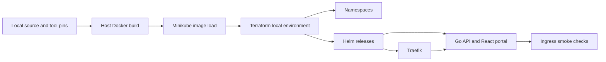

# ADR-001: HashiCorp Terraform and independent local application development

- **Status:** Accepted
- **Date:** 2026-10-23
- **Deciders:** varunpathania86

## Context

Developers must test application changes without pushing code or waiting for a
GitHub workflow, GHCR publication, approval, or the PI start date. Minikube's
Docker driver does not automatically share the host's Docker image store.
Terraform is the frozen IaC choice; application GitOps is a later stage.

## Decision

Use HashiCorp Terraform with the official Kubernetes and Helm providers after
the existing Minikube bootstrap. Terraform owns namespaces, Traefik, and the
local application Helm releases until the planned Argo CD ownership transition.

Build application images on the host, load them into the explicitly selected
Minikube profile, and deploy content-derived development tags with pull policy
`Never`. Discover runnable modules from the catalog and their packaging files,
not their descriptive module types. Keep state and image inventory local and
profile-specific. Make targets expose the entire workflow.

## Alternatives considered

| Option | Pros | Cons |
|---|---|---|
| Require GHCR publication | Shared artifact evidence | Blocks local iteration on remote workflows, credentials, and release policy |
| Local registry | Familiar push/pull interface | Extra service, networking and registry trust configuration for two small apps |
| Build inside Minikube | Avoids image loading | Changes Docker context/build environment; less explicit separation from host |
| Host build plus image load | No registry, explicit profile, simple debugging | Loading images adds a development step |
| OpenTofu | OSI-licensed Terraform-compatible alternative | Conflicts with the frozen Terraform learning/market decision |

## Consequences

- Local development remains available before the PI starts and during remote
  workflow failures. Genuine local failures remain visible and nonzero.
- No release reservations, catalog version changes, publication credentials,
  self-hosted runner, or deployment workflow are needed.
- New source content changes image references, preventing stale same-tag pods.
- First-use toolchains, dependencies, base images, charts, and providers require
  downloads. Independence from GitHub workflows is not an air-gap guarantee.
- Terraform state stays out of Git and separate for each Minikube profile.
- HashiCorp Terraform's source-available licensing remains the accepted exception
  documented in the master plan.
- Do not let Terraform and Argo CD manage the same resources when GitOps arrives.
