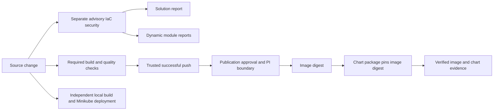

# ADR-014: Stage 1 artifact publication and separate security checks

- **Status:** Accepted
- **Date:** 2026-10-25
- **Deciders:** varunpathania86

## Context

Stage 1 now produces runnable application images and Helm charts. Developers
need independent local iteration while shared artifacts follow the approved
module release lifecycle. Build quality and security findings need distinct
merge policies, with solution and module scopes suitable for later extraction.

## Decision

Extend Stage 1 to include image and accompanying Helm OCI publication, immutable
digest evidence, and partial-failure recovery. Retain trusted default-branch
tooling, protected publication, current-UTC PI boundaries, and unchanged stable
catalog versions. Published charts pin the verified image digest.

Run TFLint as normal required quality validation. Run Trivy IaC checks separately,
locally via Make and in read-only solution/module security jobs. Findings and
execution errors remain failures; security jobs are initially non-required merge
checks through repository rulesets. Existing secret detection is not weakened.

## Alternatives considered

| Option | Pros | Cons |
|---|---|---|
| Put Trivy inside required build CI | Single gate | Couples advisory security policy to build availability |
| Hide findings with exit-zero overrides | Green checks | Misrepresents findings and incomplete scans |
| Publish charts only in Stage 17 | Smaller early scope | Leaves Stage 1 application artifacts incomplete for reuse |
| Introduce all promotion/release automation now | Full lifecycle | Pulls major later-stage work into the foundation |

## Consequences

- Workflow separation does not configure merge enforcement; repository rules
  must require build/component checks and leave initial security checks advisory.
- All packaged modules are dynamically scanned without using descriptive types.
  Shared config and Make commands remain the future repository-extraction boundary.
- Real GHCR publication requires reviewed default-branch installation, environment
  settings, registry access, and a permitted post-PI run; offline tests cannot
  prove those external conditions.
- Stage 16 retains comprehensive security hardening. Stage 17 retains GitOps,
  promotion, solution releases, stable-version recording, and verified cleanup.
