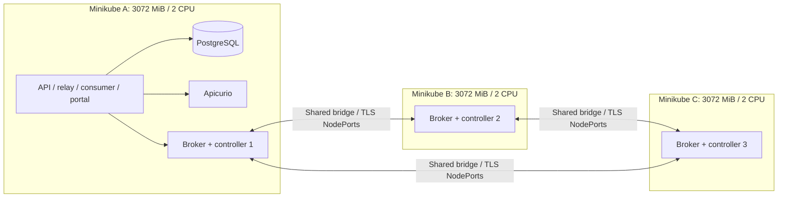

# ADR-016: Kafka across three local Kubernetes clusters

- **Status:** Accepted
- **Date:** 2026-10-30
- **Deciders:** varunpathania86

## Context

The default Stage 3 broker demonstrates outbox recovery, not broker failover.
Production-style learning also needs controller quorum, replicated partitions,
and deliberate loss of an independent Kubernetes cluster. Three local clusters
were explicitly selected over three nodes in one cluster.

## Decision

Keep the single-cluster development loop and add an opt-in three-profile
Minikube topology. Each profile has 3072 MiB RAM and 2 CPUs. One combined KRaft
broker/controller runs in each cluster, with replication factor three, minimum
in-sync replicas two, and producer acknowledgements from all in-sync replicas.

A dedicated Docker bridge connects stable node IPs. Broker and controller
NodePorts provide cross-cluster routing without assuming shared pod networking
or service DNS. Broker traffic uses TLS/SCRAM; controller traffic requires mutual
TLS. One Terraform root/state uses three explicitly aliased Kubernetes providers
and a reusable broker module; Helm is not required for these direct resources.

## Alternatives considered

| Option | Pros | Cons |
|---|---|---|
| Single broker | Cheapest normal development | No broker/quorum failover learning |
| Three nodes in one Kubernetes cluster | Simpler networking and operation | Not independent control-plane failure domains |
| Three independent local clusters | Explicit cluster outage and quorum exercises | Extra control planes, shared-host tuning and cross-cluster networking |
| Three physical hosts | Real host failure isolation | Beyond the local workstation scope |

## Consequences

- This is one Kafka cluster across three Kubernetes clusters, not three Kafka
  clusters or cross-region replication. Every node still shares one host,
  power supply, disk, Docker daemon, and kernel; it is not physical HA.
- Applications, PostgreSQL, ingress, and registry remain on A. Losing B or C can
  exercise broker failover while keeping applications available. Losing A also
  loses the application/database/registry, irrespective of Kafka quorum.
- Fractional CPU requests are Kubernetes millicores, not fractional Minikube
  node allocations. Small pod budgets are learning baselines, not stress-test
  capacity guarantees; Java heap is smaller than the total memory limit.
  The bootstrap also enforces two-CPU Docker quotas because `--cpus=2` alone
  did not apply that limit with the pinned Minikube/Docker combination.
- Three control planes need sufficient host inotify instances. The optional
  setup path raises the host limit with explicit sudo authorization; normal
  setup does not silently change the host.
- Preserve node IDs, static IPs, PVCs, cluster ID, and shared credentials together.
  Refuse an unexpected address change rather than silently rewriting quorum
  identity. Existing topic replica assignments require explicit reassignment,
  not merely a changed topic-creation default.
- Certificates/shared developer identity, NodePorts, combined roles, and
  host-path-backed development volumes are learning concessions, not a
  production deployment recommendation.
- Stress-test instrumentation and Prometheus/Grafana remain Stage 4 work.
  First deployment, failover, recovery, resource measurements, dirty rebuilds,
  and clean recreation passed on an isolated topology on 2026-10-30; this is
  local verification, not remote publication or production certification.
