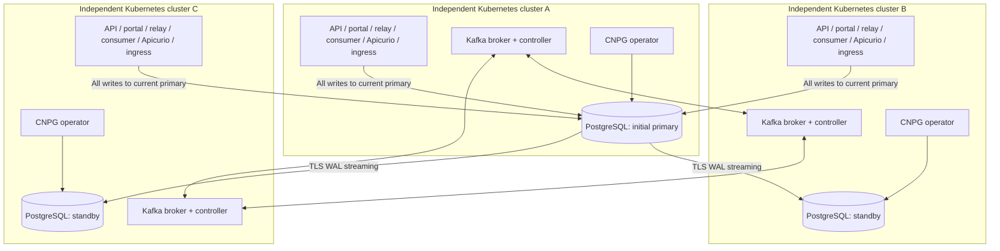

# ADR-017: Full-stack replication across three independent clusters

- **Status:** Accepted
- **Date:** 2026-11-02
- **Deciders:** varunpathania86

## Context

The three-cluster lab in [ADR-016](ADR-016-local-cross-cluster-kafka.md)
distributes Kafka but leaves applications, PostgreSQL, registry, and ingress on
A. This does not satisfy the intended learning goal: every implemented
application must be deployed in every cluster, with one shared database and
controlled recovery after loss of a cluster.

The developer explicitly selected three independent Kubernetes clusters, not
three nodes in one cluster; CloudNativePG-managed PostgreSQL; durability-first
synchronous replication; and disposable lab data only after separate verification
of the replacement topology.

## Decision

Extend the opt-in lab to deploy the implemented API, portal, relay, receipt
consumer, Apicurio, and ingress in A, B, and C. Keep Kafka's three-broker quorum.
Use CloudNativePG distributed primary/replica clusters for one PostgreSQL primary
and two cross-cluster standbys, with controlled cross-cluster promotion and
fencing. This supersedes ADR-016's A-only application/database placement, not
its independent-cluster networking or shared-host limitations.

The opt-in implementation uses `MULTI_FULL_STACK=1 make dev-up` on an unused
base. Existing Kafka-only labs retain their placement; they are not converted
in place. See [setup](../developer-setup.md#stage-3-full-stack-three-cluster-lab)
and [controlled recovery](../runbooks/event-publication.md#cross-cluster-postgresql-recovery).
Acceptance evidence is tracked in the master plan; implementation alone does
not establish every recovery or capacity guarantee below.

### PostgreSQL semantics

- CloudNativePG's ordinary `instances: 3` places instances inside one Kubernetes
  cluster. It does not span independent Kubernetes control planes. Use one
  operator and one single-instance `Cluster` resource per Kubernetes cluster,
  connected through its distributed primary/replica-cluster model.
- Exactly one PostgreSQL instance is writable. All APIs, migration jobs,
  relays, consumers, and registry instances connect to that same current
  primary. Standbys are not independent payment databases.
- Require durable WAL acknowledgement from at least one of the two remote
  standbys before acknowledging commits. Do not silently relax the requirement
  when replicas are unavailable. With neither standby available, database writes
  pause and bounded application operations fail rather than report success.
- Configure and verify the external standby `application_name` values used by
  CloudNativePG's synchronous settings. Intra-cluster defaults alone cannot
  establish this cross-cluster durability requirement.
- Cross-cluster database and replication traffic requires authenticated TLS,
  verified node/service identities, reachable endpoints, and bounded connection
  attempts. Ordinary per-cluster service DNS does not span the clusters.
- Retain one writable-database connection policy across API, worker, migration,
  and JDBC registry clients. Verify reconnection after promotion; never route
  writes to an arbitrary healthy PostgreSQL pod.

### Application semantics

- Load identical source-derived images into each selected profile. Discover
  runnable product modules from the catalog; do not implement catalog-only
  future modules merely to replicate them.
- Run one API, portal, relay, consumer, registry, and ingress instance per cluster.
  Registry instances share the same authoritative PostgreSQL schema and schema
  IDs; verify concurrent registration, compatibility settings, and cache
  visibility rather than creating three unrelated registries.
- Relay instances share the outbox and coordinate using SQL row locks. Test
  same-account ordering and crash/replay with concurrent relays.
- Consumers share one Kafka consumer group, so partitions are distributed
  between them; the three consumers are not three separate business effects.
  Verify group rebalancing and receipt deduplication during cluster loss.
- Serialize/checksum migrations against the shared primary. Test simultaneous
  application startup and bound aggregate database connection pools.
- An ingress exists in each cluster. A port-forward to A still dies when A dies;
  document how to reconnect browser/API access through B or C during controlled
  recovery. Automatic global traffic failover is not implied by three ingress
  installations.

### Controlled promotion and recovery

- Planned switchover uses CloudNativePG's distributed demotion/promotion-token
  procedure and verifies synchronization before moving the writable endpoint.
- An unplanned failover must fence the former primary before promotion. Its
  unreachability alone does not prove it cannot still accept writes.
- Determine the safe promotion candidate from durable WAL positions and replay,
  not a fixed preference for B. With acknowledgement from any one standby, an
  arbitrary standby may lag acknowledged commits. Refuse a no-data-loss claim
  when evidence is insufficient; do not silently force promotion.
- Verify exactly one writer, unchanged acknowledged payments/idempotency,
  outbox/receipt state, and registry schema IDs after promotion. Clients on
  surviving clusters must reconnect without new payment/event identities.
- Rejoin an old primary through the supported rewind/rebuild procedure; never
  simply restart a diverged writable database against the surviving topology.
- Terraform owns operator releases and declared resources; CNPG owns its
  database pods/services. Failover state must be reconciled into the topology
  source of truth so an ordinary update cannot restore the old primary.

### Resources, installation, and cutover

- Retain 3072 MiB / two-CPU limits per Minikube cluster as the starting budget.
  Each now carries the full stack and a CNPG operator, so earlier Kafka-only B/C
  measurements are not capacity evidence for this design. Measure startup,
  steady state, replica catch-up, failover, and concurrent updates.
- Pin operator/chart and compatible PostgreSQL image versions in the repository
  tool-version policy. Install through Make-managed bootstrap/Terraform, verify
  with doctor, document first-use downloads, and retain checksum verification.
  No undocumented manual Helm or operator installation is acceptable.
- The developer authorizes disposable lab data, but only after the replacement
  topology is verified separately. Do not automatically convert or destroy an
  existing Kafka-only lab during `dev-update`.
- Keep the ordinary single-cluster development workflow working. Neither
  topology may depend on GitHub publication, GHCR login, or an active PI.

## Alternatives considered

| Option | Pros | Cons |
|---|---|---|
| Current Kafka-only distribution | Already verified, lower resource use | Applications/database remain on A |
| One Kubernetes cluster with three nodes and CNPG instances=3 | Simpler database automation and networking | Does not meet independent-control-plane requirement |
| Three independent writable databases | Simple isolated environments | Divergent payments, idempotency and registry identities |
| Full stack plus distributed CNPG replicas | Meets selected cluster-failure learning goal | Requires explicit cross-cluster durability, fencing, routing and recovery |

## Consequences

This is a material infrastructure extension, not a StatefulSet replica-count
change. Stage 3 cannot be considered locally complete for this newly selected
scope until an isolated full-stack deployment, synchronous replication,
concurrent processing, controlled switchover/failover/rejoin, dirty-source
updates, clean recreation, and resource tables have been verified.

All three clusters still share one host, kernel, Docker daemon, disk, and power
source. Do not claim physical HA, production certification, automatic global
failover, or a backup strategy. Replication also propagates accidental deletes.
Historical metrics and stress-test dashboards remain Stage 4 work.

Reference behavior must be checked against the exact operator release selected
for implementation:

- [CloudNativePG replica clusters and distributed topology](https://cloudnative-pg.io/docs/1.30/replica_cluster/)
- [CloudNativePG synchronous replication and external standby names](https://cloudnative-pg.io/docs/1.30/replication/)
