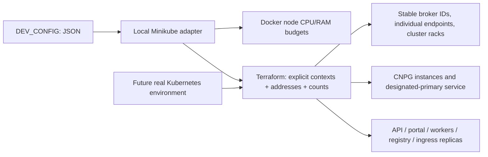

# ADR-018: Configurable Kubernetes workload topology

- **Status:** Accepted
- **Date:** 2026-11-02
- **Deciders:** varunpathania86

## Context

The verified three-cluster lab originally fixed one Kafka broker/controller and
one CNPG instance per Kubernetes cluster. Application charts also fixed one
replica. This prevents learning about intra-cluster scaling and requires source
edits for larger benchmark environments. Future deployments use real Kubernetes,
so workload identity, replication and resources must not depend on Minikube.
The developer selected multi-cluster development as the only public workflow
and explicitly requested configurable CNPG instances as well as application
and broker counts.

## Decision

Expose per-cluster broker, CNPG and application counts in distribution-neutral
Terraform/Helm inputs. Keep local node sizing, image loading and node lifecycle
in the Minikube adapter, with persisted validated JSON configuration and small
defaults. Replace the public `multi-*` targets and separate single-cluster
workflow with `dev-*` and `db-*`. The later unified lifecycle uses `dev-clean`
for destructive removal.

Additional brokers are broker-only. The first broker per cluster retains its
original name, data and controller identity; there are exactly three controller
voters. RF3/minimum ISR2 remains independent of broker count. Cluster racks guide
new partition placement. Adding brokers does not rebalance old partitions;
automatic broker removal is refused without an explicit reviewed reassignment.

CNPG instances are local to each independent cluster. Their designated primary
can change, so routing and recovery discover it rather than selecting all pods
or assuming ordinal one. Local cascading replicas remain asynchronous; commits
still require a remote standby acknowledgement. Global failover refuses missing
or more advanced surviving local replicas rather than promoting stale state.

Application replicas share bounded database pools, serialized migrations,
SQL outbox locks, consumer-group membership and event-ID-deduplicated receipts.
Use catalog module identities for application overrides, not a workflow switch
based on module type.

## Alternatives considered

| Option | Pros | Cons |
|---|---|---|
| Increase StatefulSet replicas only | Small patch | Duplicate Kafka IDs and ambiguous endpoints |
| Make every broker a controller | Uniform pods | Couples data scaling to an unnecessarily large metadata quorum |
| Keep separate single/multi public commands | Backward-compatible names | Two competing developer workflows |
| Distribution-neutral counts with a local adapter | Reusable workloads and explicit identities | Requires endpoint, state and recovery validation |

## Consequences

Defaults remain two CPUs / 3072 MiB per local node and one of each workload.
Larger node budgets and counts are opt-in and must be measured; raising node
limits does not change per-container limits. The same-host lab is not physical
HA or production capacity certification.

The local Make interface uses `MULTI_CLUSTER=0` (default) for the single
`rpp` profile and `MULTI_CLUSTER=3` for the fixed profiles `rpp-1`, `rpp-2`,
and `rpp-3`. It does not create alternate profile families.
Topology and node keys, Kafka racks and CNPG members use the same numbers;
the database members are `pg-1`, `pg-2`, and `pg-3`. An identity marker makes
the new workflow refuse older letter-identified state instead of applying a
destructive rename. Preserve old state and follow the
[legacy-state procedure](../developer-setup.md#protecting-a-legacy-topology).

Kubernetes modules/charts remain portable; the existing Docker fence and
Minikube rebuild are local-only recovery adapters. Future production deployments
need reviewed endpoint, storage, placement, image and fencing policies.
Existing Kafka-only bases remain untouched until deliberately recreated.
See the [configuration guide](../developer-setup.md#configuring-counts-and-benchmark-node-budgets).
