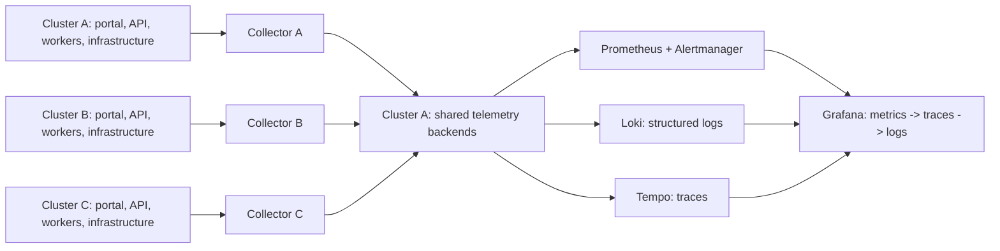

# ADR-019: Per-cluster collectors with shared observability backends

- **Status:** Accepted
- **Date:** 2026-11-02
- **Deciders:** varunpathania86

## Context

Stage 4 must correlate portal/API requests, PostgreSQL operations, transactional
outbox publication, Kafka delivery and consumer receipts. Running a full
observability backend stack in each local cluster would duplicate storage and
increase memory substantially. Independent Grafana/Tempo installations would
also fragment cross-cluster investigation. Existing three-cluster defaults
remain a low-load payment development baseline, not a capacity guarantee for
additional backends.

## Decision

Deploy one OpenTelemetry Collector per Kubernetes cluster and use shared
Prometheus, Alertmanager, Loki, Tempo and Grafana backends **in cluster A**.
The opt-in topology reserves 5120 MiB/3 CPUs for A and 3072 MiB/2 CPUs for
B/C; these are low-load learning budgets, not capacity certification.
The solution-owned `telemetry` namespace avoids conflicting ownership with
existing application-foundation namespaces. Keep collector
endpoints, resource budgets and placement explicit and portable to real
Kubernetes. Future production HA and retention policies require separate
validation; one shared local stack is not highly available.

Use standard OpenTelemetry SDKs, compatible ready-made instrumentation and
Collector receivers for infrastructure signals. Custom spans/metrics cover
business workflow boundaries rather than duplicating library instrumentation.
Kafka broker/PostgreSQL server metrics complement, but do not replace,
client-side spans. Browser instrumentation must use a controlled same-origin
ingestion path rather than expose unrestricted collectors.

Use W3C `traceparent`/`tracestate` for propagation and persist originating
context through the outbox. Do not copy unrestricted baggage into payment
events. Standardize resource identity (`service.name`, `service.version`,
deployment environment and cluster) and JSON log correlation fields.
Identifiers belong in spans/logs, never metric labels. Suppress sensitive SQL
text/parameters, credentials, payloads, and raw URLs. Telemetry exporters use
bounded queues/timeouts and cannot make payment success depend on a backend.

Data lineage is separate: define transformation/dataset identities during
Stage 5 and implement durable dataset/job lineage with the first persistent
Flink-to-ClickHouse pipeline in Stage 6. Extend to the lakehouse when introduced.
Select lineage tooling/storage in a future ADR; no lineage service is added
now. Trace sampling and retention make traces unsuitable as a lineage ledger.

## Alternatives considered

| Option | Pros | Cons |
|---|---|---|
| Full monitoring stack in every cluster | Independent local storage | High local cost; fragmented cross-cluster investigation |
| Per-cluster collectors, shared backends | Uniform ingestion, one investigation view, lower cost | Shared local monitoring failure domain |
| Application-specific logging/tracing | Small initial setup | Inconsistent propagation and duplicate instrumentation |

## Consequences

Applications remain replicated across all three clusters. Losing the shared
backends interrupts visibility, not payments; bounded buffering cannot guarantee
lossless telemetry during an extended outage. Ordinary development must remain
usable without starting the entire observability profile. Completion requires
live proof of Grafana latency-to-trace-to-log navigation and alert/runbook links,
not merely successful installation.
