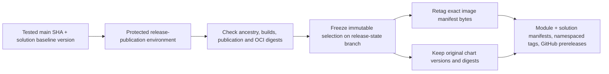

# ADR-020: Bring iteration baseline releases forward to Stage 4

- **Status:** Accepted
- **Date:** 2026-11-02
- **Deciders:** varunpathania86

## Context

Stage 3 publishes tested module image/chart revisions but does not freeze a
versioned solution. Deferring all release promotion to Stage 17 prevents
recording a sprint baseline while implementing earlier stages. The owner
requested baseline releases in Stage 4, explicitly deferring deployment,
GitOps and RC/production promotion.

## Decision

Add a manually dispatched, protected `Release iteration baseline` workflow on
`main`. Select a full tested main commit and an explicit independent solution
version such as `0.1.0-it1`. A new baseline must match the current UTC iteration
and exceed the stable solution version. It freezes artifacts; it does not
close the calendar iteration or advance the PI schedule.

Discover packaged modules from the source catalog and Dockerfiles. Select the
latest published main ancestor for each, rejecting missing/incomplete or stale
publications after module, catalog or tool-pin changes. Require successful
same-repository main builds and completed trusted publication runs. Catalog-only
modules have no artifact to promote and are explicitly excluded.

Freeze a write-once selection under `release-baselines/` on
`automation/release-state` before any promotion. Reruns reuse the frozen
selection even after the iteration changes; changing the source for that
version fails. Promote image manifest bytes to module iteration-baseline tags,
verify unchanged digests, and retain chart packages at their original integrated
versions/digests. Rewriting chart metadata to the baseline version would change
the approved digest. The chart already references the approved image digest.

Create schema-validated module/solution manifests, namespaced annotated Git
tags and prerelease GitHub Releases. Release bodies and tag messages preserve
the manifests; workflow artifacts provide downloadable JSON copies. Reruns
reject conflicting existing records, tags, releases or image digests.
Stable catalog fields remain production-only and unchanged.

## Alternatives considered

| Option | Pros | Cons |
|---|---|---|
| Wait until Stage 17 | No early release work | Cannot freeze earlier sprint deliverables |
| Rebuild images/charts for baseline | Familiar packaging flow | No longer promotes the exact tested artifacts |
| Advance iteration when releasing | Explicit early sprint closure | Conflicts with approved date-derived schedule |
| Freeze exact artifacts now | Reproducible baseline, safe retries | Deployment and runtime acceptance remain separate |

## Consequences

Release automation is testable offline but real registry/tag/release acceptance
requires merging the workflow and an approved live dispatch. No live release
is inferred from unit tests. Existing development commands remain independent
of release approval and publication. Configure actual environment reviewers and
state/tag protection in GitHub; YAML cannot establish those repository policies.
Do not delete frozen state to force a new selection.

Stage 4 now includes this baseline slice alongside observability. Deployment,
GitOps, RC/production promotion, stable-version PRs and cleanup remain deferred.
