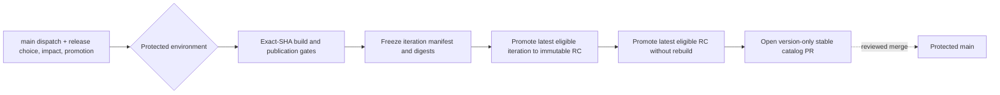

# ADR-021: Automate iteration, RC, and stable release promotion

- **Status:** Accepted
- **Date:** 2026-11-03
- **Deciders:** varunpathania86

## Context

Iteration baselines are frozen from tested main publications, but choosing
release versions manually and deferring RC/production promotion leaves the
release lifecycle incomplete. The solution and modules have independent
stable versions, while publication state carries reviewed module targets,
approved impacts, source commits, and immutable image/chart digests. Promotion
must preserve those records and cannot rebuild artifacts or write directly to
protected `main`.

The first successful baseline already exists as solution `0.1.0-it1` and
module `0.0.1-it1`; the new workflow must continue to recognize its frozen
records, tags, releases, and artifact digests.

## Decision

Extend the protected `Release and promote versions` dispatch with release
choice (`solution` or `module`), module name, explicit impact (`major`,
`minor`, or `patch`), and promotion (`iteration`, `release_candidate`, or
`stable`). Inputs default to solution, blank module, patch, and iteration. No
SHA or version is manually supplied: iteration releases use the exact dispatch
SHA on `main`, and targets are calculated from the selected stable catalog
version plus the explicit impact.

Solution impact is independent from module impacts. Solution iteration
manifests retain the reviewed targets and impacts already published for each
module. A standalone module's protected dispatch `type` explicitly approves
that module's impact and calculates its target from the module's current stable
catalog version. It is intentionally independent of the impact selected for
integrated publication: the immutable release record retains the source
publication's original target, impact, workflow evidence, provenance, image
digest, and chart package version/digest, while recording the dispatch-approved
impact for the standalone release. No other module target is changed. Stale
source, failed build/publication evidence, incomplete artifacts, or ambiguous
state blocks release.

RC promotion selects the latest eligible frozen iteration for that target and
creates immutable `<target>-rcN` release records. Stable promotion selects the
highest eligible RC, publishes a non-prerelease release from the same commit
and OCI digests, then opens a PR changing only the corresponding stable catalog
version. Stable promotion is gated by a separate protected `release-stable`
environment. The automation never rebuilds artifacts, rewrites chart
metadata, mutates frozen records, or pushes directly to `main`.

Reruns reuse write-once records, including after `main` or the date-derived PI
iteration moves. State is stored on `automation/release-state`. Conflicts and
multiple equally eligible candidates fail closed instead of guessing.

## Alternatives considered

| Option | Pros | Cons |
|---|---|---|
| Continue supplying manual source SHAs and versions | Simple dispatch form | Easy to select stale source, inconsistent impact, or the wrong iteration |
| Rebuild images/charts for RC or stable | Familiar artifact workflow | Loses exact tested digest identity and invalidates frozen evidence |
| Push stable catalog versions directly | No PR handoff | Bypasses protected-main review and can trigger unintended integrated publication |
| Promote frozen records and open a version-only PR | Preserves evidence, retries, and review boundary | Requires state/tag protection and actual environment reviewer configuration |

## Consequences

Release automation can be tested offline with deterministic API/registry
fixtures. A successful unit test does not prove that GHCR permissions,
environment reviewers, tag protections, or release settings are configured.
Repository administrators must set actual `release-stable` required reviewers
and access policies; a workflow environment name alone is not an approval gate.
The stable catalog PR remains subject to ordinary review and merge protection.

Existing solution/module iteration baseline records and tags remain eligible
for RC promotion. Chart artifacts keep their original version and digest,
because rewriting their metadata would produce different package bytes.
Deployment and GitOps remain deferred; local development does not require
GitHub Actions, GHCR credentials, or release approvals.
