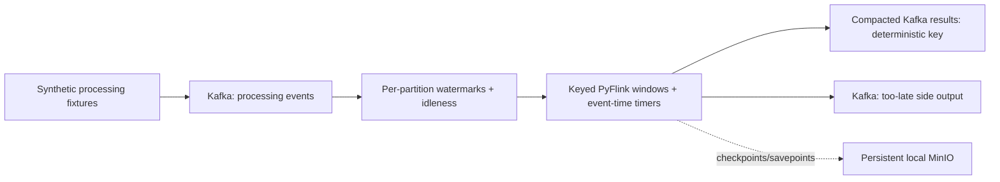

# ADR-022: PyFlink event-time and synthetic processing boundaries

- **Status:** Accepted
- **Date:** 2026-11-03
- **Deciders:** varunpathania86

## Context

Stage 5 requires Flink event-time windows, lateness handling, keyed state,
timers and persistent recovery. The existing payment initiation contract has
no authorization outcome, account, country or payment method. Inventing those
fields or treating initiation as authorization would change payment semantics.
The project excludes Java application code; future in-process ML also needs
the Python ecosystem.

## Decision

Use PyFlink, with Flink's JVM and compatible Python installed inside the pinned
runtime image, not as additional host toolchains. This is an explicit Python
ecosystem use for stream processing/ML, not a change to Go's backend role.

Add a separate synthetic `payment.processing.v1` contract and deterministic
fixtures. Keep the existing API/outbox/initiation/receipt path unchanged.
Synthetic outcomes are fixture labels, never authorization decisions.

Kafka CreateTime must equal the contract's `event_time`; the fixture producer
sets it explicitly and the operator rejects mismatches. Flink's native source
watermarks remain per partition, with 10-second bounded disorder and
30-second partition idleness. Passing a Python timestamp assigner to
`from_source` does not install it in Flink 1.20's source implementation;
relying on that would silently process Kafka ingestion timestamps instead.

Key by currency/country/payment method. Assign each event to one one-minute
tumbling window and ten overlapping ten-minute windows with one-minute slide.
Emit at end minus one millisecond, allow revisions until end plus two minutes,
and then remove window state using event-time timers. An event is too late
only when all its applicable windows have expired; expiration of its tumbling
window alone does not make it too late for every sliding window.

Deduplicate event IDs within each dimension key using processing-time state
TTL of 24 hours. Duplicate replays after that horizon are not guaranteed to be
removed. A late accepted event updates its original result identity
(`window_start`, `window_end`, currency, country, payment method), increasing
its revision. A compacted Kafka topic materializes replacements by result ID;
physical duplicate records may exist before compaction.

Checkpoint keyed state, timers and source positions every ten seconds to a
local persistent MinIO bucket. Retain external checkpoints on cancellation
and document explicit savepoint/restore. Internal Flink state uses exactly-once
checkpoints; Kafka outputs are at-least-once. Compacted result keys make replayed
updates replaceable; too-late records require downstream event-ID deduplication.
Do not claim transactional exactly-once behavior across both sinks.

Add transformation/schema/input/output dataset identities now. Stage 6
persists dataset/job/transformation identities with the first
Flink-to-ClickHouse sink.

## Alternatives considered

| Option | Pros | Cons |
|---|---|---|
| Java Flink job | Broad native API access | Violates the approved application-language boundary |
| Treat initiations as authorized payments | No new dataset | Incorrect business semantics |
| Python source-level timestamp callback | Familiar API | Not applied by the selected native source path |
| Kafka CreateTime equal to event time | Native per-partition watermarks | Requires producer contract enforcement |
| Append-only unkeyed aggregates | Simple sink | Late revisions create uncontrolled logical duplicates |

## Consequences

Flink and MinIO are opt-in and placed only in cluster 1; ordinary payment
development does not start them. Flink brings a larger image, Python worker
overhead and an explicit larger local node budget. The local JobManager and
MinIO volume are not highly available. TaskManager recovery uses checkpoints;
JobManager replacement requires an explicit compatible restore URI rather
than a claim of automatic HA. Deployment/GitOps remain outside this change.
