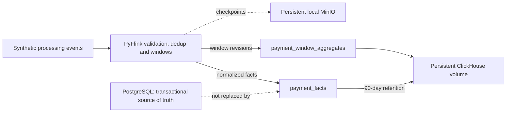

# ADR-023: Persistent ClickHouse analytics sinks

- **Status:** Accepted
- **Date:** 2026-11-03
- **Deciders:** varunpathania86

## Context

Stage 5 produces normalized synthetic processing events and revision-aware
event-time windows, but Kafka is not a query-serving analytics store. Stage 6
needs persistent operational analytics without moving transactional authority
away from PostgreSQL or claiming exactly-once writes across Flink and
ClickHouse.

## Decision

Add an opt-in, single-replica ClickHouse deployment with persistent local
storage. Flink sends normalized facts and window revisions over authenticated
HTTP synchronously inside Python operators before forwarding records. A failed
request fails the Flink record path; checkpoint barriers cannot pass unprocessed
records. Writes are at-least-once; table replacement keys and revision-aware
queries make replays logically replaceable.

Use month partitions and sort keys beginning with event day, currency, country
and payment method. Detailed facts expire after 90 days. Window rows use
`result_id` plus revision and are queried with `FINAL` when merges may be
pending. Do not add materialized views before a measured query justifies them.
Store job/version, transformation, source and output dataset identities on
records. PyFlink 1.20 does not expose a Python `SinkFunction` suitable for this
HTTP integration, so use supported `MapFunction`/`KeyedProcessFunction`
operators for synchronous side effects rather than a Java connector or a
background writer that could acknowledge checkpoints before persistence.

An offline benchmark generates synthetic data in a unique disposable table,
measures client p50/p95/p99 for a warmed seven-day grouped query, records
hardware, row/part/partition counts and configuration, and enforces the
documented 500 ms p95 target. It drops the temporary table after the run.

## Alternatives considered

| Option | Pros | Cons |
|---|---|---|
| Query Kafka directly | No additional storage | Poor dashboard/query-serving behavior |
| Use PostgreSQL for analytics | Existing transactional store | Couples analytical scans to payment transactions |
| Append every Flink revision | Simple writes | Replays and late updates create uncontrolled logical duplicates |
| Exactly-once claim across Flink and ClickHouse | Attractive semantics | No shared transaction; would be inaccurate |
| Materialized views now | Potentially faster queries | No measured query has justified the extra state/maintenance |

## Consequences

ClickHouse is optional and placed only in cluster 1. The local image is pinned
in `.tool-versions`; credentials are generated into profile-local Terraform
state and Kubernetes Secrets. The StatefulSet and PVC are single-node local
development components, not HA or production backups. Removing the feature or
profile destroys its local database volume. PostgreSQL remains the authority
for payment state. Predictive scoring is intentionally outside this ADR and
remains Stage 7.
