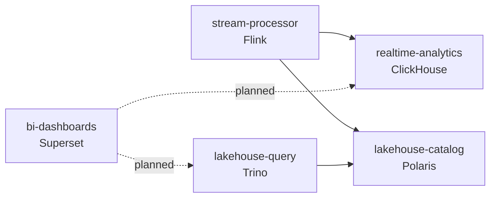

# ADR-027: Capability-based module names

- **Status:** Accepted
- **Date:** 2026-11-05
- **Deciders:** varunpathania86

## Context

Several modules were named after the product that implements them
(`flink-jobs`, `clickhouse-analytics`, `superset-bi`, and the Stage 8
`iceberg-lakehouse` and `trino-analytics`). A module name propagates into
image and chart names, Helm releases, Kubernetes resources, Terraform
addresses, release reservations and tags. Replacing a product would therefore
force a rename across all of these, and product names hide what the module
does for the platform. `iceberg-lakehouse` was also misleading: the module
runs the Polaris catalog, while Iceberg is a table format shared by Flink,
Polaris and Trino.

## Decision

Name modules after the capability they provide. Keep product names inside the
module (Dockerfile, chart, README and ADRs).

| Previous name | New name |
|---|---|
| `flink-jobs` | `stream-processor` |
| `clickhouse-analytics` | `realtime-analytics` |
| `iceberg-lakehouse` | `lakehouse-catalog` |
| `trino-analytics` | `lakehouse-query` |
| `superset-bi` | `bi-dashboards` |

## Alternatives considered

| Option | Pros | Cons |
|---|---|---|
| Keep product names | No migration | Product swaps rename images, charts, releases and tags; names describe tools, not responsibilities |
| `stream-processing` | Matches the module `type` | Reads as a category; other modules are named as components |
| `payment-processor` | Payment-specific | Implies authorization and settlement, which this module never does |
| Capability names (chosen) | Stable across product changes; explain responsibility | One-time rename of published modules |

## Consequences

- Published GHCR packages and release reservations under the previous names
  stay unchanged. The renamed modules start new reservation lineages on the
  next main publication; stable catalog versions are unchanged.
- Local clusters recreate the renamed Helm releases on the next `dev-update`.
  The Flink guard requires `make streaming-stop` and a restore path first.
  The ClickHouse release gets new persistent volume claims, so local
  ClickHouse tables start empty and refill from new events.
- Historical ADR file names (for example ADR-023) are kept; their links are
  unchanged.
