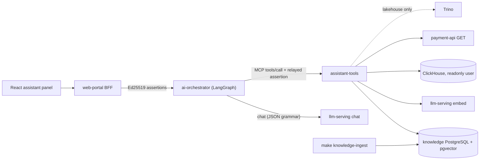

# ADR-029: Local AI operations assistant with RAG, LangGraph and read-only MCP

- **Status:** Accepted
- **Date:** 2026-11-05
- **Deciders:** varunpathania86

## Context

Stage 10 adds an assistant that answers operator questions from platform
knowledge (runbooks, ADRs, module READMEs, API and event contracts) and from
live read-only data. ADR-025 already requires that the LLM stays out of the
payment path, that tools are reached only through MCP, and that the assistant
never makes authorization or numeric decisions. It must run on a laptop
Minikube profile with synthetic data, without paid APIs or GPUs, and stay
explainable in an interview.

## Decision

Build five catalog modules:

- [ai-core](../../modules/ai-core/README.md): a shared library for
  assertions, retrieval, embeddings and redaction.
- [operations-knowledge](../../modules/operations-knowledge/README.md): the
  corpus, batch ingestion and the evaluation set.
- [llm-serving](../../modules/llm-serving/README.md): pinned llama.cpp serving
  Qwen2.5-1.5B Q4_K_M chat and nomic-embed-text v1.5 embeddings on CPU.
- [assistant-tools](../../modules/assistant-tools/README.md): an MCP server with
  five read-only tools.
- [ai-orchestrator](../../modules/ai-orchestrator/README.md): a FastAPI and
  LangGraph API.

Knowledge lives in a separate PostgreSQL with pgvector. It uses exact cosine
search plus full-text search, fused with Reciprocal Rank Fusion, and
permission filters run in SQL. Answers use grammar-constrained JSON whose
`sources` may only name retrieved chunks. Citations are verified in code, with
one retry and then an extractive fallback. A lean `ai` profile runs
ClickHouse with synthetic fixtures and no Flink.

## Alternatives considered

| Option | Pros | Cons |
|---|---|---|
| Ollama instead of llama.cpp | Simpler model pulls | Extra daemon and registry behaviour; less control over grammar and pinning |
| Store vectors in the payments PostgreSQL | One fewer StatefulSet | Mixes extension, roles and load with the payment system of record |
| Qdrant or another vector database | Purpose-built ANN | Not justified before an exact-search baseline; one more system to operate |
| Let the graph query databases directly | Fewer hops | Breaks ADR-025; permissions would be checked only once |
| Free-text answers with regex citations | Simpler prompts | A 1.5B model invents labels; grammar-constrained sources make verification deterministic |
| Kafka-driven ingestion | Event-native | Not needed for a static corpus; deferred by the master plan |

## Consequences

- The assistant works offline after the first model download, which is about
  1.2 GiB into a kept PVC.
- A 1.5B CPU model is slow, at roughly 25 tokens per second, and its answers
  are modest. The evaluation reports quality, but it fails only on leaks and on
  failed authorization or injection cases.
- When the model is unavailable, keyword routing and extractive answers keep
  the panel useful.
- HNSW indexes, a reranker, Kafka ingestion and a Qdrant comparison wait for
  measurements.
- Identity is described in [ADR-030](ADR-030-assistant-identity-assertions.md),
  and shared-library builds in
  [ADR-031](ADR-031-catalog-dependency-build-contexts.md).
