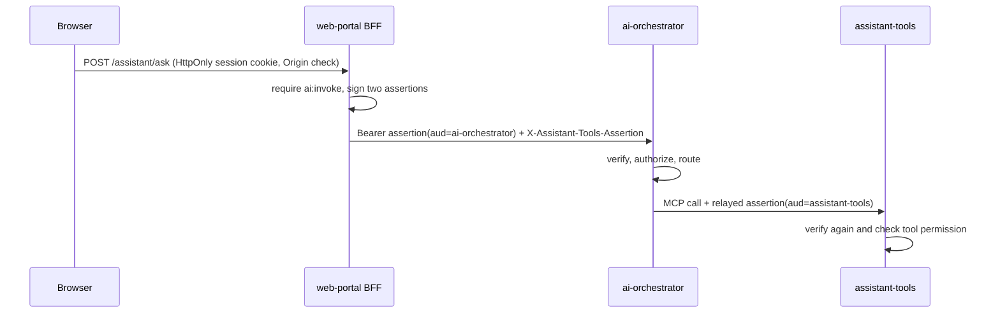

# ADR-030: Portal-signed Ed25519 assertions for the assistant

- **Status:** Accepted
- **Date:** 2026-11-05
- **Deciders:** varunpathania86

## Context

The assistant must know who is asking and with which permissions. It must
check those permissions before retrieval and inside every MCP tool. Keycloak
arrives in Stage 11. Until then, the web-portal BFF signs users in with the
local development identity from ADR-025: synthetic users held in a Terraform
Secret. Browsers must never hold credentials that the orchestrator or tools
would trust, and the orchestrator must not be able to raise a user's
permissions when it calls tools.

## Decision

The web-portal BFF is the only assertion issuer. For each question
(`POST /assistant/ask`) it signs two short-lived EdDSA JWTs, one for audience
`ai-orchestrator` and one for audience `assistant-tools`. Both carry:

- `iss`: `web-portal`
- `sub` and `tenant`
- `permissions`: the user's permissions intersected with an allowlist
- a random `jti`
- a lifetime of 120 seconds

The orchestrator verifies its own assertion. It relays the tools assertion
unchanged through the LangGraph run config, never through graph state.
assistant-tools verifies that assertion again and applies its own checks.

Terraform generates the Ed25519 key pair. Only web-portal mounts the private
key (Secret `web-portal-assistant-signer`). The verifiers receive only the
public key (Secret `ai-identity`).

## Alternatives considered

| Option | Pros | Cons |
|---|---|---|
| Shared HMAC secret | Simple | Every verifier could mint assertions |
| Orchestrator mints the tools assertion | One portal token | A compromised orchestrator could escalate tool permissions |
| Forward the portal session cookie | No new tokens | Spreads browser credentials to internal services |
| Wait for Keycloak (Stage 11) | Standard OIDC | Blocks Stage 10; Keycloak can later replace the issuer while keeping the claim contract |

## Consequences

- Users and permissions:
  - `ops-viewer`: `bi:view`, `ai:invoke`, `knowledge:read`, `analytics:read`.
  - `payments-clerk`: `ai:invoke`, `payments:read`.
  - `ops-engineer`: all of these, plus `knowledge:restricted`.
- Assertions cannot be replayed beyond 120 seconds. A `jti` replay cache is
  deferred.
- The portal's identity resources now exist when either `bi` or `ai` is
  enabled. Terraform `moved` blocks keep existing BI passwords.
- Stage 11 replaces the issuer with Keycloak-backed tokens; the verifiers keep
  their audience, issuer and permission checks.
