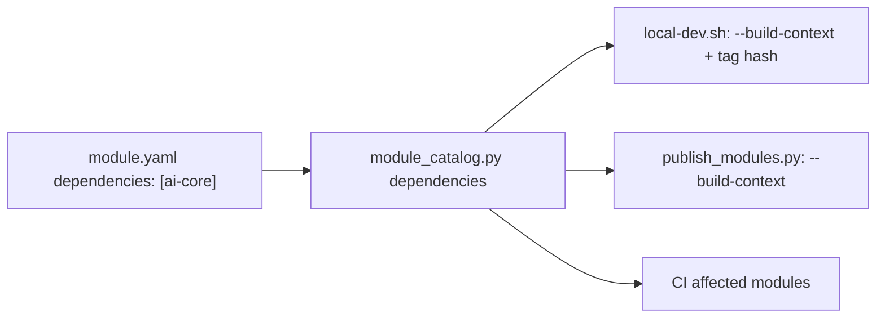

# ADR-031: Catalog dependencies as image build contexts

- **Status:** Accepted
- **Date:** 2026-11-05
- **Deciders:** varunpathania86

## Context

Three Stage 10 images (operations-knowledge, assistant-tools and
ai-orchestrator) reuse the
[ai-core](../../modules/ai-core/README.md) Python library. Module Dockerfiles
build from their own directory, so they cannot copy files from a sibling module.
Copying ai-core into each module would duplicate code and let the copies
drift. The catalog already records `dependencies` in `module.yaml` for CI
affected-module detection.

## Decision

A module's catalog `dependencies`, and their transitive closure, are passed to
Docker as named build contexts (`--build-context ai-core=modules/ai-core`)
in two places: local `make dev-up`/`dev-update` builds and trusted
publication. Dockerfiles copy from them with `COPY --from=ai-core`.

The local image tag hashes the dependency files as well, so editing ai-core
rebuilds every dependent image. Catalog dependencies therefore mean "build
input". They do not mean runtime calls.

## Alternatives considered

| Option | Pros | Cons |
|---|---|---|
| Build ai-core as a wheel and publish it | Standard packaging | Needs a package index and a release flow for an internal library |
| Repository-root build context | No new flags | Each image would see the whole repo, breaking per-module cache and tag hashing |
| Vendor copies | No tooling change | Duplicated code drifts |

## Consequences

- web-portal is **not** given a dependency on ai-orchestrator. It only calls
  the orchestrator over HTTP, and a build dependency would rebuild and retag
  the portal for every orchestrator change.
- Branch publication runs `publish_modules.py` from the default branch, so the
  new build contexts take effect for publication only after merge.
- Dependency cycles are rejected by catalog validation.
