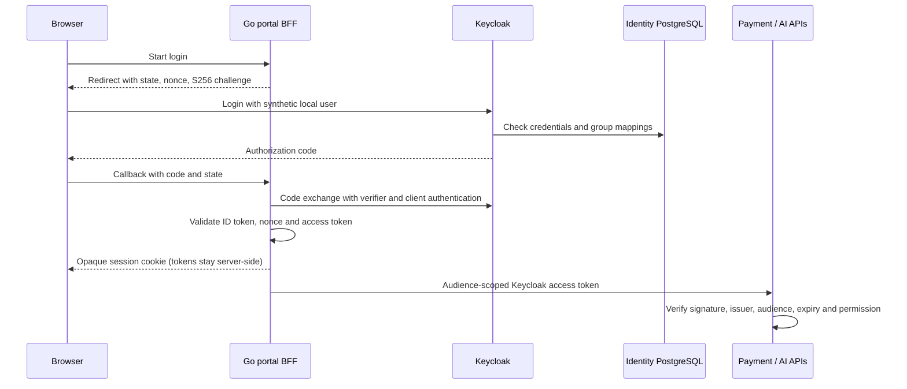

# ADR-032: Keycloak-managed identity and the portal BFF

- **Status:** Accepted
- **Date:** 2026-11-06
- **Deciders:** varunpathania86

## Context

Stage 11 replaces the synthetic password check and portal-issued AI assertions
introduced in ADR-025 and ADR-030. Humans need one identity across the portal,
Superset, Grafana and the assistant. Payment writes need explicit authorization,
including callers that do not use the browser.

The user selected Keycloak-managed users backed by PostgreSQL, rather than a
new LDAP server, and Authorization Code with PKCE handled by the existing Go
Backend-for-Frontend (BFF).

## Decision

Use Keycloak as solution-level identity infrastructure, backed by a dedicated
PostgreSQL database and credentials, separate from payments and knowledge.
Keycloak stores its users, credential hashes, groups, sessions and client
configuration there. Applications do not query that database for authentication.
LDAP/Active Directory federation is not required; it can be added later without
changing application OIDC contracts.

The Go portal BFF is a confidential OIDC client using Authorization Code with
S256 PKCE, state and nonce. It keeps OAuth tokens server-side. The browser
receives only an opaque HttpOnly session cookie, with Secure outside explicitly
local HTTP development. The cross-site OIDC callback uses a separate
SameSite=Lax transaction cookie; application mutations retain Origin checks.
Do not put tokens in localStorage, URLs or browser JavaScript.

Resources accept only their own audience. Each resource validates issuer,
signature, expiry and explicit application permissions. A resource must not
trust an identity header or decode an unverified JWT. Unknown signing keys
trigger a bounded JWKS refresh; a rotation test must verify new keys and reject
unknown keys, wrong issuers, expired tokens and wrong audiences.

Map the initial `platform-admin`, `developer`, `analyst` and `viewer` groups to
application roles. Enforce `payments:read`, `payments:write`, `analytics:read`,
`knowledge:read`, `knowledge:restricted`, `ai:invoke` and `ai:admin` independently
of group names. Preserve `bi:view` as the permission for embedded dashboards.
Viewers cannot write payments. Client Credentials is only for explicit machine
clients, never as a substitute for a human user or a forwarded user token.

Superset retains the scoped embedded guest-token path; Keycloak replaces the
identity that authorizes issuance. Its interactive UI and Grafana use OIDC.
Define an Argo CD client contract, but do not deploy Argo CD before its roadmap
stage. Kafka remains on TLS and SASL/SCRAM.

## Alternatives considered

| Option | Pros | Cons |
|---|---|---|
| Keycloak-managed users in PostgreSQL | Complete local OIDC and SSO, no directory dependency | Local users must be maintained in Keycloak |
| LDAP/Active Directory federation | Reuses an existing organization directory | No directory exists here; adding one adds operations without improving the initial demo |
| Browser-managed OIDC tokens | Standard SPA deployment | Exposes tokens to JavaScript and changes the existing BFF security boundary |
| Keep portal-signed AI assertions | Small Stage 10 implementation | Does not replace the temporary issuer with Keycloak validation as Stage 11 requires |

## Consequences

- Keycloak is shared solution infrastructure, not an independently versioned
  application module named after a vendor.
- Local development uses synthetic identities with generated, profile-specific
  credentials. No LDAP server, hosted IdP subscription or GitHub publication
  is needed.
- Only the initial realm seed is imported at startup; Keycloak deliberately
  does not overwrite existing realms. Realm upgrades need explicit
  reconciliation, not an undocumented restart assumption.
- Session storage, refresh, logout and identity revocation must be implemented
  and tested in the BFF before replacing the Stage 10 login.
- Anonymous application development remains available only when identity is
  explicitly disabled. Configured but unavailable or invalid identity must fail
  closed, never fall back to the development password path.
- Stage 11 is not complete until the login, resource authorization, application
  SSO and rotation exit criteria in the master plan pass.
