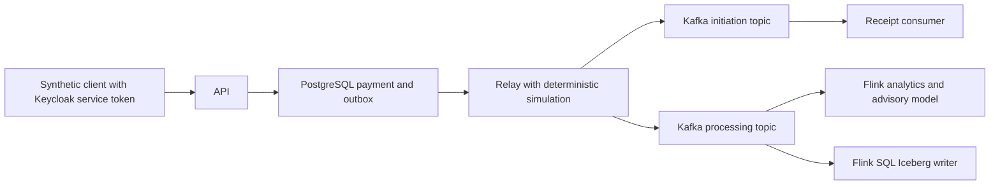

# ADR-035: Authenticated API origin for synthetic streaming

- **Status:** Accepted
- **Date:** 2026-11-15
- **Deciders:** Repository maintainer

## Context

Independent direct-Kafka fixtures made streaming exercises disconnected from
the payment API. The maintainer approved a unified API origin, required country
and payment method, client-credentials authentication and restricted synthetic
event-time controls. The current development contract may be replaced in place;
no backwards-compatible endpoint or message version is requested.

## Decision

Keep Go as the payment backend and reuse the existing outbox relay process.
After acknowledging the Avro initiation, the relay generates and publishes
a deterministic JSON processing event for the same payment. Mark the outbox
published only after both acknowledgements. This avoids a new service, a second
input consumer and another distributed deduplication ledger. The simulator is
not a Kafka initiation consumer and does not approve real payments.

`payment-generator` uses confidential client credentials, a `payment-api`
audience and only payment read/write/simulate roles. Human roles do not gain
`payments:simulate`. Required API inputs are country and payment method;
optional synthetic account/device fields support model features. Controlled
event time and simulated outcome require the simulate role.

Live fixtures, load, benchmarks and risk acceptance call the API. Unit/operator
tests retain deterministic records, and isolated protocol tests may inject
malformed boundary records to test quarantine. No developer live-input tool
publishes directly to Kafka.

## Alternatives considered

| Option | Trade-off |
|---|---|
| Separate simulator service/consumer | More independent scaling, but extra process and durable replay boundary |
| API synchronously publishes Kafka | Loses the transactional outbox guarantee |
| Treat every initiation as approval | Incorrect business semantics |
| Keep independent direct-input fixtures | Does not test authenticated payment-origin flow |

## Consequences

- API response includes the deterministic processing event identity.
- Processing timestamps are emitted with six fractional digits. Flink normalizes
  valid zero-to-six-digit contract timestamps before model inference, including
  replayed records, because Python 3.10's ISO parser rejects some shorter fractions.
- The API remains asynchronous: it waits for PostgreSQL, not Flink or inference.
- Kafka/SQL commits are not one transaction. Partial publication can replay
  both events; existing receipt and Flink deduplication semantics still apply.
- These are simulated outcomes, not authorization or settlement decisions.
- Existing local data/message baselines must be explicitly recreated.
  Migration checksums remain enforced; cleanup never happens automatically.
- Historical direct-Kafka benchmarks remain unchanged and cannot certify
  performance of the new API-originated path.
- This supersedes ADR-022's independent fixture-origin decision, not its
  event-time/window/state guarantees. No later CAG/AI roadmap stage is added.
