# SDD: Implemented components and execution flows

- **Status:** Implemented-source reference, not a live-cluster inventory
- **Version:** v0.1.0
- **Owner:** Platform maintainers
- **Reviewed:** 2026-11-15

## 1. Purpose and scope

Explain what the repository actually implements, including the components
inside each major system and the direction of data and control flow.
The [master plan](../master-plan.md) contains the larger **target** architecture;
this document deliberately excludes unimplemented target-state connections.

Read the diagrams in order:

Start with the [high-level streaming data flow](#31-high-level-streaming-data-flow)
for data origins, processing, predictive inference and storage only.

1. [Overall application flow](#3-context-diagram).
2. [Payments and Kafka](#41-payments-postgresql-and-kafka).
3. [Flink and predictive inference](#42-flink-execution-and-predictive-inference).
4. [Lakehouse and BI](#43-lakehouse-and-bi).
5. [Identity and browser requests](#44-identity-and-browser-requests).
6. [AI ingestion, retrieval and GPU](#45-ai-knowledge-ingestion-and-interactive-execution).
7. [Observability](#8-observability).
8. [Deployment and topology](#10-deployment-and-operations).

**Arrow convention:** solid arrows show application data, requests or returned
results, as labelled. Dotted arrows show scheduling, configuration, identity,
artifact delivery or other control-plane interactions. A request arrow to a
database means the caller sends a query; results return to that caller.
`OPTIONAL` means implemented but enabled only by configuration, not missing.
Diagrams show available capabilities together, not a promise that every
topology enables them simultaneously.

## 2. Requirements

### 2.1 Functional

These are the implemented boundaries, not one serial processing chain:

| Path | Actual order | Important distinction |
|---|---|---|
| Payment creation | Browser/client -> Go API -> PostgreSQL transaction -> outbox relay -> Kafka -> receipt consumer -> PostgreSQL | Payment API does not consume processing events to authorize payments |
| Streaming analytics | Authenticated synthetic requests -> API/outbox -> relay simulation -> Kafka processing topic -> Flink | The processing event references the API-created payment |
| Advisory prediction | Same processing topic -> Flink account/currency history -> ONNX Runtime -> Kafka audit topics and optional ClickHouse | Inference is inside TaskManager Python workers, not an HTTP prediction service |
| Historical lakehouse | Same processing topic -> separate Flink SQL job -> Iceberg files in MinIO and snapshot commits through Polaris | Does not consume risk predictions or window results |
| BI | Browser dashboard -> Superset -> ClickHouse and optional Trino -> Polaris/MinIO | Read-only analytical queries, not payment decisions |
| Interactive AI | Browser -> portal BFF -> orchestrator -> MCP tools/chat server -> verified answer | Never in the payment creation or predictive scoring path |
| Knowledge ingestion | Repository corpus -> batch ingestion Job -> embedding server -> pgvector; originals -> MinIO | A triggered batch Job, not an always-running ingestion service |

### 2.2 Non-functional (performance, security, availability, cost)

- Synthetic data only; integer minor-unit money amounts in payment contracts.
- Idempotent payment creation, durable outbox publication, replay-safe receipts.
- Checkpointed streaming state with explicitly described external sink semantics.
- Authorization and numeric payment decisions never delegated to an LLM.
- Optional AI, BI, observability and GPU features retain their own resource costs.
- Local single-cluster operation is not highly available or capacity-certified.

## 3. Context diagram

### 3.1 High-level streaming data flow

This map excludes UI, BI and interactive AI. Synthetic fixture/load clients
authenticate using Keycloak client credentials and call the payment API.
The relay publishes an initiation and a simulated processing event for the
same payment; no live fixture/load client publishes directly to Kafka.
Optional destinations and branches require their corresponding feature flags.

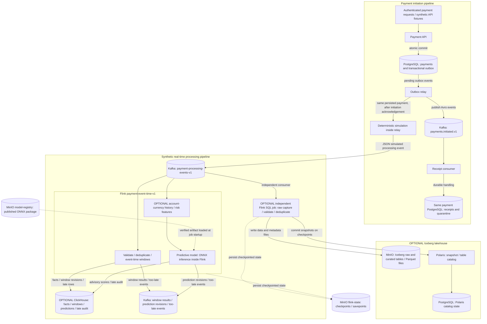

**How to read it:**

- PostgreSQL receives initiated payments and receipts. Flink does not currently
  write processed events or predictive scores back into the payment database.
- Flink consumes processing events derived from the API-created payment. Its window and risk branches
  run in parallel; risk features are not derived from completed window results.
- The predictive model is a trained, published ONNX artifact loaded into a
  Flink Python operator. It produces advisory scores, not payment approvals.
- ClickHouse receives streaming facts, aggregate revisions, prediction
  revisions and late-event audit rows when analytics is enabled.
- The separate Flink SQL job writes raw/curated **processing events** into
  Iceberg on MinIO. Predictions are not currently written into Iceberg.
- Polaris stores catalog state in PostgreSQL; table files live in MinIO.
  Dotted arrows are artifact/state operations, not additional event streams.
- The relay's simulation is a Go function, not a new service or a Kafka
  initiation-topic consumer. It acknowledges both publications before marking
  the outbox row published. Partial publication can replay either event.

Sources: [payment pipeline](../../modules/payment-api/README.md),
[Flink processing and risk branches](../../modules/stream-processor/job.py),
[lakehouse job](../../modules/stream-processor/lakehouse.py),
[model lifecycle](../../modules/payment-risk-model/README.md).

### 3.2 Overall application flow

This is the application-level map. Sections below expand the boxes.

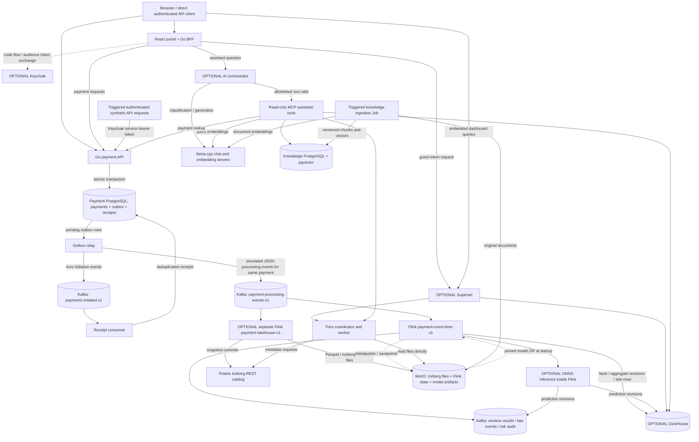

Apicurio, authentication subcomponents, storage details and observability are
expanded below rather than making this overview unreadable.

## 4. Architecture

### 4.1 Payments, PostgreSQL and Kafka

The API, relay and receipt consumer are **three process modes of the same
payment-api image**, deployed separately. They are not Kafka, Flink or model
subcomponents.

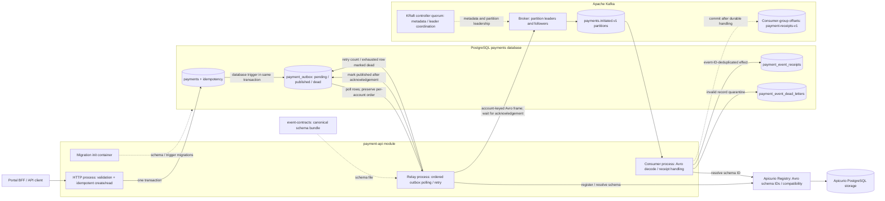

- Local `rpp` has one Kafka process with `broker,controller` roles. It is not
  three brokers just because a topic has three partitions.
- The multi-cluster topology provides brokers and a KRaft quorum across
  `rpp-1/2/3`; partition replicas communicate across their shared Docker network.
- KRaft replaces ZooKeeper; no ZooKeeper workload is deployed.
- API response success means the PostgreSQL transaction succeeded. Relay
  publication happens asynchronously afterward. A crash between broker
  acknowledgement and marking the outbox published can replay an event.
- The receipt consumer writes receipt records; it does not call Flink, generate
  processing outcomes, settle a payment, or invoke a risk model.
- The relay now simulates processing using required request dimensions and
  publishes `payment-processing-events-v1` after the initiation acknowledgement.
  Both sends precede the outbox SQL commit; deterministic output identity
  makes replay logically deduplicable. This is not an atomic Kafka/SQL transaction.
- Apicurio provides schema identity/compatibility, not message transport.

Evidence: [payment API](../../modules/payment-api/README.md),
[database triggers](../../modules/payment-api/internal/postgres/migrations/004_outbox_write_guard.sql),
[event contracts](../../modules/event-contracts/README.md),
[single-cluster Kafka configuration](../../platform/terraform/environments/local/events.tf).

### 4.2 Flink execution and predictive inference

One session cluster runs a JobManager Deployment and a TaskManager Deployment.
The normal enabled chart runs one pod per role. Two jobs can share its task
slots: `payment-event-time-v1` and optional `payment-lakehouse-v1`.

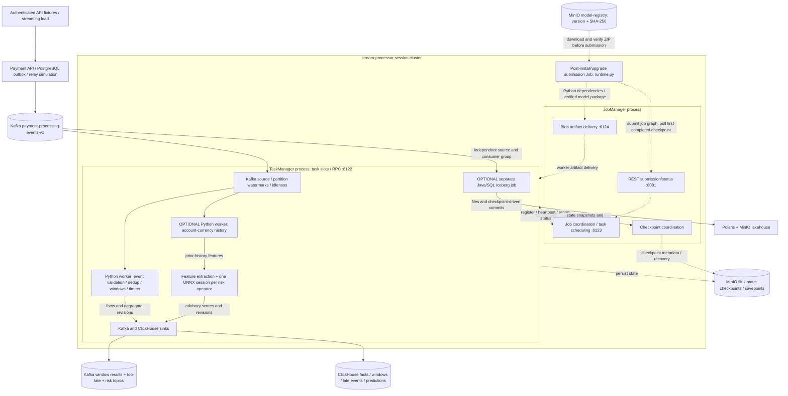

**JobManager manages execution; TaskManager executes records.** The JobManager
is not the per-payment prediction engine. Python operators run through Flink's
Python worker machinery associated with TaskManager tasks. ONNX inference
runs there on CPU; the NVIDIA option accelerates llama.cpp, not ONNX or Flink.
There is no deployed standalone Flink ResourceManager pod, model server,
dedicated SQL cluster, or model-training service.

The payment job branches are:

| Branch | Transformation | Actual outputs |
|---|---|---|
| Windows | Validate event time; deduplicate event IDs; 1-minute tumbling and 10-minute sliding windows; 2-minute allowed lateness | Compacted Kafka `payment-window-results-v1`; optional ClickHouse `payment_window_aggregates` |
| Facts | Normalize deduplicated processing events inside the window operator, including events too late for a window | Optional ClickHouse `payment_facts` |
| Too late | Events beyond all retained window boundaries | Kafka `payment-events-too-late`; optional ClickHouse `payment_late_events` |
| Risk | Key by account/currency; maintain prior history; compute contracted features; score ONNX; revise for accepted late history | Kafka `payment-risk-predictions-v1`, `payment-risk-too-late-v1`; optional ClickHouse predictions/late rows |
| Lakehouse | Independent SQL validation and keep-first event-ID deduplication | Iceberg bronze and curated processing-event tables; **not** risk predictions |

The payment job checkpoints every 10 seconds, with 10-second bounded
out-of-order watermarks, 30-second idle-partition detection and 24-hour
deduplication state TTL. The independent SQL job checkpoints every 60 seconds
and retains keep-first deduplication state for 24 hours.

The training path is separate from this always-running stream:

```mermaid
flowchart LR
    Train["Triggered offline payment-risk-model training container"]
    Data["Synthetic account-held-out training/evaluation data"] --> Train
    Train --> Baseline["scikit-learn logistic-regression pipeline"]
    Train --> Candidate["LightGBM comparison"]
    Baseline --> Export["ONNX export / selection"]
    Candidate --> Export
    Export --> Verify["Python vs ONNX golden/held-out parity"]
    Verify --> Package["model.onnx + feature contract + metadata + golden cases + ZIP"]
    Package --> Publish["make risk-publish: immutable, checksum-verified upload"]
    Publish --> Store[("MinIO model-registry")]
    Store -. "startup artifact, not per-record request" .-> Worker["Flink Python risk operator"]
```

Evidence: [actual payment graph](../../modules/stream-processor/job.py),
[submission and bootstrap](../../modules/stream-processor/runtime.py),
[risk operator](../../modules/stream-processor/risk.py),
[model module](../../modules/payment-risk-model/README.md),
[Flink chart roles and ports](../../modules/stream-processor/chart/README.md).

### 4.3 Lakehouse and BI

Iceberg is a **table format and library**, not another HTTP server. Polaris
is the REST catalog, MinIO stores the files, and Trino executes SQL.

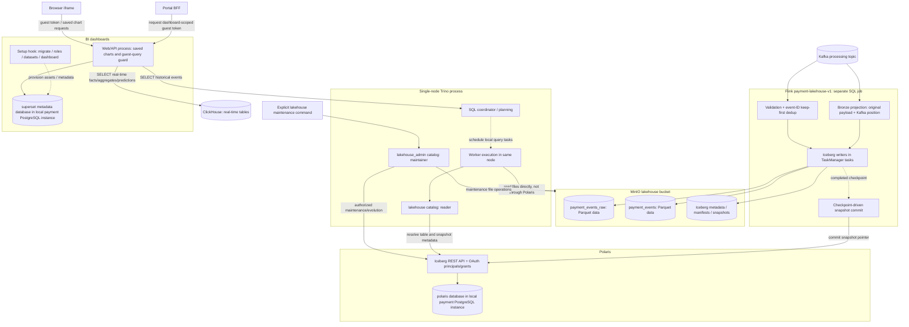

Polaris and Superset use separate logical databases/roles on the local
PostgreSQL instance; they are not independent PostgreSQL pods in this path.
Knowledge PostgreSQL and identity PostgreSQL **are** separate workloads.
Trino does not query these metadata databases directly.
Superset uses synchronous queries: no Redis, Celery workers, scheduled reports
or alert execution are deployed.

Evidence: [lakehouse SQL](../../modules/stream-processor/lakehouse.py),
[Polaris](../../modules/lakehouse-catalog/README.md),
[Trino](../../modules/lakehouse-query/README.md),
[ClickHouse sinks](../../modules/stream-processor/analytics.py),
[Superset](../../modules/bi-dashboards/README.md).

### 4.4 Identity and browser requests

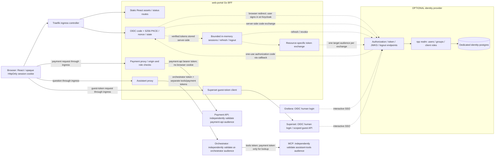

Keycloak access/refresh tokens never reach React or model input. The narrowly
scoped Superset guest token deliberately does reach the embedded dashboard.
Identity-disabled development login
and assertions exist as a compatibility mode; configured OIDC fails closed.
BFF restart signs users out because durable multi-replica sessions are not
implemented. DBX has its own local password, not Keycloak SSO.

Evidence: [BFF](../../modules/web-portal/README.md),
[identity chart](../../platform/terraform/modules/identity/chart/README.md),
[identity ADR](../adr/ADR-032-keycloak-identity-and-bff.md).

### 4.5 AI knowledge ingestion and interactive execution

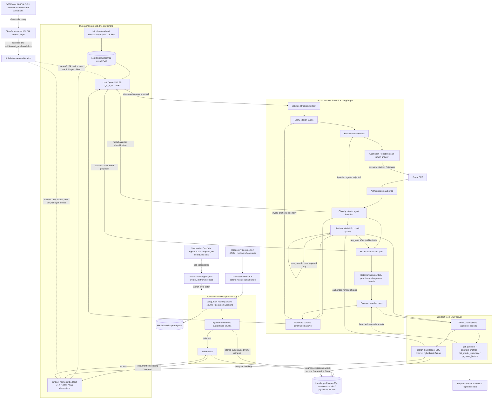

`ai-core` is a shared library copied into ingestion, MCP and orchestrator
images: identity validation, embeddings adapter, hybrid SQL retrieval and
deterministic safety utilities. It is **not** another pod.
The graph never connects directly to PostgreSQL, ClickHouse or Trino; MCP
owns those accesses. Authorization occurs in code before retrieval and again
at the tool boundary, never as a model decision.

GPU mode is optional; CPU remains available. Both llama.cpp containers request
one `nvidia.com/gpu.shared` slot. The fetch init container gets none.
Time slicing shares compute and VRAM, without VRAM isolation or extra host RAM.
The vendor chart's label-gated MPS helper is not part of the chosen time-slicing
execution path. There is no vLLM, separate embedding service module, persisted
LangGraph checkpointer, CAG cache, or asynchronous LLM-enrichment worker here.

Evidence: [ingestion](../../modules/operations-knowledge/README.md),
[actual graph](../../modules/ai-orchestrator/README.md),
[MCP tool/backend table](../../modules/assistant-tools/README.md),
[shared library](../../modules/ai-core/README.md),
[model servers](../../modules/llm-serving/README.md),
[GPU decision](../adr/ADR-034-shared-local-ai-gpu.md).

## 5. Data model and contracts

| Store/topic | Contents | Writer / reader |
|---|---|---|
| PostgreSQL `payments` database | Payments, idempotency, ordered outbox, receipts, dead letters | API, relay, receipt consumer |
| Kafka `payments.initiated.v1` | Schema-ID-framed Avro initiation event; partition key account ID | Relay / receipt consumer |
| Kafka `payment-processing-events-v1` | JSON simulated outcomes derived from API payments; CreateTime equals event time | Outbox relay / two independent Flink jobs |
| Kafka `payment-window-results-v1` | Keyed aggregate result payloads; compacted topic | Flink / inspection tools |
| Kafka late/risk topics | Late-event records and advisory prediction revisions | Flink / verification and inspection tools |
| ClickHouse | Facts, window revisions, late events, prediction revisions and lineage fields | Flink; explicit synthetic AI fixtures / BI and MCP |
| Iceberg bronze/curated tables | Raw and validated/deduplicated processing events | Flink SQL / Trino |
| Polaris metadata database | Catalog objects, access grants and table metadata references | Polaris |
| MinIO | `flink-state`, `lakehouse`, `model-registry`, `knowledge-originals` buckets | Checkpointing, Iceberg clients, model publication, ingestion |
| Knowledge PostgreSQL | Versioned documents, classified chunks, full-text and vector indexes | Ingestion / MCP retrieval |
| Identity PostgreSQL | Keycloak realm/client/user/session data | Keycloak |
| Superset metadata database | Roles, dashboards, chart definitions and connection metadata | Superset setup and web process |
| DBX PVC | Workbench configuration and runtime state | DBX server and provisioning |

Checkpointed Flink internal state does not make all external stores one
transaction. Kafka side sinks and ClickHouse writes can replay; replacement
keys/revisions and `FINAL` queries handle ClickHouse duplicates logically.
Iceberg commits happen on the separate lakehouse job's checkpoints.
Durable lineage fields exist; no dedicated lineage catalog/UI is deployed.

## 6. Key flows

### Payment initiation is asynchronous after commit

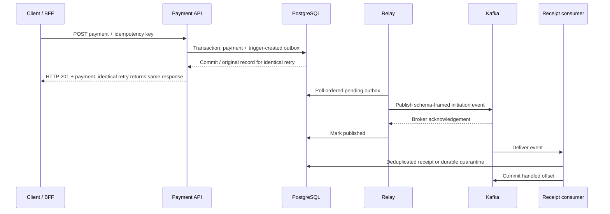

### A processing event has independent consumers

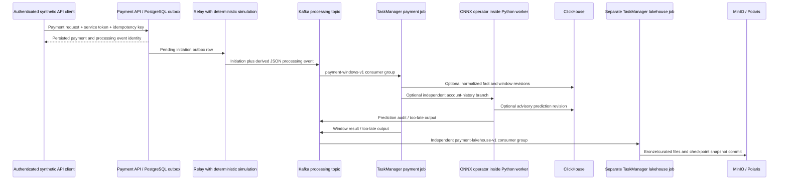

The two jobs do not wait for each other's results. Window emission is driven by
watermarks/timers; the diagram does not imply an immediate completed window
for every event or a prediction-to-Iceberg connection.

## 7. Security and privacy

- Keycloak, when enabled, authenticates humans. API, orchestrator and MCP
  validate their own audience-scoped tokens and roles.
- Internal Kafka uses TLS/SCRAM; application credentials come from Kubernetes
  Secrets. Diagrams intentionally contain no passwords or token values.
- DBX and maintainer commands are developer access paths, not user-facing
  payment or AI authorization boundaries.
- Superset readers, MCP queries and Polaris reader/writer/maintainer principals
  are scoped separately. Internal connectivity is not proof of network-policy
  isolation.
- No real payment/cardholder data, OpenBao or External Secrets Operator is
  introduced by these diagrams.

## 8. Observability

Full observability is implemented in the optional three-cluster topology:
collectors per cluster, shared backends in cluster 1. The single-cluster
identity path installs **Grafana only**, not the entire collector/backend set.

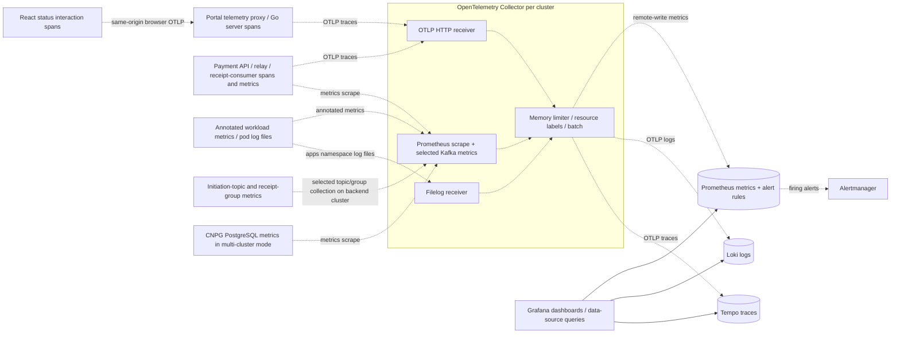

This is not universal instrumentation of every box. Flink has operator/model
metrics and inspection APIs; the current collector's selected Kafka metrics
cover initiation/receipt traffic, not every processing or risk topic.
The implemented MCP allowlist does **not** query Prometheus, Loki or Tempo.
Alertmanager's local receiver has no configured email, Slack or webhook
destination; firing alerts are not automatically external notifications.

Evidence: [collector configuration](../../platform/terraform/modules/observability/chart/templates/collector.yaml),
[observability chart](../../platform/terraform/modules/observability/chart/README.md),
[observability runbook](../runbooks/observability.md).

## 9. Testing strategy

This is a source-grounded reference; it does not start, reset or certify a
cluster. Relevant executable evidence lives in:

- [Payment integration tests](../../modules/payment-api/README.md#make-targets):
  idempotency, outbox replay, schema and receipt/quarantine behavior.
- [Flink/model checks](../../modules/payment-risk-model/README.md#make-targets):
  actual worker execution, golden-score parity and late-history revisions.
- [Lakehouse verification](../runbooks/lakehouse.md): snapshot, deduplication,
  evolution and reader/maintainer boundaries.
- [AI evaluation](../runbooks/ai-assistant.md): retrieval, citation,
  authorization and injection cases.
- [Identity verification](../runbooks/unified-identity.md): code flow, SSO,
  resource access, rotation, expiry and logout.
- [GPU live evidence](../developer-setup.md#optional-nvidia-acceleration-for-ai):
  concurrent chat/embedding requests and observed shared-device allocations.

Documentation validation uses the existing Markdown/format hooks. Historical
test success is not a claim that workloads are running right now.

## 10. Deployment and operations

### 10.1 Execution control plane

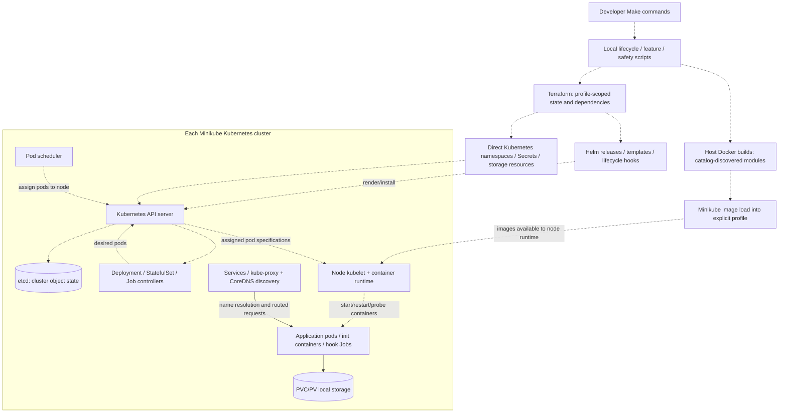

Terraform/Helm create desired resources; Kubernetes controllers and kubelet
run them. Flink's JobManager schedules **Flink tasks**, while Kubernetes
schedules **pods**. These are different schedulers at different layers.
Services are stable routing/discovery addresses, not extra application
processes. PVCs are persistent storage, not database engines.

### 10.2 Single versus three-cluster placement

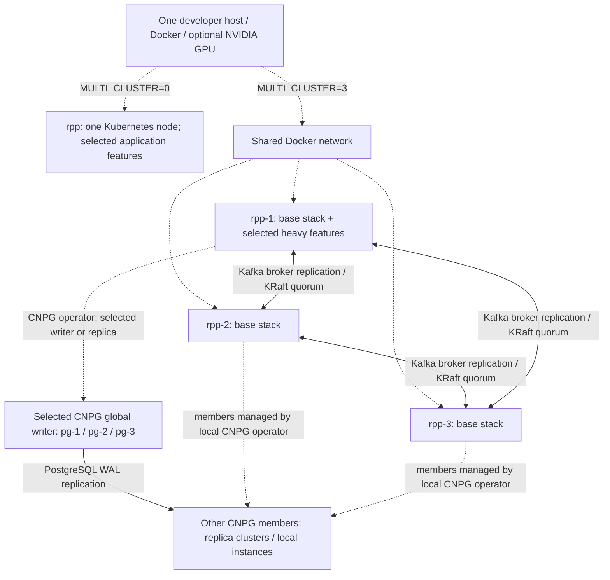

The CNPG writer is selected configuration, not necessarily always cluster 1.
The illustrated association with cluster 1 is the default placement; explicit
switchover/failover changes the writer. CNPG operators manage PostgreSQL
members; they do not execute application SQL. The base multi-cluster
infrastructure can run without the full-stack CNPG option.
Three profiles on one laptop are a learning/failure-recovery topology, not
independent hardware failure domains. Heavy optional AI/analytics/lakehouse
features and GPU passthrough belong to cluster 1 in the multi-cluster workflow.
There is no single topology template promising every feature at once.

### 10.3 Developer workbench and supporting Jobs

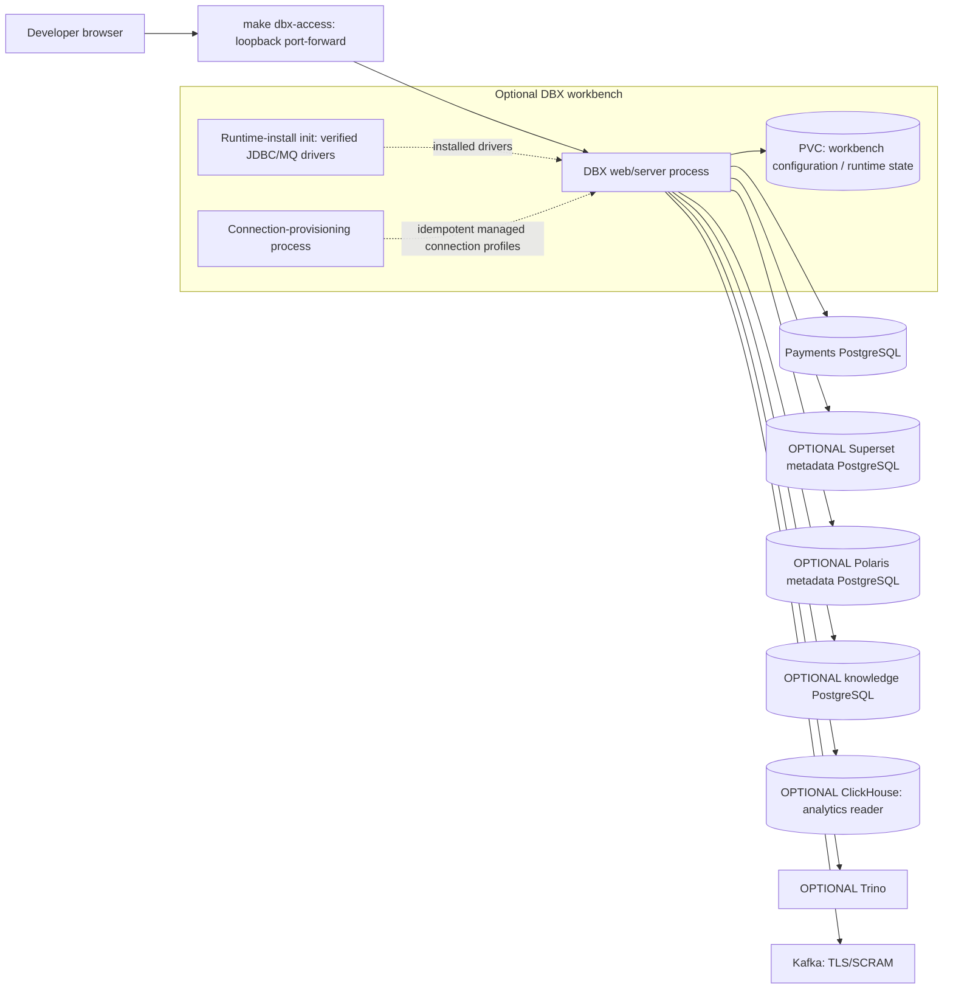

- **DBX:** a server/persistent workbench plus runtime-install and
  connection-provisioning logic. Its seven managed connection profiles are
  shown above; optional profiles exist only when their backing configuration
  is present. It reaches PostgreSQL, Kafka, ClickHouse and Trino internally;
  browser access uses an explicit loopback forward. It does not relay normal
  payment events, run Flink tasks, or sit between BI and the databases.
- **Setup hooks/init Jobs:** migrations, Kafka topic/schema setup, Polaris
  catalog/table/principal setup, ClickHouse table setup, Superset assets,
  identity realm seed/reconciliation, knowledge database grants, DBX connection
  sync and Flink submission.
  They are provisioning dependencies, not continuously executing data stages.
- **Triggered tools:** fixtures, load/benchmark drivers, model training and
  publication, knowledge ingestion, maintenance and acceptance checks.
  `event-generator` is not a deployed daemon; current generators are tooling.
- **Delivery:** local build/load/deploy works without publication or an active
  PI. GitHub build/publication/release-state workflows are a separate artifact
  lifecycle, not a Kafka/data processing step. Terraform still owns local
  deployments rather than Argo CD.

Evidence: [local workflow](local-platform-guide.md),
[single-cluster Terraform](../../platform/terraform/environments/local/main.tf),
[multi-cluster orchestration](../../scripts/multi-cluster.sh),
[CNPG composition](../../platform/terraform/environments/kafka-multicluster/database.tf),
[DBX infrastructure](../../platform/terraform/environments/local/dbx.tf).

## 11. Risks and open questions

### Catalog entries are not proof of implemented services

| Catalog module | Implemented form |
|---|---|
| `payment-api` | HTTP API + migration init + relay + receipt consumer |
| `web-portal` | React assets + Go BFF process |
| `stream-processor` | Flink session cluster, submission hook, payment and lakehouse jobs |
| `realtime-analytics` | ClickHouse StatefulSet + schema hook |
| `lakehouse-catalog` | Polaris REST catalog + setup/init logic |
| `lakehouse-query` | Single Trino coordinator/worker |
| `bi-dashboards` | Superset web process + setup hook |
| `payment-risk-model` | Offline training/export/package code + in-worker scoring library; no standalone serving pod |
| `operations-knowledge` | Versioned corpus, suspended CronJob template, explicitly triggered ingestion Jobs and evaluation tooling |
| `ai-core` | Shared Python library; no standalone deployment |
| `ai-orchestrator` | FastAPI + request-local LangGraph execution |
| `assistant-tools` | Read-only MCP server |
| `llm-serving` | One pod with fetch init and two llama.cpp containers |
| `event-contracts` | Schema/data bundle; no runtime service |
| `event-generator` | Catalog-only module; synthetic generators currently live in tooling |
| `ai-gateway` | Catalog-only module; current browser AI boundary is the portal BFF |
| `llm-enrichment-worker` | Catalog-only module; asynchronous LLM enrichment is not implemented |

**Do not infer these target-state connections from the overall master plan:**

- Real authorization/settlement decisions: outcomes remain explicitly simulated.
- Risk prediction output automatically being written to Iceberg.
- Risk triggering Kafka LLM requests and an enrichment worker.
- MCP querying observability stores.
- Argo CD, OpenBao, External Secrets Operator or a lineage platform running.
- A GPU providing system RAM or accelerating the ONNX operator.
- Model training happening automatically for each event.
- Every feature running or enabled merely because it exists in the catalog.

## 12. Related ADRs and LLDs

- [Transactional outbox](../adr/ADR-003-transactional-outbox.md).
- [Local cross-cluster Kafka](../adr/ADR-016-local-cross-cluster-kafka.md).
- [Cross-cluster PostgreSQL](../adr/ADR-017-full-stack-cross-cluster-replication.md).
- [Shared observability](../adr/ADR-019-shared-observability-backends.md).
- [PyFlink event-time semantics](../adr/ADR-022-pyflink-event-time-semantics.md).
- [ClickHouse analytics](../adr/ADR-023-clickhouse-analytics.md).
- [Advisory risk features](../adr/ADR-024-advisory-event-time-risk-features.md).
- [Polaris/Iceberg lakehouse](../adr/ADR-026-polaris-iceberg-lakehouse.md).
- [Embedded Superset](../adr/ADR-028-embedded-superset-bi.md).
- [AI operations assistant](../adr/ADR-029-ai-operations-assistant.md).
- [Keycloak and BFF](../adr/ADR-032-keycloak-identity-and-bff.md).
- [Optional DBX](../adr/ADR-033-optional-dbx-development-workbench.md).
- [Shared local AI GPU](../adr/ADR-034-shared-local-ai-gpu.md).
