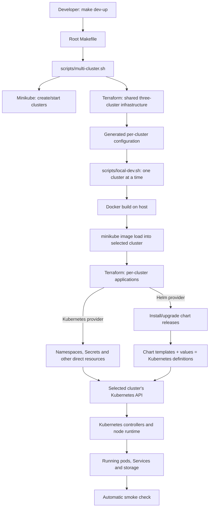
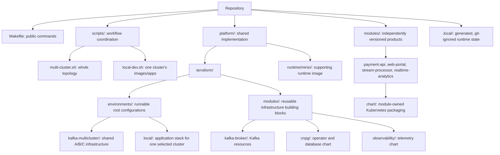
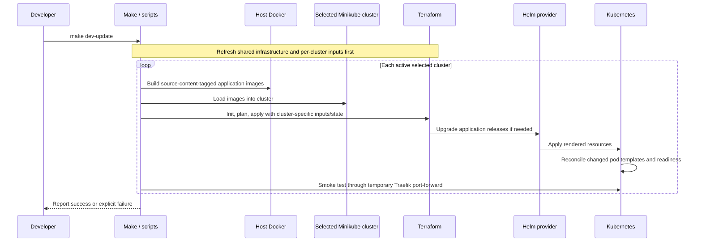
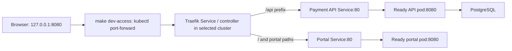

# Local platform: from Make to running applications

- **Status:** Implemented local workflow; optional Stage 6 analytics is in progress
- **Parent SDD:** [Master plan](../master-plan.md)
- **Owner:** Platform maintainers

## 1. Responsibility

Start here if the infrastructure folders are unfamiliar. This guide connects
the repository files to what runs on your machine; the
[developer setup guide](../developer-setup.md) covers installation and commands.

The short version: **Make invokes scripts, scripts create Minikube clusters and
run Terraform, Terraform creates infrastructure and installs Helm charts,
and Kubernetes runs the resulting workloads.**

| Tool / concept | Its job here | What it does not do |
|---|---|---|
| Make | Provides commands such as `make dev-up` | Does not itself schedule containers |
| Shell/Python scripts | Coordinate cluster creation, configuration, image builds and Terraform | Are not a replacement for Kubernetes controllers |
| Docker | Builds application images on the host; runs Minikube nodes with the Docker driver | A host image is not automatically available inside every cluster |
| Minikube | Creates local Kubernetes clusters | Does not install our applications by itself |
| Terraform | Plans and applies desired infrastructure; owns resources and Helm releases | Does not compile application source or build our images |
| Helm | Renders a chart plus values and manages an installed release | Is not the process that keeps application pods running |
| Kubernetes | Schedules pods, starts containers, routes Service traffic and reconciles workloads | Does not read Terraform source or Helm template expressions |

Arrows show coordination or configuration delivery, not application traffic.
Terraform also uses Helm in the shared-infrastructure step, for example to
install the PostgreSQL operator.

## 2. Structure

### Repository layout: where to start reading

The two directories named `modules` mean different things:

- Root [modules/](../../modules/) holds product capabilities and their packaging.
- [platform/terraform/modules/](../../platform/terraform/modules/) holds reusable
  Terraform infrastructure blocks. A Terraform module is a configuration unit,
  not necessarily a service or product.

### Why there are multiple Terraform environments

The current normal workflow uses **both** root configurations below. They are
two ownership scopes, not a choice between development and production:

| Root configuration | Scope | Important files |
|---|---|---|
| [kafka-multicluster/](../../platform/terraform/environments/kafka-multicluster/) | Shared infrastructure across A/B/C | [main.tf](../../platform/terraform/environments/kafka-multicluster/main.tf): providers, Kafka and outputs; [database.tf](../../platform/terraform/environments/kafka-multicluster/database.tf): cross-cluster CNPG; [observability.tf](../../platform/terraform/environments/kafka-multicluster/observability.tf): optional telemetry |
| [local/](../../platform/terraform/environments/local/) | Application stack in one explicitly selected cluster, repeated for A/B/C | [main.tf](../../platform/terraform/environments/local/main.tf): namespaces, Traefik and application Helm releases |

Despite its historical name, `kafka-multicluster` now composes more than Kafka.
Despite its name, `local` is not a fourth cluster: its same code is applied
separately to each selected member.

### Why so many files next to local main.tf?

**Terraform reads all top-level `.tf` files in the selected directory together.**
It does not execute `main.tf` first and then the other files. Filenames organize
the code; references and `depends_on` establish dependencies. Child directories
are loaded only through explicit module calls.

| File in local environment | Responsibility |
|---|---|
| [main.tf](../../platform/terraform/environments/local/main.tf) | Discovers deployable catalog modules, creates namespaces, installs Traefik and module charts |
| [providers.tf](../../platform/terraform/environments/local/providers.tf) | Points Kubernetes and Helm providers at the explicit kubeconfig/context |
| [versions.tf](../../platform/terraform/environments/local/versions.tf) | Declares provider requirements and local state backend; exact developer tool pins remain in the root tool-version file |
| [variables.tf](../../platform/terraform/environments/local/variables.tf) | Declares inputs such as images, replicas and external database/Kafka settings |
| [postgres.tf](../../platform/terraform/environments/local/postgres.tf) | Database Secret/service/workload wiring, including conditional local fallback resources |
| [events.tf](../../platform/terraform/environments/local/events.tf) | Kafka/registry/schema/credential wiring, including external Kafka support |
| [streaming.tf](../../platform/terraform/environments/local/streaming.tf) | Optional Flink feature inputs and MinIO storage/runtime |
| [analytics.tf](../../platform/terraform/environments/local/analytics.tf) | Optional ClickHouse password and Secret |
| [outputs.tf](../../platform/terraform/environments/local/outputs.tf) | Exposes application/access information |
| [moved.tf](../../platform/terraform/environments/local/moved.tf) | Preserves state identity across resource-address refactoring |

In the normal full-stack workflow, shared Terraform owns CNPG and cross-cluster
Kafka. Per-cluster Terraform receives their connection settings; it does not
create a second independent copy of those shared datasets.

## 3. Interfaces

Read these in order, rather than trying to understand every infrastructure file:

1. [Root Makefile](../../Makefile): find `dev-up`, `dev-update` and `dev-access`.
2. [multi-cluster.sh](../../scripts/multi-cluster.sh): follow `up` to `deploy`.
    It starts owned profiles, applies shared Terraform and writes application inputs.
3. [local-dev.sh](../../scripts/local-dev.sh): follow `update`, `build_images`,
    `init`, `plan`, `apply` and `smoke`.
4. [local main.tf](../../platform/terraform/environments/local/main.tf): find
    `helm_release.application`; it connects product chart paths to supplied values.
5. [API chart guide](../../modules/payment-api/chart/README.md): follow the
    Deployment, Service and Ingress through to a running API.

A `helm_release` is Terraform's instruction to install/upgrade a chart.
`.Values.image` in a Helm template receives merged chart defaults and Terraform
overrides. The resulting Deployment contains a concrete image reference;
Kubernetes never sees `.Values` or other Helm expressions.

## 4. Data and state

Three different kinds of state are easy to confuse:

| State | Where / purpose |
|---|---|
| Terraform state | Maps Terraform resource addresses to managed objects; may contain credentials |
| Helm release state | Stored in the target cluster; records chart release information |
| Application data | PostgreSQL, Kafka, ClickHouse and MinIO data on their storage volumes |

For the default base, shared Terraform state is in
`.local/rpp/terraform.tfstate`; per-cluster states are in
`.local/rpp-a/terraform.tfstate`, `.local/rpp-b/terraform.tfstate` and
`.local/rpp-c/terraform.tfstate`. Generated `events.tfvars.json` carries
connection/feature settings; `images.tfvars.json` carries local image references.
Treat these files and saved plans as private. Do not commit or casually delete
them: losing Terraform state is not a safe way to reset the platform.

The topology input template is user-editable source; generated `.local` inputs
are workflow output. Do not use generated files as the normal configuration API.

## 5. Behavior

### What happens when you change application code?

You do not need to publish an image to GHCR first. Host Docker images are loaded
into the selected clusters, and local charts use `imagePullPolicy: Never`.
An application image contains executable code; a chart describes how to run it.

### How does the browser reach the application?

An Ingress is the routing declaration; Traefik implements it. `dev-access`
provides loopback access to Traefik. Terraform and Helm are not in the live HTTP
request path, and the portal's static server does not proxy `/api`.

## 6. Error handling and idempotency

Terraform plans the difference between desired configuration and managed state;
Kubernetes controllers continually reconcile their workloads. Re-running an
update is not equivalent to destroying and recreating the environment.
Readiness failures can keep a Service without a usable backend even when its
resource exists.

Use `make dev-status` and the [local development runbook](../runbooks/local-development.md)
to investigate failures. Do not run ad-hoc `helm upgrade` or `kubectl apply` over
Terraform-owned resources: that introduces competing ownership/configuration.
`dev-down` destroys application/database resources and data; `cluster-down`
deletes owned nodes after teardown. Neither is needed for routine code edits.

## 7. Configuration

Use `DEV_PROFILE` for the whole topology base, `DEV_CONFIG` for a checked-in
topology configuration, and `MINIKUBE_PROFILE` to select one cluster for access
or smoke. Defaults are the `rpp` base and access to `rpp-a`.

Optional streaming/analytics run in A; observability uses per-cluster collectors
and shared backends in A. See the [developer guide](../developer-setup.md) for
budgets and feature templates. Local development needs no GitHub Actions,
GHCR login, publication approval or active PI; first-use downloads need internet.

## 8. Tests

`make ci` checks source, charts and Terraform statically and runs offline tests;
it does not create clusters. Live smoke/recovery checks are separate. See the
[local-development verification procedure](../../ai/skills/local-development/SKILL.md)
for isolated acceptance; never destroy a shared profile to test documentation.

## 9. Open questions

None for this walkthrough. GitOps and later deployment targets are roadmap work,
not part of this current local execution path.
