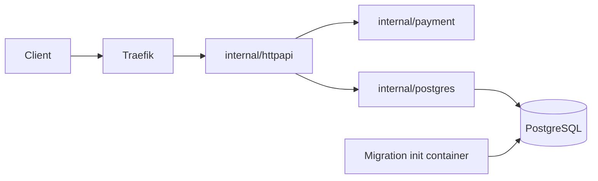

# LLD: Stage 2 payment API

- **Status:** Review
- **Parent SDD:** [Master plan, Stage 2](../master-plan.md#stage-2-production-style-go-backend)
- **Owner:** varunpathania86

## 1. Responsibility

Create and read synthetic initiated payments durably and idempotently. Never
authorize, settle, score, or publish payment events in this stage.

## 2. Structure

`main` composes configuration, JSON slog logging, signal handling, and bounded
HTTP shutdown. Domain types/validation have no database dependency. HTTP uses
a small Store interface; PostgreSQL owns persistence and embedded SQL migrations.

## 3. Interfaces

See [OpenAPI](../../modules/payment-api/openapi.yaml). Direct and `/api`-prefixed
routes use identical behavior. POST requires a single `Idempotency-Key` and
`application/json`; body limit is 4096 bytes. Payment IDs and account IDs are
lowercase UUIDs, amounts are positive int64 minor units, and currency is one of
USD, EUR, GBP, INR, JPY, CAD, AUD, CHF, SGD.

## 4. Data and state

The payments table stores ID, account, amount, currency, initiated status,
timestamp, and a unique idempotency key. A single atomic insert covers both
business state and deduplication; no TTL or deletion endpoint exists.
UTC timestamps and UUIDs are generated without real financial/personal data.

The migration ledger records version 1 and its SHA-256 checksum. A transaction
and advisory lock serialize creation/checking; checksum drift fails explicitly.
Additional schema versions must be added as new migrations, not edits to applied
SQL. The initial runner deliberately handles only the first Stage 2 schema.

## 5. Behavior

```mermaid
sequenceDiagram
  participant Client
  participant API
  participant DB as PostgreSQL
  Client->>API: POST /payments + Idempotency-Key
  API->>API: Validate body, key, amount, UUID, currency
  API->>DB: INSERT ... ON CONFLICT DO NOTHING RETURNING
  alt new key
    DB-->>API: committed initiated payment
  else existing key
    API->>DB: SELECT winner in a fresh statement
    DB-->>API: original payment
    API->>API: Compare account, amount, currency
  end
  API-->>Client: 201 original payment or 409 payload conflict
```

## 6. Error handling and idempotency

Each dependency operation has a two-second request context; migration execution
has a 30-second limit. No application-level retry loop exists. The pool has at
most ten connections and bounded idle/lifetime settings. HTTP has header/read/
write/idle limits and ten-second graceful shutdown.

Validation errors return 400, content-type errors 415, oversized bodies 413,
missing payments 404, payload conflicts 409, and unavailable storage 503.
Dependency errors never expose credentials in HTTP or request logs. JSON
request logs record route templates, method, and duration, not keys or bodies.
Readiness requires a reachable, migrated database; liveness only checks process
responsiveness, preventing database outages from inducing liveness restarts.
These are direct-pod probe semantics. An unready pod is excluded from normal
Service/ingress traffic, so ingress can return 503 even for the health route.
Use direct pod forwarding to verify liveness during an outage.

## 7. Configuration

`DATABASE_URL` is mandatory. Local Terraform supplies it through an apps-namespace
Secret to both the init container and runtime container. Local PostgreSQL is
private ClusterIP in `data` with a 1 GiB PVC and a container tag from
`.tool-versions`. A generated profile-local credential is preserved across
updates. No public database port or committed `.env` file is needed.

## 8. Tests

- Offline domain/HTTP/OpenAPI tests: validation, exact response schemas, methods,
  prefixed routes, readiness/liveness separation, redacted errors, shutdown.
- Testcontainers: repeatable migrations, checksum drift, concurrent same-key
  creation, payload conflicts, reads, and bounded outage behavior.
- Local Minikube: deployment/migration, ingress payment replay, dirty-source
  update, API pod recovery, data persistence on updates, clean-cluster recreation.

## 9. Open questions

Production role separation, backups/TLS, tenant-scoped keys, and supported currency
expansion require later explicit decisions. These are not implied by this local
educational backend. See [ADR-015](../adr/ADR-015-stage-2-payment-storage-and-idempotency.md).
