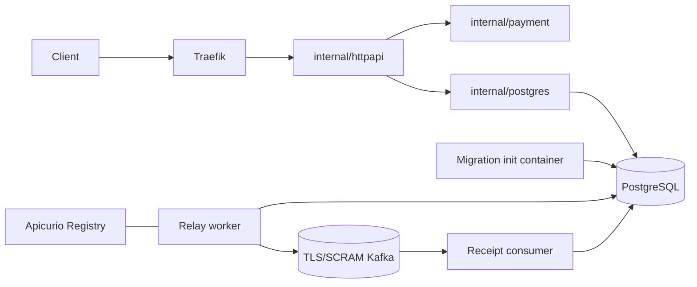
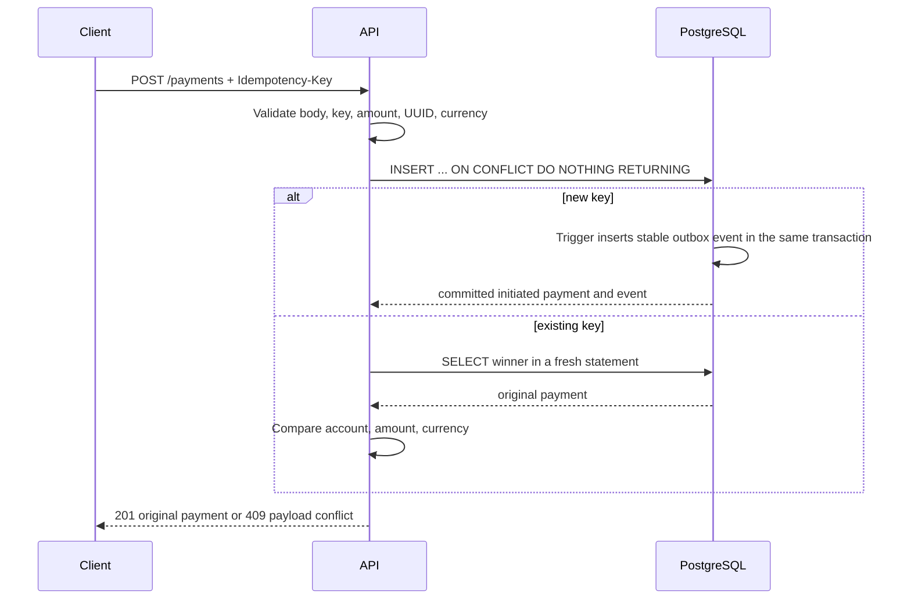

# LLD: Payment API and Stage 3 event publication

- **Status:** Review
- **Parent SDD:** [Master plan, Stage 2](../master-plan.md#stage-2-production-style-go-backend)
- **Owner:** varunpathania86

## 1. Responsibility

Create and read synthetic initiated payments durably and idempotently. Stage 3
adds reliable event publication and receipt deduplication, never authorization,
settlement, or scoring.

## 2. Structure

`main` composes configuration, JSON slog logging, signal handling, and bounded
HTTP shutdown. Domain types/validation have no database dependency. HTTP uses
a small Store interface; PostgreSQL owns persistence and embedded SQL migrations.

## 3. Interfaces

See [OpenAPI](../../modules/payment-api/openapi.yaml). Direct and `/api`-prefixed
routes use identical behavior. POST requires a single `Idempotency-Key` and
`application/json`; body limit is 4096 bytes. Payment IDs and account IDs are
lowercase UUIDs, amounts are positive int64 minor units, and currency is one of
USD, EUR, GBP, INR, JPY, CAD, AUD, CHF, SGD.

## 4. Data and state

The payments table stores ID, account, amount, currency, initiated status,
timestamp, and a unique idempotency key. A single atomic insert covers both
business state and deduplication; no TTL or deletion endpoint exists.
UTC timestamps and UUIDs are generated without real financial/personal data.

The migration ledger records each applied version and its SHA-256 checksum. A transaction
and advisory lock serialize creation/checking; checksum drift fails explicitly.
Additional schema versions must be added as new migrations, not edits to applied
SQL. Ordered migrations preserve the original payments schema, add/backfill the
outbox and receipts, add consumer quarantine, and install database write guards.
The guards cover Stage 2 writers during rolling upgrades, serialize account
inserts, and queue events in the payment transaction without a broker dependency.

## 5. Behavior

## 6. Error handling and idempotency

Each dependency operation has a two-second request context; migration execution
has a 30-second limit. No HTTP database retry loop exists. The pool has at
most ten connections and bounded idle/lifetime settings. HTTP has header/read/
write/idle limits and ten-second graceful shutdown.

Validation errors return 400, content-type errors 415, oversized bodies 413,
missing payments 404, payload conflicts 409, and unavailable storage 503.
Dependency errors never expose credentials in HTTP or request logs. JSON
request logs record route templates, method, and duration, not keys or bodies.
Readiness requires a reachable, migrated database; liveness only checks process
responsiveness, preventing database outages from inducing liveness restarts.
These are direct-pod probe semantics. An unready pod is excluded from normal
Service/ingress traffic, so ingress can return 503 even for the health route.
Use direct pod forwarding to verify liveness during an outage.

The relay holds one outbox row lock through broker acknowledgement and then
commits publication state. A crash in that gap causes safe redelivery with the
same event ID. Account-level creation locks plus earlier-unpublished-row checks
preserve publication order; `SKIP LOCKED` permits independent account progress.
Failures use persisted capped exponential delays and eight attempts, then remain
in SQL as dead letters. The receipt consumer commits its event-ID-deduplicated
effect before its broker offset; invalid records are durably quarantined first.
See [ADR-003](../adr/ADR-003-transactional-outbox.md) for precise guarantees.

## 7. Configuration

`DATABASE_URL` is mandatory. Local Terraform supplies it through an apps-namespace
Secret to both the init container and runtime container. Local PostgreSQL is
private ClusterIP in `data` with a 1 GiB PVC and a container tag from
`.tool-versions`. A generated profile-local credential is preserved across
updates. No public database port or committed `.env` file is needed.
Kafka TLS/SCRAM credentials and CA are supplied through a separate Secret.
The authoritative Avro schema is mounted from event-contracts via ConfigMap.
Local Kafka has a PVC; Apicurio persists schema IDs in PostgreSQL.

## 8. Tests

- Offline domain/HTTP/OpenAPI tests: validation, exact response schemas, methods,
  prefixed routes, readiness/liveness separation, redacted errors, shutdown.
- Testcontainers: repeatable migrations, checksum drift, concurrent same-key
  creation, payload conflicts, reads, and bounded outage behavior.
- Real Kafka/Apicurio recovery: kill publisher after broker acknowledgement,
  restart, verify duplicate records but one receipt, reject schema incompatibility
  and bad SCRAM credentials, and quarantine malformed records.
- Local Minikube: deployment/migration, ingress payment replay, dirty-source
  update, API pod recovery, data persistence on updates, clean-cluster recreation.

## 9. Open questions

Production role separation, backups/TLS, tenant-scoped keys, and supported currency
expansion require later explicit decisions. These are not implied by this local
educational backend. See [ADR-015](../adr/ADR-015-stage-2-payment-storage-and-idempotency.md).
