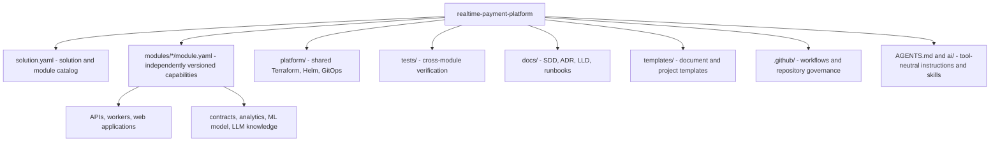
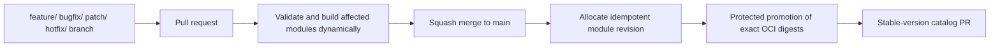
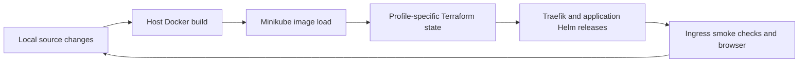

# Repository and delivery overview

How the monorepo's independently versioned modules are cataloged and how changes travel from branch to release.

## Layout

## Delivery flow

CI validates catalogs and builds/tests modules. Successful same-repository push CI can trigger protected branch/main OCI publication using trusted default-branch tooling. Main revision reservations use atomic updates on `automation/release-state`; no temporary versions enter catalogs. See the [publication runbook](../release-publication.md) for activation and recovery. Promotion and stable-version PR automation in the diagram remain target-state steps.

## Local development flow

`make dev-up` and `make dev-update` implement this path without GitHub Actions,
GHCR, publication approvals, release reservations, or the PI clock.
Module-owned charts live with their application; shared Terraform composition
lives under `platform/terraform/`. Terraform owns the releases until the
planned Argo CD transition. See [ADR-001](../adr/ADR-001-terraform-local-development.md).
