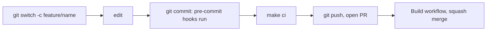

# Developer setup

How to prepare a machine to work on this repository. Target environment: Windows with WSL2 (Ubuntu), VS Code Remote - WSL. Native Linux and macOS work the same way.

Work inside the WSL filesystem (for example `~/code`), not under `/mnt/c`, for speed and correct line endings.

## 1. Prerequisites

| Tool | Needed for | Install (Ubuntu/WSL) |
|---|---|---|
| git | Version control | `sudo apt install git` |
| make | All workflows | `sudo apt install make` |
| python3 with venv | pre-commit and catalog validation | `sudo apt install python3 python3-venv` |
| SSH key on GitHub | Push access | [GitHub docs](https://docs.github.com/en/authentication/connecting-to-github-with-ssh); verify with `ssh -T git@github.com` |
| GitHub CLI (optional) | Creating pull requests | [cli.github.com](https://cli.github.com); then `gh auth login` |

`make setup` installs the pinned tools, Node.js with npm, and Docker (see below).

### Pinned tools

Versions are pinned in [.tool-versions](../.tool-versions). `make setup` (or `make tools`) downloads kubectl, Minikube, Helm, Terraform, Go, jq, yq, and Node.js into `~/.local/bin` without sudo, verifying each download with SHA-256. Go is unpacked to `~/.local/go`; Node.js includes npm and lives in a versioned directory under `~/.local/`. Tools already at the pinned version are skipped, so the command is safe to repeat.

Make sure `~/.local/bin` is on your PATH:

```bash
echo 'export PATH="$HOME/.local/bin:$PATH"' >> ~/.bashrc && source ~/.bashrc
```

To upgrade a tool, change its version in `.tool-versions` and run `make tools`.

### Docker

Minikube runs on the Docker driver. `make setup` runs `scripts/install-docker.sh` (also available alone as `make docker`):

- If `docker info` already works (Docker Desktop with WSL integration, or an existing Engine), nothing is installed.
- Otherwise it installs Docker Engine from Docker's official apt repository, enables the service, and adds you to the `docker` group. This needs `sudo`, so it asks for your password once. Supported: Ubuntu and Debian, including WSL2 with systemd.
- Docker then works without `sudo`, even in the terminal you ran `make setup` from: the group membership applies to new shells, and a one-time access rule on the Docker socket (`setfacl`) covers open ones. If you ever see a permission error after a Docker restart, run `make docker` again or open a new terminal (in WSL: `wsl --shutdown` from Windows PowerShell, then reopen).

On other systems, install Docker manually ([Docker Desktop](https://docs.docker.com/desktop/) or [Engine](https://docs.docker.com/engine/install/)) and verify with `docker info`.

### Node.js

The exact Node.js version is pinned in `.tool-versions` and installed, with npm,
by `make setup`. No manual Node manager is required. The portal uses `npm ci`
with its committed lockfile; its Makefile installs dependencies when needed.
`make doctor` checks Node.js and npm along with the other required tools.

## 2. One-time setup

```bash
git clone git@github.com:varunpathania86/realtime-payment-platform.git
cd realtime-payment-platform
make setup
```

`make setup`:

1. Creates the git-ignored `.venv/` and installs the pinned catalog-validation libraries and Apache Avro 1.12.0 from `scripts/requirements-catalog.txt`; installs `pre-commit` there only if it is not already on your PATH. Avro validates and binary-round-trips the first synthetic event contract.
2. Installs the git pre-commit hook, so checks run on every commit.
3. Installs the pinned tools from `.tool-versions` (`scripts/install-tools.sh`).
4. Installs Docker Engine if it is missing (`scripts/install-docker.sh`, needs sudo).
5. Runs `make doctor`, which compares everything with `.tool-versions` and lists problems (for example a missing Docker).

### Editor (optional)

[.vscode/extensions.json](../.vscode/extensions.json) lists recommended VS Code extensions: Remote - WSL, EditorConfig, markdownlint, ShellCheck, YAML, Mermaid preview, Docker, Kubernetes, Terraform, and Go. VS Code offers to install them when you open the folder; nothing is installed automatically and `make setup` does not depend on them. Open the repo from WSL (`code .` inside the WSL terminal) so the extensions run in WSL. Other editors can ignore this file.

## 3. Daily commands

| Command | Purpose |
|---|---|
| `make help` | List all targets |
| `make doctor` | Check the environment against `.tool-versions` |
| `make validate-catalog` | Validate `solution.yaml`, module manifests, release manifests, and dependency references |
| `make test-catalog` | Run offline tests for catalog validation, versions, reservations, classification, and publication recovery |
| `make tools` | Install or update the pinned tools |
| `make docker` | Install Docker Engine if missing (needs sudo) |
| `make setup-agent` | Optional: register this machine as a self-hosted runner for the Deploy workflow ([runbook](runbooks/self-hosted-runner.md), including the dedicated WSL instance steps) |
| `make cluster-up` | Start the local Minikube cluster (profile `rpp`) |
| `make cluster-status` | Show cluster status |
| `make cluster-down` | Delete the cluster and its data (destructive) |
| `make dev-up` | Build/load local application images, provision Terraform/Helm, and smoke-test |
| `make dev-update` | Rebuild/load local images and apply application updates |
| `make dev-images` | Build/load images and write the profile-specific image inventory |
| `make dev-access` | Forward local ingress to loopback port 8080 until Ctrl-C |
| `make dev-status` | Inspect local namespaces and application resources |
| `make smoke` | Verify ingress, API build identity, readiness, and the React entry page |
| `make dev-down` | Destroy Terraform-managed local resources, preserving Minikube (destructive) |
| `make ci` | Lint, test, and build; same as the Build workflow |
| `make lint` | Shared static checks and per-project lint |
| `make fmt` | Format all sub-projects |
| `make projects` | List discovered sub-projects |

## 4. Local application development

Stage 0 prepares the workstation and cluster lifecycle. Stage 1 supplies the
first runnable applications and the local edit/build/deploy/test loop.
The Go API exposes `/healthz`, `/readyz`, and `/version`; ingress exposes them
under `/api`. The React page displays API health, readiness, and build identity.
There is no database or payment-command implementation yet.

### Start and update

```bash
make doctor
make dev-up
make dev-access
```

Open `http://127.0.0.1:8080` in your browser. `dev-access` runs in the foreground
and binds only to loopback. No hosts-file changes, root-owned port binding,
Minikube tunnel, GitHub runner, or registry login is required.

After editing an application:

```bash
# Ctrl-C the dev-access terminal first, or choose a different LOCAL_PORT below.
make ci
make dev-update
make dev-access
```

`dev-up` starts Minikube, builds images using the host Docker daemon, loads them
into Minikube, initializes Terraform, plans/applies the stack, and runs smoke
checks. `dev-update` repeats build/load/deploy/smoke against an existing cluster.
Both commands fail explicitly if a build, image load, deployment, or smoke check
fails. They do not consult the PI schedule or release-reservation state.

The local Docker image store is not a registry. Minikube uses a separate
container runtime, so building on the host alone is insufficient: `dev-images`
loads every runnable module image into the selected profile.
Images use `rpp-local/<module>:dev-<content-hash>` and `imagePullPolicy: Never`.
The hash includes non-ignored module files (including dirty/untracked source),
the source commit, and tool pins. Editing source changes the image reference and triggers a rollout.
These tags are development identities, not stable catalog or PI release versions.

The catalog discovers runnable modules by the presence of both a Dockerfile and
a Helm chart. Catalog-only and non-runtime modules are not deployed.
The applications run non-root with read-only filesystems, restricted capabilities,
probes, and resource requests/limits. Stage 1 creates no persistent application
data; persistent databases are introduced in later stages.

### Explicit Terraform workflow

For inspecting the infrastructure plan separately:

```bash
make cluster-up
make dev-images
make terraform-init
make terraform-validate
make terraform-plan
make terraform-apply
make smoke
```

`terraform-apply` calculates a fresh saved plan, then applies that exact plan.
Terraform owns the six namespaces, Traefik Helm release, and application Helm
releases. Do not also use manual `helm upgrade` or `kubectl apply` to manage those
objects. Argo CD is not introduced until its roadmap stage.
Helm installs are atomic and upgrades clean up newly created resources on failure,
so an unsuccessful installation does not leave an untracked failed release.

Provider versions and checksums are pinned in the local Terraform environment;
the Traefik chart version is pinned there too. `make ci` validates Terraform and
lints/renders application charts without needing a running cluster.

### Profiles, ports, and state

The default Minikube profile is `rpp`, with 4 CPUs and 8 GiB RAM. To isolate a
development or verification environment, consistently pass a different profile:

```bash
make dev-up MINIKUBE_PROFILE=rpp-sandbox MINIKUBE_CPUS=2 MINIKUBE_MEMORY=4096
make dev-access MINIKUBE_PROFILE=rpp-sandbox LOCAL_PORT=8081
```

Resource overrides are intended for the minimal Stage 1 stack; later profiles
need more memory. Every local Kubernetes/Terraform command explicitly targets
the selected profile, not whichever kubeconfig context happened to be current.
Use a single kubeconfig file; `KUBECONFIG` may override its path.

Terraform state, provider working data, saved plans, and image inventory live in
git-ignored `.local/<profile>/`. Keep this directory until you have destroyed the
resources it owns. Do not commit it, copy state between profiles, or delete state
as a workaround for a failed apply. Stop access forwarding before smoke tests,
or use another port, for example `make smoke LOCAL_PORT=8081`.

### Recovery and clean-cluster acceptance

Remote CI/publication/deploy failures do not block these commands. Fix genuine
local build/test errors normally. Initial setup, npm/base-image downloads, provider
initialization, and chart downloads still require internet access; this is not
an air-gapped workflow.

To demonstrate pod recovery:

```bash
make dev-status
kubectl --context rpp -n apps delete pod -l app.kubernetes.io/name=payment-api
kubectl --context rpp -n apps rollout status deployment/payment-api --timeout=120s
make smoke
```

The deletion is intentional and affects only the selected API pod; its Deployment
recreates it. To verify complete reproducibility, use a dedicated profile:

```bash
make dev-up MINIKUBE_PROFILE=rpp-recreate
make dev-down MINIKUBE_PROFILE=rpp-recreate
make cluster-down MINIKUBE_PROFILE=rpp-recreate
make dev-up MINIKUBE_PROFILE=rpp-recreate
make smoke MINIKUBE_PROFILE=rpp-recreate
```

`dev-down` (also `terraform-destroy`) destroys all Terraform-managed resources in
that profile, including its application namespaces. `cluster-down` deletes the
whole cluster and its data. Never use this sequence on another person's profile.
Clean up the dedicated profile afterward using the same two teardown commands.

See [local development troubleshooting](runbooks/local-development.md) and
[ADR-001](adr/ADR-001-terraform-local-development.md) for ownership and trade-offs.

## 5. Workflow summary



Branch, commit, and versioning rules are in [CONTRIBUTING.md](../CONTRIBUTING.md).

Trusted OCI publication uses GitHub-hosted Buildx and the job's GitHub token.
Local contract tests and archive builds need only `make setup`; no new CLI is
required. GitHub approval/environment and GHCR configuration are covered in the
[publication runbook](release-publication.md).

## 6. Troubleshooting

For WSL networking and disk problems see the [WSL runbook](runbooks/wsl-troubleshooting.md).

| Problem | Fix |
|---|---|
| `make doctor` reports `PROBLEM ...` | Follow the hint printed on that line; most are fixed by `make setup` |
| `~/.local/bin is not on PATH` | Add it to `~/.bashrc` as shown above |
| `docker daemon is not reachable` | `sudo systemctl start docker`, or start Docker Desktop with WSL integration |
| `permission denied` on the Docker socket | Run `make docker`, or open a new terminal so the `docker` group applies |
| `python3 -m venv` fails | `sudo apt install python3-venv` |
| Catalog validation dependencies are missing | Run `make setup` to install the pinned libraries into `.venv/` |
| `systemd-binfmt.service failed` during `apt install` on WSL | Harmless: WSL already registers its own binfmt handler. Check with `sudo dpkg --audit`; no output means apt finished cleanly |
| `Permission denied (publickey)` on push | Check the key with `ssh -T git@github.com` and that the remote uses the SSH URL (`git remote -v`) |
| Hooks fail on line endings | Work in the WSL filesystem; the repo enforces LF via `.gitattributes` |
| Hook environments are broken or stale | `.venv/bin/pre-commit clean` (or `pre-commit clean`), then `make lint` |
