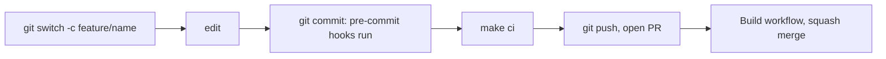

# Developer setup

How to prepare a machine to work on this repository. Target environment: Windows with WSL2 (Ubuntu), VS Code Remote - WSL. Native Linux and macOS work the same way.

Work inside the WSL filesystem (for example `~/code`), not under `/mnt/c`, for speed and correct line endings.

New to the infrastructure? Start with
[Local platform: from Make to running applications](architecture/local-platform-guide.md)
for the folder map, reading order, deployment sequence and browser request path.

## 1. Prerequisites

| Tool | Needed for | Install (Ubuntu/WSL) |
|---|---|---|
| git | Version control | `sudo apt install git` |
| make | All workflows | `sudo apt install make` |
| python3 with venv | pre-commit and catalog validation | `sudo apt install python3 python3-venv` |
| SSH key on GitHub | Push access | [GitHub docs](https://docs.github.com/en/authentication/connecting-to-github-with-ssh); verify with `ssh -T git@github.com` |
| GitHub CLI (optional) | Creating pull requests | [cli.github.com](https://cli.github.com); then `gh auth login` |

`make setup` installs the pinned tools, Node.js with npm, and Docker (see below).

### Pinned tools

Versions are pinned in [.tool-versions](../.tool-versions). `make setup` (or `make tools`) downloads kubectl, Minikube, Helm, Terraform, Go, jq, yq, Node.js, TFLint, and Trivy into `~/.local/bin` without sudo, verifying each download with SHA-256. Go is unpacked to `~/.local/go`; Node.js includes npm and lives in a versioned directory under `~/.local/`. Tools already at the pinned version are skipped, so the command is safe to repeat.

Make sure `~/.local/bin` is on your PATH:

```bash
echo 'export PATH="$HOME/.local/bin:$PATH"' >> ~/.bashrc && source ~/.bashrc
```

The Markdown pre-commit hook uses the installed Node runtime rather than
downloading an independently resolved latest release. `make setup` installs the
Node version from `.tool-versions`, `make doctor` checks it, and Make puts
`~/.local/bin` first on PATH. CI installs the same toolchain before quality checks.

To upgrade a tool, change its version in `.tool-versions` and run `make tools`.
For a focused installation use `make tools TOOLS="tflint trivy"`.
GitHub release checksum lookups use `GH_TOKEN` (or `GITHUB_TOKEN`) when set;
CI supplies its scoped job token to avoid anonymous API rate limits. Local setup
still works without a token, subject to GitHub's anonymous rate limits.
Authentication is sent only to the GitHub API metadata request, not release
asset redirects or other download hosts. Metadata failures stop installation
with an explicit error; checksum verification is never skipped.
TFLint uses its bundled Terraform ruleset and root `.tflint.hcl`; no downloaded
provider plugin is required. Trivy uses root `trivy.yaml` and may download an
updated public checks bundle on first use. It scans locally; no source upload,
SaaS subscription, or registry authentication is needed for IaC scans.

### Docker

Minikube runs on the Docker driver. `make setup` runs `scripts/install-docker.sh` (also available alone as `make docker`):

- If `docker info` already works (Docker Desktop with WSL integration, or an existing Engine), nothing is installed.
- Otherwise it installs Docker Engine from Docker's official apt repository, enables the service, and adds you to the `docker` group. This needs `sudo`, so it asks for your password once. Supported: Ubuntu and Debian, including WSL2 with systemd.
- Docker then works without `sudo`, even in the terminal you ran `make setup` from: the group membership applies to new shells, and a one-time access rule on the Docker socket (`setfacl`) covers open ones. If you ever see a permission error after a Docker restart, run `make docker` again or open a new terminal (in WSL: `wsl --shutdown` from Windows PowerShell, then reopen).

On other systems, install Docker manually ([Docker Desktop](https://docs.docker.com/desktop/) or [Engine](https://docs.docker.com/engine/install/)) and verify with `docker info`.

### Node.js

The exact Node.js version is pinned in `.tool-versions` and installed, with npm,
by `make setup`. No manual Node manager is required. The portal uses `npm ci`
with its committed lockfile; its Makefile installs dependencies when needed.
`make doctor` checks Node.js and npm along with the other required tools.

## 2. One-time setup

### Optional Stage 7 model training

```bash
RISK_MODEL=1 make setup
RISK_MODEL=1 make doctor
make -C modules/payment-risk-model build test lint
make -C modules/payment-risk-model integration
```

Setup builds a pinned Python training container with the model's exact library
requirements; no host ML packages or additional system Python installation
are needed. The Python base image tag is pinned as `risk-python` in
`.tool-versions`. The container includes libgomp for LightGBM; setup is
idempotent through Docker's cache. Initial downloads need internet; subsequent
training runs use `--network none`. Doctor checks the optional image only
when `RISK_MODEL=1`.

The [model guide](../modules/payment-risk-model/README.md) defines generated
local artifacts, imbalanced-class metrics, explicit MinIO publication and
savepoint-safe advisory scoring. `integration` prepares the Flink runtime too,
and verifies original Python, Python ONNX and real Flink worker golden scores
within `1e-5`. It also exercises late-history revisions and cleanup without
starting Kubernetes. Affected-module CI runs this gate with `INTEGRATION=1`.
Ordinary unit tests remain offline; do not start extra clusters for training.

### Single-cluster risk validation

The public `make dev-up` workflow still provisions three clusters; it does not
silently shrink topology when memory is insufficient. On the maintainer's
resource-constrained host, Stage 7 uses the existing internal single-cluster
diagnostic path, as Stage 6 did. This is not three-cluster HA acceptance.

Stop only **owned** unused profiles before starting; stopped nodes already
consume no running RAM. Do not terminate Vmmem or delete unrelated profiles.
Use a new, explicit profile and retain at least 2 GiB available host reserve.
No ClickHouse or observability backends are needed for this scoring check.

1. Prepare runtimes and run local correctness checks:

    ```bash
    STREAMING=1 RISK_MODEL=1 make setup
    make ci
    make -C modules/payment-risk-model integration
    ```

2. Create `.local/rpp-stage7-verify/events.tfvars.json` with:

    ```json
    {
      "streaming_enabled": true,
      "runtime_profile": "low-memory"
    }
    ```

3. Start only this dedicated 4-CPU/6144-MiB profile:

    ```bash
    MINIKUBE_PROFILE=rpp-stage7-verify MINIKUBE_CPUS=4 MINIKUBE_MEMORY=6144 \
      bash scripts/local-dev.sh up
    make risk-publish MINIKUBE_PROFILE=rpp-stage7-verify
    make streaming-stop MINIKUBE_PROFILE=rpp-stage7-verify
    ```

4. Retain the printed savepoint URI. Add `risk_enabled: true`,
    `risk_package_key: "payment-risk/1.0.0/payment_risk.zip"` and
    `risk_package_sha256` containing the **actual publication checksum** to
    the same JSON file. These Terraform variable names differ from the
    public multi-cluster topology's `risk` object; do not mix the two schemas.
5. Export `STREAMING_RESTORE_PATH` to the exact returned URI, then:

    ```bash
    MINIKUBE_PROFILE=rpp-stage7-verify bash scripts/local-dev.sh update
    make risk-verify MINIKUBE_PROFILE=rpp-stage7-verify
    make smoke MINIKUBE_PROFILE=rpp-stage7-verify
    ```

    The source-content image update remains local; no publication workflow,
    model server, PI clock or GHCR login is involved. Keep the generated
    model directory unchanged for identical publication retries.
6. Further dirty-source updates require another `make streaming-stop` and
    the new URI. To reclaim memory without destroying evidence:

    ```bash
    minikube stop -p rpp-stage7-verify
    ```

This leaves profile-specific Terraform state, MinIO artifacts and savepoints
on disk. Only remove the dedicated profile/data after explicitly choosing
to discard them; do not use the three-cluster cleanup against other profiles.

### Optional Stage 5 streaming runtime

`STREAMING=1 make setup` prepares the pinned Flink/PyFlink runtime image and
MinIO image. `STREAMING=1 make doctor` verifies both; ordinary `make doctor`
checks their pins without requiring optional images. No host JVM, Maven,
PyFlink or Kafka client installation is needed.

The Kafka connector JAR is verified against the root-pinned SHA-256. Official
MinIO binary release assets are likewise verified against root-pinned AMD64/
ARM64 checksums and packaged into a non-root local image, because the selected
official Docker/Quay image tags are no longer available. This is the community
server, not a switch to an enterprise service. Runtime build scripts are
idempotent and reuse Docker's cache; first-use downloads require internet.

Use `make dev-up DEV_CONFIG=templates/streaming-topology.json` to opt in:
only A runs Flink and a persistent 5 GiB MinIO volume. Normal local image builds
skip optional chart features that are not enabled, so payment-only development
does not download/build Flink. CI still discovers and validates every packaged
module. Feature selection uses chart metadata, never descriptive module types.
Unchanged source-content image tags are reused rather than reimported.
The stateful update guard checks candidate images before building or loading
them; changed Flink code requires a stopped job and an explicit savepoint URI.
The [Flink guide](../modules/stream-processor/README.md) and
[recovery runbook](runbooks/flink-recovery.md) cover fixtures and safe upgrades.

### Optional Stage 6 ClickHouse analytics

For the bounded 50 events/s baseline and 100 events/s stress test, follow the
[pipeline benchmark guide](../modules/stream-processor/README.md#bounded-pipeline-benchmark).
Its compact topology uses A=4 CPUs/6144 MiB, B/C=2 CPUs/3072 MiB each. Run
`make streaming-benchmark-preflight DEV_PROFILE=rpp-stage6-perf` first;
it requires 14336 MiB available host memory before any nodes are started.
Do not bypass a failed preflight on a resource-constrained shared machine.
Cluster startup is outside the under-seven-minute measured benchmark.
For coordinated Flink process/container tuning, the opt-in
`templates/analytics-low-memory-topology.json` selects `runtime_profile:
low-memory` while retaining the same node minimums. Preflight still applies:

```bash
make streaming-benchmark-preflight DEV_PROFILE=rpp-stage6-perf DEV_CONFIG=templates/analytics-low-memory-topology.json
```

Reducing Pod requests is not a reduction in actual application usage. The
[low-memory measurement](../tests/benchmarks/pipeline/2026-11-04-low-memory.md)
records a successful isolated deployment but a failed latency target; this is
not proof that three clusters fit this laptop.
For independent servers, see the
[failure boundaries](runbooks/realtime-analytics.md#three-cluster-resources-and-failure-boundaries);
the local Minikube Docker network is not a multi-server deployment adapter.

Use `make dev-up DEV_CONFIG=templates/analytics-topology.json` to enable
streaming and ClickHouse in cluster A. The example budgets A at 4 CPUs/8192 MiB
and other clusters at 4 CPUs/6144 MiB; analytics requires at least 4 CPUs and
6144 MiB on A. This builds the locally pinned ClickHouse image and creates a
profile-local 8 GiB persistent volume and generated Secret. Normal payment-only
or streaming-only development does not build or deploy ClickHouse.

The [ClickHouse guide](../modules/realtime-analytics/README.md) describes the
tables and benchmark. To benchmark a running profile, forward the internal
service in one terminal:

```bash
kubectl --context rpp-a -n apps port-forward --address 127.0.0.1 service/realtime-analytics 8123:8123
```

In another terminal, pass the password only through the process environment:

```bash
export CLICKHOUSE_PASSWORD="$(kubectl --context rpp-a -n apps get secret realtime-analytics \
  -o jsonpath='{.data.password}' | base64 --decode)"
CLICKHOUSE_URL=http://127.0.0.1:8123 make -C modules/realtime-analytics benchmark
unset CLICKHOUSE_PASSWORD
```

The benchmark uses a unique disposable table, reports client-side p50/p95/p99,
host limits, row/partition counts and query configuration, and fails if the
selected warmed query exceeds 500 ms p95. This is local evidence for the
recorded host/configuration, not a production capacity claim.

### Optional Stage 8 Iceberg lakehouse

`STREAMING=1 make setup` also downloads the Iceberg Flink runtime, Iceberg
AWS bundle and Hadoop client JARs into the local Flink image, each verified
against the SHA-256 pinned in `.tool-versions`. Polaris and Trino are pinned
container images built by `make dev-images`; no host Java or Trino CLI is
required. `make doctor` checks the pins.

Use `make dev-up DEV_CONFIG=templates/lakehouse-topology.json` to enable
streaming, the [Polaris catalog](../modules/lakehouse-catalog/README.md),
[Trino](../modules/lakehouse-query/README.md) and the Flink lakehouse writer
in cluster A. The lakehouse requires streaming and at least 4 CPUs/8192 MiB
on A, or 10240 MiB together with analytics. It uses the profile-local
PostgreSQL for catalog metadata and cannot be combined with the full-stack
external database.

On a resource-constrained host, verify with one dedicated profile (stop only
owned unused profiles first; keep at least 2 GiB host memory free):

```bash
mkdir -p .local/rpp-stage8-verify
printf '{"streaming_enabled": true, "lakehouse_enabled": true}\n' > .local/rpp-stage8-verify/events.tfvars.json
MINIKUBE_PROFILE=rpp-stage8-verify MINIKUBE_CPUS=4 MINIKUBE_MEMORY=8192 bash scripts/local-dev.sh up
make streaming-fixtures MINIKUBE_PROFILE=rpp-stage8-verify
make lakehouse-verify MINIKUBE_PROFILE=rpp-stage8-verify
make lakehouse-query MINIKUBE_PROFILE=rpp-stage8-verify SQL='SELECT currency, count(*) AS n FROM payment_events GROUP BY 1'
make lakehouse-maintain MINIKUBE_PROFILE=rpp-stage8-verify
minikube stop -p rpp-stage8-verify
```

Enabling or disabling the lakehouse on a running profile restarts the Flink
session cluster: run `make streaming-stop` first and pass both printed
savepoints as `STREAMING_RESTORE_PATH` and `LAKEHOUSE_RESTORE_PATH`. The
[lakehouse runbook](runbooks/lakehouse.md) covers diagnosis,
maintenance and evolution.

### Optional Stage 9 Superset BI

[Superset](../modules/bi-dashboards/README.md) is a container image pinned by
version and digest in `.tool-versions` (`superset` and
`superset-image-digest`). `make dev-images` builds it, and `make doctor`
checks the pins. You don't need to install Superset on the host.

`make dev-up DEV_CONFIG=templates/bi-topology.json` enables streaming,
analytics, the lakehouse and BI in cluster A. BI requires analytics, and
cluster A needs at least 7168 MiB, or 11264 MiB with the lakehouse. Superset
stores its metadata in the profile-local PostgreSQL, so BI can't be combined
with the full-stack external database.

To verify on one dedicated profile:

```bash
PROFILE=rpp-stage9-verify
mkdir -p ".local/$PROFILE"
printf '{"streaming_enabled": true, "analytics_enabled": true, "lakehouse_enabled": true, "bi_enabled": true}\n' \
  > ".local/$PROFILE/events.tfvars.json"
MINIKUBE_PROFILE="$PROFILE" MINIKUBE_CPUS=4 MINIKUBE_MEMORY=11264 bash scripts/local-dev.sh up
make streaming-fixtures MINIKUBE_PROFILE="$PROFILE"
make bi-verify MINIKUBE_PROFILE="$PROFILE"
make dev-access MINIKUBE_PROFILE="$PROFILE"   # http://localhost:8080/analytics
minikube stop -p "$PROFILE"
```

Sign in as `ops-viewer`. `payments-clerk` is the denied example. Both are
synthetic local development users (ADR-025) with generated per-profile
passwords; the [BI runbook](runbooks/bi-dashboards.md) shows how to read
them. The browser origins allowed to embed Superset come from `LOCAL_PORT`
during `dev-up`/`dev-update`, so browse with the same port.

### Optional Stage 10 AI operations assistant

The [assistant](runbooks/ai-assistant.md) uses container images only. Its
Python runtime (`ai-python`), the llama.cpp server (`llama-cpp` plus
`llama-cpp-image-digest`) and pgvector (`pgvector`) are pinned in
`.tool-versions`, and `make doctor` checks the pins. The AI module checks
(`make -C modules/<ai-module> test`) run in a pinned local container built
once with `AI=1 make setup`. You don't need a host Python AI stack, a GPU or
any hosted model API.

`make dev-up DEV_CONFIG=templates/ai-topology.json` starts the lean profile:
analytics and the assistant without streaming, so cluster A needs about
10 GiB. The assistant requires analytics. The first start downloads the
pinned GGUF models (about 1.2 GB) into a persistent volume, so it needs
internet access once.

To verify on one dedicated profile:

```bash
PROFILE=rpp-stage10-verify
mkdir -p ".local/$PROFILE"
printf '{"streaming_enabled": false, "analytics_enabled": true, "ai_enabled": true}\n' \
  > ".local/$PROFILE/events.tfvars.json"
MINIKUBE_PROFILE="$PROFILE" MINIKUBE_CPUS=4 MINIKUBE_MEMORY=10240 bash scripts/local-dev.sh up
make knowledge-ingest MINIKUBE_PROFILE="$PROFILE"   # index the operations corpus
make ai-fixtures MINIKUBE_PROFILE="$PROFILE"        # deterministic synthetic analytics rows
make ai-eval MINIKUBE_PROFILE="$PROFILE"            # writes .local/$PROFILE/ai-eval/report.md
make dev-access MINIKUBE_PROFILE="$PROFILE"         # http://localhost:8080/analytics
minikube stop -p "$PROFILE"
```

`ai-eval` fails on leaked secrets or a broken authorization or injection
case. Answer quality is reported, not enforced, because a small local model
varies.

### Stage 11 unified identity

Identity uses Keycloak-managed synthetic users in a dedicated PostgreSQL
database, **not LDAP**. See [ADR-032](adr/ADR-032-keycloak-identity-and-bff.md).
The provider is shared infrastructure; it does not add a catalog module.

Keycloak and its upstream image digest are pinned as `keycloak` and
`keycloak-image-digest` in `.tool-versions`. The optimized runtime is built
through `IDENTITY=1 make setup` and checked by `IDENTITY=1 make doctor`.
No host Java, LDAP server or Keycloak CLI installation is required.

```bash
IDENTITY=1 make setup
make identity-integration
```

The integration check uses isolated disposable containers and generated test
credentials. First-use image downloads need internet; no publication,
registry login or GitHub Actions run is required.

`templates/identity-topology.json` enables the provider in cluster A with
5120 MiB. Identity adds a 2048 MiB budget to the existing feature minimums;
combining it with AI needs at least 10240 MiB on cluster A. For one dedicated
profile instead of three clusters:

```bash
PROFILE=rpp-stage11-verify
mkdir -p ".local/$PROFILE"
printf '{"identity_enabled": true}\n' > ".local/$PROFILE/events.tfvars.json"
make dev-up MINIKUBE_PROFILE="$PROFILE" MINIKUBE_CPUS=4 MINIKUBE_MEMORY=5120
make dev-access MINIKUBE_PROFILE="$PROFILE"
# OIDC discovery: http://identity.localhost:8080/realms/rpp/.well-known/openid-configuration
minikube stop -p "$PROFILE"
```

`dev-up`/`dev-update` operate on that one explicitly selected
`MINIKUBE_PROFILE`; without it they retain the existing three-cluster workflow.
Never stop, delete or resize somebody else's profile. A stateful streaming
image change still requires `make streaming-stop` and both printed restore
paths before `make dev-update MINIKUBE_PROFILE=...`; identity does not bypass
the savepoint guard.

The initial realm seed imports only into a new identity database. Startup does
not overwrite an existing realm. See the [chart guide](../platform/terraform/modules/identity/chart/README.md)
for storage, ingress and seed lifecycle. Enabling identity replaces the portal
password form with Keycloak Authorization Code + S256 PKCE. The Go BFF keeps
OAuth tokens server-side behind opaque HttpOnly sessions, refreshes them and
exchanges separate payment, orchestrator and MCP audience tokens. Each API
verifies its own resource roles. Superset and Grafana use interactive OIDC;
Argo CD is only a disabled, reserved client.

Existing databases require explicit realm upgrades:

```bash
make identity-access MINIKUBE_PROFILE="$PROFILE"   # dedicated loopback admin forward
make identity-sync MINIKUBE_PROFILE="$PROFILE"     # another terminal; repeatable
make identity-verify MINIKUBE_PROFILE="$PROFILE"   # full AI/BI profile required
```

The sync preserves existing human passwords, creates missing users, reconciles
declared client/group/user role mappings and does not delete unrelated
identities. Do not assume pod restart reimports an existing realm.
The BFF currently uses one replica with bounded in-memory sessions; restarting
it signs users out. Identity-disabled development remains available, but
configured and unavailable OIDC never falls back to the development password.
See the [identity runbook](runbooks/unified-identity.md).

The initial dedicated-profile check used about 2.8 GiB of its 5 GiB budget
with the base application stack and identity provider idle. This is not a
measurement of the later combined AI/BI/SSO stack.

## Local accounts and credentials

All accounts are synthetic local-development accounts. Most credentials are
generated per profile; payment database credentials follow the selected local
or external database configuration. The
Stage 11 Keycloak identities sign in to the portal, Superset and Grafana when
identity is enabled. The identity-disabled development passwords are separate;
identical usernames do not imply identical passwords.

### Password retrieval helpers

Select a running profile with the required features, then define these helpers
in your terminal. `secret_value` decodes one exact Secret key; `portal_password`
extracts one user from the portal's JSON credential map. The commands in the
tables below use these helpers, not additional installed tools.

```bash
PROFILE=rpp-stage11-verify   # replace with your running profile
secret_value() {
  kubectl --context "$PROFILE" -n "$1" get secret "$2" -o json |
    jq -er --arg key "$3" '.data[$key] | select(. != null) | @base64d'
}
portal_password() {
  secret_value apps web-portal-identity dev-users |
    jq -er --arg user "$1" '.[$user].password'
}
```

### Human logins and application service accounts

| Module | Username | Description | Roles | How to get password |
|---|---|---|---|---|
| `web-portal` (React; identity disabled, BI or AI enabled) | `ops-viewer` | Development-only portal login for dashboards and assistant | `bi:view`, `ai:invoke`, `knowledge:read`, `analytics:read` | `portal_password ops-viewer` |
| `web-portal` (React; identity disabled, BI or AI enabled) | `payments-clerk` | Development-only assistant payment lookup; no dashboard | `ai:invoke`, `payments:read` | `portal_password payments-clerk` |
| `web-portal` (React; identity disabled, BI or AI enabled) | `ops-engineer` | Development-only restricted incident knowledge | `bi:view`, `ai:invoke`, `knowledge:read`, `knowledge:restricted`, `analytics:read`, `payments:read` | `portal_password ops-engineer` |
| `bi-dashboards` (Superset; BI enabled) | `admin` | Local administration API account; interactive humans use Keycloak when identity is enabled | Superset `Admin` | `secret_value apps bi-dashboards admin-password` |
| `bi-dashboards` (Superset; BI enabled) | `rpp_guest_token_issuer` | Backend service account, not a human login | Least-privilege guest-token issuance | `secret_value apps bi-dashboards token-issuer-password` |
| DBX infrastructure (DBX enabled) | No username; shared access password | Browser login to the development database workbench; separate from Keycloak | Access to provisioned connections; underlying database permissions still apply | `secret_value apps dbx-workbench password` |
| Shared MinIO infrastructure (streaming or AI enabled) | `rpp-streaming` | Browser login to the separate MinIO console | Local MinIO root administrator; same credential as the S3 service account | `secret_value apps streaming-storage secret-key` |
| Observability infrastructure (Grafana; identity or observability enabled) | `admin` | Local break-glass administrator; humans use Keycloak SSO when identity is enabled | Grafana server administrator | `secret_value telemetry grafana-admin password` |
| Identity infrastructure (Keycloak realm `rpp`; identity enabled) | `ops-viewer` | Portal, Superset and Grafana SSO human identity | `viewer` group: payment read, dashboard, non-restricted knowledge, analytics and assistant access; Grafana `Viewer`, Superset `Gamma`, reserved Argo CD `readonly` | `secret_value security identity-provider VIEWER_PASSWORD` |
| Identity infrastructure (Keycloak realm `rpp`; identity enabled) | `payments-clerk` | Seeded human identity without knowledge or dashboard access | Explicit payment read/write, assistant invocation and payment lookup | `secret_value security identity-provider CLERK_PASSWORD` |
| Identity infrastructure (Keycloak realm `rpp`; identity enabled) | `ops-engineer` | Seeded developer identity with restricted knowledge access | `developer` group plus `knowledge:restricted`: payment read/write, dashboard, analytics and assistant access; Grafana `Editor`, Superset `Gamma`, reserved Argo CD `readonly` | `secret_value security identity-provider ENGINEER_PASSWORD` |
| Identity infrastructure (Keycloak administration; identity enabled) | `bootstrap-admin` | Bootstrap provider administrator, not an application user | Keycloak administration in the `master` realm | `secret_value security identity-provider KC_BOOTSTRAP_ADMIN_PASSWORD` |

### Database, storage and catalog service accounts

These are machine credentials, not browser logins. Read-only application
readers are distinct from administrators and writers. Optional accounts exist
only when their corresponding features are enabled.

| Module | Username | Description | Roles | How to get password |
|---|---|---|---|---|
| `payment-api` / payment PostgreSQL | `payments` | Database login for the API, migration and outbox workers | Payment database access; bootstrap superuser in the default single-cluster database | `secret_value data payments-postgres POSTGRES_PASSWORD` |
| Shared Kafka infrastructure | `payments` | SASL/SCRAM service identity for payment event clients | Kafka producer/consumer authentication | `secret_value apps payment-api-events KAFKA_PASSWORD` |
| Shared MinIO infrastructure (streaming or AI enabled) | `rpp-streaming` | Object storage access for state, lakehouse and knowledge originals | Local MinIO root account | `secret_value apps streaming-storage secret-key` |
| `realtime-analytics` (ClickHouse; analytics enabled) | `rpp_analytics` | Local analytics administrator and ingestion account | Schema management and writes | `secret_value apps realtime-analytics password` |
| `bi-dashboards` / ClickHouse (BI enabled) | `rpp_bi_reader` | Superset analytics reader | SELECT-only analytics access | `secret_value apps realtime-analytics bi-reader-password` |
| `assistant-tools` / ClickHouse (AI enabled) | `rpp_ai_reader` | Assistant analytics reader | SELECT-only analytics access | `secret_value apps realtime-analytics ai-reader-password` |
| `bi-dashboards` / PostgreSQL (BI enabled) | `superset` | Superset metadata database owner | Owns database `superset` | `secret_value data superset-database password` |
| `lakehouse-catalog` / PostgreSQL (lakehouse enabled) | `polaris` | Polaris metadata database owner | Owns database `polaris` and its catalog schema | `secret_value data polaris-database password` |
| `lakehouse-catalog` (Polaris; lakehouse enabled) | `root` principal; generated client ID | Catalog bootstrap administrator | Polaris bootstrap administration | `secret_value apps lakehouse-catalog root-client-secret`; client ID: `secret_value apps lakehouse-catalog root-client-id` |
| `stream-processor` / Polaris (lakehouse enabled) | `writer` principal; generated client ID | Flink Iceberg writer | Catalog/table write access | `secret_value apps lakehouse-writer client-secret`; client ID: `secret_value apps lakehouse-writer client-id` |
| `lakehouse-query` / Polaris (lakehouse enabled) | `reader` principal; generated client ID | Trino read-only catalog identity | Catalog/table read access | `secret_value apps lakehouse-query reader-credential` returns `client-id:client-secret` |
| `lakehouse-query` / Polaris (lakehouse enabled) | `maintainer` principal; generated client ID | Trino maintenance identity | Iceberg maintenance/write access | `secret_value apps lakehouse-query maintainer-credential` returns `client-id:client-secret` |
| AI knowledge PostgreSQL (AI enabled) | `rpp_knowledge_admin` | Knowledge database bootstrap administrator | Database administration and pgvector extension setup | `secret_value data knowledge-postgres POSTGRES_PASSWORD` |
| `operations-knowledge` / PostgreSQL (AI enabled) | `rpp_knowledge_writer` | Ingestion/schema owner | Knowledge schema creation and data writes | `secret_value apps knowledge-database writer-password` |
| `assistant-tools` / PostgreSQL (AI enabled) | `rpp_knowledge_reader` | Knowledge retrieval service identity | Read-only knowledge access | `secret_value apps knowledge-database reader-password` |
| Identity PostgreSQL (identity enabled) | `keycloak` | Dedicated provider database login | Owns Keycloak database; bootstrap superuser in the local identity database | `secret_value data identity-postgres POSTGRES_PASSWORD` |

Other components such as llama.cpp, Flink, Prometheus, Loki and Tempo do not
have separately provisioned username/password logins in the current local
deployment. Argo CD is not deployed; its disabled Keycloak client is a reserved
configuration, not a usable account.

The Keycloak `analyst` and `platform-admin` groups also exist, but no default
human user belongs to them. Application permissions in the Keycloak rows
describe the realm configuration, not completed application enforcement.
Portal dashboard viewers use scoped guest tokens; they do not need separate
Superset accounts.

Select the profile that actually runs the relevant feature. It must be
running, and your Kubernetes credentials must permit reading its Secrets.
These commands print passwords to your terminal: do not paste their output
into issues, logs, screenshots or commits.

Existing React portal passwords:

```bash
PROFILE=rpp-stage10-verify   # or your BI/AI-enabled profile
kubectl --context "$PROFILE" -n apps get secret web-portal-identity \
  -o jsonpath='{.data.dev-users}' | base64 -d | jq 'map_values(.password)'
```

Superset passwords (requires a BI-enabled profile):

```bash
PROFILE=rpp-stage9-verify   # or your BI-enabled profile
# Human administrator: admin
kubectl --context "$PROFILE" -n apps get secret bi-dashboards \
  -o jsonpath='{.data.admin-password}' | base64 -d; echo
# Backend service account: rpp_guest_token_issuer
kubectl --context "$PROFILE" -n apps get secret bi-dashboards \
  -o jsonpath='{.data.token-issuer-password}' | base64 -d; echo
```

Keycloak initial passwords:

```bash
PROFILE=rpp-stage11-verify   # or your identity-enabled profile
kubectl --context "$PROFILE" -n security get secret identity-provider -o json |
  jq '.data | {
    "ops-viewer": (.VIEWER_PASSWORD | @base64d),
    "payments-clerk": (.CLERK_PASSWORD | @base64d),
    "ops-engineer": (.ENGINEER_PASSWORD | @base64d),
    "bootstrap-admin": (.KC_BOOTSTRAP_ADMIN_PASSWORD | @base64d)
  }'
```

The Keycloak Secret records **initial seed/bootstrap passwords**. If a
password is subsequently changed in Keycloak, that Secret does not show the
new password, and restarting the provider does not reset it. Administration
is not exposed through the public identity Ingress; use an explicit
loopback-only port forward when administration is necessary.

### Clone and initialize

```bash
git clone git@github.com:varunpathania86/realtime-payment-platform.git
cd realtime-payment-platform
make setup
```

`make setup`:

1. Creates the git-ignored `.venv/` and installs the pinned catalog-validation libraries and Apache Avro 1.12.0 from `scripts/requirements-catalog.txt`; installs `pre-commit` there only if it is not already on your PATH. Avro validates and binary-round-trips the first synthetic event contract.
2. Installs the git pre-commit hook, so checks run on every commit.
3. Installs the pinned tools from `.tool-versions` (`scripts/install-tools.sh`).
4. Installs Docker Engine if it is missing (`scripts/install-docker.sh`, needs sudo).
5. Runs `make doctor`, which compares everything with `.tool-versions` and lists problems (for example a missing Docker).

### Editor (optional)

[.vscode/extensions.json](../.vscode/extensions.json) lists recommended VS Code extensions: Remote - WSL, EditorConfig, markdownlint, ShellCheck, YAML, Mermaid preview, Docker, Kubernetes, Terraform, and Go. VS Code offers to install them when you open the folder; nothing is installed automatically and `make setup` does not depend on them. Open the repo from WSL (`code .` inside the WSL terminal) so the extensions run in WSL. Other editors can ignore this file.

## 3. Daily commands

| Command | Purpose |
|---|---|
| `make help` | List all targets |
| `make doctor` | Check the environment against `.tool-versions` |
| `make validate-catalog` | Validate `solution.yaml`, module manifests, release manifests, and dependency references |
| `make test-catalog` | Run offline tests for catalog validation, versions, reservations, classification, and publication recovery |
| `make tools` | Install or update the pinned tools |
| `make docker` | Install Docker Engine if missing (needs sudo) |
| `make setup-agent` | Optional: register this machine as a self-hosted runner for the Deploy workflow ([runbook](runbooks/self-hosted-runner.md), including the dedicated WSL instance steps) |
| `make cluster-down` | Delete the three owned nodes/network after `dev-down` (destructive) |
| `make dev-up` | Start three full-stack clusters, build/load images, provision and smoke-test |
| `make dev-update` | Apply configured budgets/counts and rebuild/load applications across active clusters |
| `make dev-access` | Forward local ingress to loopback port 8080 until Ctrl-C |
| `make dev-status` | Show all three nodes and workload CPU/RAM, readiness and requests/limits |
| `make dev-metrics` | Enable the bundled metrics-server in all three clusters |
| `make db-switchover DATABASE_TARGET=pg-b` | Planned token-based move of the global database writer |
| `make db-failover DATABASE_TARGET=pg-b` | Fence the old local node and verify WAL before promotion |
| `make db-rejoin` | Rebuild the fenced former-primary profile (destructive) |
| `make smoke` | Verify ingress, API build identity, readiness, and the React entry page |
| `make dev-down` | Destroy Terraform-managed local resources, preserving Minikube (destructive) |
| `make ci` | Lint, test, and build; same as the Build workflow |
| `make quality-report` | Run `make ci`, retaining Markdown results and full text logs |
| `make quality-module-report MODULE_NAME=payment-api` | Run the module quality contract with Markdown/log output |
| `make lint` | Shared static checks and per-project lint |
| `make security` | Separate Trivy IaC checks for shared solution and packaged modules; findings return nonzero |
| `make security-solution` | Scan shared platform Terraform/IaC |
| `make security-module MODULE_NAME=payment-api` | Scan one catalog module's Dockerfile/chart/IaC |
| `make fmt` | Format all sub-projects |
| `make projects` | List discovered sub-projects |

### Quality and security reports

`make ci` and `make lint` print directly to the terminal. To retain a quality
report locally, run `make quality-report`; it runs the same `make ci` command,
streams its output, and writes `.local/quality/solution.md` plus `solution.log`.
For a single module, use `make quality-module-report MODULE_NAME=payment-api`;
output is `.local/quality/module-payment-api.md` and `.log`.
These are command-result reports with full diagnostic output, not coverage
reports or a Sonar-style quality score. Checks remain fail-fast and failures
return nonzero; later checks may not have run.

Every `make security`, `make security-solution`, or `make security-module` scan
automatically writes both JSON and Markdown under `.local/security/`:
`solution.json` / `solution.md`, and `module-<name>.json` / `module-<name>.md`.
Markdown includes severity, check ID, target, scanner-reported line where
available, finding, message, and remediation. Failed/incomplete scans write
an error Markdown report, never a clean-scan result.
Module-owned `.trivyignore.yaml` files contain exact-file/check exceptions with
rationales and expiry dates, listed in each report. They do not disable scanner
rules globally. See [the security triage record](runbooks/security-checks.md#mitigation).

In GitHub Actions, open the workflow run's **Summary** for job status summaries.
Download full reports from **Artifacts**: `quality-solution`,
`quality-module-<name>`, `security-solution`, or `security-module-<name>`.
They are retained for 30 days and uploaded even when checks fail, provided the
reporting step ran. Dependency/tool installation failures before that step are
available in job logs, not a generated report. These workflow changes must be
pushed before GitHub produces the new reports.

Local reports are Git-ignored and each scope's next run replaces its previous
files. A successful report describes that run, not future source edits.

Build and security checks run on pushes to same-repository branches (except
`automation/**`). Same-repository PR events skip their jobs rather than repeating
the push checks; GitHub may still show a skipped workflow entry. Push results on
the PR's head commit supply its checks. Fork PRs retain read-only PR checks.
Push CI remains the publication trigger, including for feature branches.
Same-repository PR checks no longer test GitHub's synthetic merge commit; update
the branch from its target when you need to verify the combined source.

## 4. Local application development

### Single-cluster end-to-end development

```bash
make run-local
make dev-access MINIKUBE_PROFILE=rpp-dev-single   # separate terminal; http://localhost:8080
make stop-local                                # preserve data for the next run
make clean-local                               # DESTRUCTIVE: delete profile and profile-local state
```

`run-local` defaults to one profile named `rpp-dev-single`, 6 CPUs and
16384 MiB of cluster memory. On first use it enables streaming, ClickHouse,
the Iceberg lakehouse, Superset BI and the AI assistant. It builds and loads
local images, applies Terraform and runs the existing smoke check without
GitHub Actions or registry publication. Subsequent runs preserve the profile's
saved feature settings in `.local/rpp-dev-single/events.tfvars.json`.
It does not automatically produce payment traffic or ingest knowledge.

The combined feature set has **not been certified together** on this host.
The host needs additional memory beyond the 16 GiB cluster allocation for
Docker, the OS and development tools. Prefer a smaller saved feature
configuration on a 16 GiB machine. Stage 11 Keycloak is not enabled by default
while application integration is incomplete, and risk inference still requires
its separately configured model artifact.

```bash
# Use the same profile override for every lifecycle command.
make run-local MINIKUBE_PROFILE=my-dev MINIKUBE_CPUS=6 MINIKUBE_MEMORY=16384
make stop-local MINIKUBE_PROFILE=my-dev
make clean-local MINIKUBE_PROFILE=my-dev

# After changing application sources on the default single-cluster profile:
MINIKUBE_PROFILE=rpp-dev-single bash scripts/local-dev.sh update
make smoke MINIKUBE_PROFILE=rpp-dev-single

# Prepare the assistant corpus, then generate synthetic pipeline traffic:
make knowledge-ingest MINIKUBE_PROFILE=rpp-dev-single
make streaming-fixtures MINIKUBE_PROFILE=rpp-dev-single
```

`stop-local` only stops the selected cluster. `clean-local` deletes that
Minikube profile (including its volumes) and its `.local/<profile>` directory,
including Terraform state, saved feature settings and local reports. It does
not delete other profiles, host Docker images, shared tool caches or trained
model artifacts outside that directory. A failed cluster deletion preserves
the state directory. Cleanup refuses symlinked state paths and fenced profiles.
The existing `make dev-up`/`make dev-update` commands remain the **three-cluster**
workflow.

### Optional in-cluster DBX workbench

#### Browser URLs and login credentials

Select your running profile; these commands do not require the password helper
functions from the account table:

```bash
PROFILE=rpp-dev-single
```

| Browser interface | URL | Username | Password source |
|---|---|---|---|
| DBX workbench | `http://127.0.0.1:44224` | None; enter the shared access password | `apps/dbx-workbench`, key `password` |
| MinIO console | `http://127.0.0.1:19091` | `rpp-streaming` | `apps/streaming-storage`, key `secret-key` |

Start DBX browser access in one terminal and leave it running:

```bash
make dbx-access MINIKUBE_PROFILE="$PROFILE"
```

In another terminal, retrieve the DBX password:

```bash
kubectl --context "$PROFILE" -n apps get secret dbx-workbench \
  -o jsonpath='{.data.password}' | base64 --decode
printf '\n'
```

DBX uses this one web-login password; saved database usernames/passwords and
Kafka credentials remain server-side. The DBX password is **not** the MinIO
password and is not a Keycloak login.

MinIO is a separate web interface, not a connection inside DBX. Start its
console access in another terminal and leave that command running:

```bash
make minio-access MINIKUBE_PROFILE="$PROFILE"
```

Then retrieve the MinIO password (also its S3 secret key):

```bash
printf 'MinIO username: rpp-streaming\n'
kubectl --context "$PROFILE" -n apps get secret streaming-storage \
  -o jsonpath='{.data.secret-key}' | base64 --decode
printf '\n'
```

Enter `rpp-streaming` and the decoded value at the MinIO console URL, not at
the S3 API endpoint (`http://127.0.0.1:19090`). MinIO's root account is
privileged; do not delete application buckets or modify their contents during
normal inspection.

Both forwards bind only to loopback. Ctrl-C closes the corresponding forward
without stopping the cluster. Restart browser access after pod replacement.
`make minio-access` forwards only the console, not the S3 API or databases.
DBX uses internal Services; the broad `make access-local` command is needed
only when deliberately using native desktop clients, not for DBX or MinIO
console access.
Credentials are generated per profile and may change after cleanup/recreation;
retrieve them again rather than relying on an old copied password. These
commands deliberately display secrets in your local terminal: do not paste
their output into documentation, commits, screenshots or shared logs.

#### Setup, provisioning and security boundaries

DBX's pinned connection picker/driver manifest does not provide an S3/MinIO
profile. MinIO is object storage, not a PostgreSQL database or Kafka service,
and cannot be added as a working DBX connection by renaming a profile.
Use the existing MinIO console at `http://127.0.0.1:19091` while
`make minio-access` runs; its username is `rpp-streaming` and its credential is
listed in the local accounts table. A unified browser endpoint for that
separate console requires an additional routing integration; it is not
provided by DBX itself.

Saved DBX connections are distinct from the databases/schemas expanded under
them. The payment server contains application-owned metadata databases, while
knowledge uses its own PostgreSQL server. Provisioning uses separate logins
for Superset, Polaris and the knowledge reader rather than treating the payment
administrator as the identity for every database. ClickHouse inspection
prefers its application reader account when BI or AI is enabled.

Saved profiles must include the browser's `driver_profile` identity; otherwise
password-viewer protection rejects connections as a changed target. The
provisioner includes this field and reruns its completed sync Job when adapter
or credential revisions change. Reload the browser after synchronization.
PostgreSQL, ClickHouse and Trino queries and Kafka topic listing have been
verified through DBX. The upstream image does not bundle those Kafka/Trino
runtimes; the deployment installs checksum-verified, pinned Kafka and Trino
agents plus Java 21 through an init container and DBX's runtime APIs.
Trino saves its passwordless configuration so the browser does not prompt for
an unnecessary password. Do not disable credential protection or enter
replacement credentials to bypass a target check.

The optional DBX Web workbench runs inside the selected Minikube cluster and
preloads connections from the platform's existing Kubernetes Secrets. It is
shared local infrastructure, not a product module. The workbench is disabled
unless `dbx_enabled: true` is added to the selected profile's
`.local/<profile>/events.tfvars.json`; preserve all other saved settings. Then
reconcile the already-running single-cluster profile with:

```bash
make run-local MINIKUBE_PROFILE=rpp-dev-single MINIKUBE_CPUS=6 MINIKUBE_MEMORY=13312
```

For multi-cluster topology configuration, use `dbx: true`; the workbench is
installed only on cluster A. The configuration validator budgets an additional
512 MiB for DBX.

Forward the web UI only to loopback:

```bash
make dbx-access MINIKUBE_PROFILE=rpp-dev-single
# Open http://127.0.0.1:44224 in a browser; Ctrl-C stops only this forward.
make dbx-status MINIKUBE_PROFILE=rpp-dev-single
```

DBX has its own single shared web password; this is not yet a Keycloak SSO
client. Retrieve the profile-generated login password only when needed:

```bash
kubectl --context rpp-dev-single -n apps get secret dbx-workbench \
  -o jsonpath='{.data.password}' | base64 --decode
```

The Secret is never emitted by setup, Terraform outputs, provisioning logs or
smoke checks. DBX's saved-password viewer is disabled. Its data and encryption
key are stored in the workbench PVC; the server starts as UID 10001 with a
read-only root filesystem and writable data/runtime-temp mounts only. Browser access has
no Ingress, NodePort or host bind except the explicit loopback port-forward.

The workbench uses the Apache-2.0 DBX Web image pinned by version and OCI index
digest in `.tool-versions`. Provisioning uses the DBX Web API's connection
list/save routes through a deliberately version-coupled adapter. Upstream marks
these routes internal and unstable, so the exact API contract version is also
pinned; changing the DBX image requires updating the adapter contract tests and
passing local API/credential verification. The adapter authenticates to DBX,
upserts stable connection IDs, verifies saved IDs/types, never deletes other
connections, rejects non-cluster API URLs/redirects and suppresses response
bodies from errors. It writes no DBX private storage.

PostgreSQL and Kafka login details are sourced from the existing application
Secrets; ClickHouse is added when analytics is enabled, and Trino when the
lakehouse is enabled. Connections use in-cluster Service DNS. Credentials stay
inside Kubernetes/DBX server storage, and the profiles are configured read-only.
No DBX cloud sync, remote AI provider or external AI agent integration is configured; do
not enable remote sync or send payment data to hosted tools. The DBX image
defaults to root, so its non-root startup and writable directories are checked
before deployment.

### Optional native database and desktop resource access

#### Manual connection setup

After starting the single-cluster solution, leave this command running in a
separate terminal:

```bash
make access-local
# For a different running profile:
make access-local MINIKUBE_PROFILE=my-dev
```

It discovers deployed data Services in the explicitly selected Kubernetes
context and opens loopback-only forwards. Features not deployed are reported
as skipped. Startup failures, occupied ports and failed forwards are errors,
not successful connection reports. Ctrl-C closes only the command's own
forwards; it does not stop the cluster. Restart it after cluster recreation or
pod replacement. Browser application access remains `make dev-access`.

For clients running on the developer machine, use the settings below where
DBX is disabled or where a native client is specifically needed. Trino is an
HTTP service; a forwarded endpoint does not by itself install a driver.

| Resource | Host / local port | Connection settings | Credential retrieval |
|---|---|---|---|
| Payment PostgreSQL | `127.0.0.1:15432` | PostgreSQL, database `payments`, user `payments`; local TLS disabled | `secret_value data payments-postgres POSTGRES_PASSWORD` |
| Superset metadata | `127.0.0.1:15432` | PostgreSQL, database/user `superset`; BI must be enabled | `secret_value data superset-database password` |
| Polaris metadata | `127.0.0.1:15432` | PostgreSQL, database/user `polaris`; lakehouse must be enabled | `secret_value data polaris-database password` |
| AI knowledge PostgreSQL | `127.0.0.1:15433` | PostgreSQL, database `ai_knowledge`, user `rpp_knowledge_reader` for inspection | `secret_value apps knowledge-database reader-password` |
| Keycloak PostgreSQL | `127.0.0.1:15434` | PostgreSQL, database/user `keycloak`; identity must be enabled | `secret_value data identity-postgres POSTGRES_PASSWORD` |
| ClickHouse | HTTP `127.0.0.1:18123`; native `127.0.0.1:19000` | Database `analytics`, user `rpp_analytics`; prefer `rpp_bi_reader` or `rpp_ai_reader` for read-only inspection when enabled | `secret_value apps realtime-analytics password`; reader keys are in the account table |
| Trino | `http://127.0.0.1:18080` | Catalog `lakehouse`, schema `payments`; a nonempty client username such as `developer`, no password in the current local configuration | No HTTP authentication is configured; `lakehouse` is read-only, but `lakehouse_admin` allows maintenance writes |
| MinIO S3 API | `http://127.0.0.1:19090` | Access key `rpp-streaming`, region `us-east-1`, path-style access, local HTTP | `secret_value apps streaming-storage secret-key` |
| MinIO console | `http://127.0.0.1:19091` | Browser login with username `rpp-streaming` | Same MinIO secret key |
| Kafka | `localhost:19092` by default | `SASL_SSL`, `SCRAM-SHA-512`, username `payments`, trusted CA file, hostname verification enabled | `secret_value apps payment-api-events KAFKA_PASSWORD` |
| Polaris catalog API | `http://127.0.0.1:18181` | Iceberg REST/OAuth API, not a SQL database; use catalog reader credentials | See the Polaris principal rows in the account table |
| Apicurio schema registry | `http://127.0.0.1:18081` | HTTP API, e.g. `/apis/registry/v3/system/info`; no local user login | No password in the current local configuration |

`secret_value` is defined in [Local accounts and credentials](#local-accounts-and-credentials).
Do not edit Superset, Polaris, Keycloak or knowledge metadata directly during
normal application development. Their owning applications manage schema and
state. These connections are for inspection; administrator credentials can
modify or destroy data.

#### Kafka desktop listener and certificate

New `make run-local` profiles enable `kafka_host_port: 19092` automatically.
For an existing single-cluster profile, add `"kafka_host_port": 19092` to its
saved `.local/<profile>/events.tfvars.json`, retaining every other setting,
then run `make run-local MINIKUBE_PROFILE=<profile>` before `make access-local`.
This changes the broker configuration and certificate and restarts the broker;
allow internal clients time to reconnect.

The desktop listener is separate from the internal
`payments-kafka.data.svc.cluster.local:9092` listener. It advertises
`localhost:<kafka_host_port>` so metadata remains reachable from desktop
clients, uses the existing SCRAM credentials and TLS, and has localhost and
loopback certificate SANs. No external NodePort or unauthenticated listener is
created. Zero (the Terraform default outside `run-local`) disables this
single-broker desktop listener. The multi-cluster Kafka configuration is not
changed.

Export the **public CA certificate**, not a private key:

```bash
PROFILE=rpp-dev-single
mkdir -p ".local/$PROFILE/access"
secret_value apps payment-api-events ca.pem > ".local/$PROFILE/access/kafka-ca.pem"
```

Select that file as the Kafka connector's CA certificate; keep certificate and
hostname verification enabled. Do not use the internal listener as the desktop
bootstrap address. If you change `kafka_host_port`, `access-local` reads the
actual advertised port; configure the extension with that same port and avoid
the other reserved ports in the table. Re-export the CA after certificate
rotation.

The forwards run where VS Code's extension host runs. In Remote SSH or WSL,
install/run the extension on that host, or explicitly forward the required
ports to your desktop. `127.0.0.1` in another machine's extension host is not
the development machine.

Stage 0 prepares the workstation and cluster lifecycle. Stage 1 supplies the
first runnable applications and the local edit/build/deploy/test loop.
The Go API exposes `/healthz`, `/readyz`, and `/version`; ingress exposes them
under `/api`. The React page displays API health, readiness, and build identity.
Stage 2 adds PostgreSQL-backed `/api/payments` POST and `/api/payments/{id}` GET,
repeatable migrations, and durable idempotency. See
[the payment API guide](../modules/payment-api/README.md) for a synthetic curl
example and supported currencies; [OpenAPI](../modules/payment-api/openapi.yaml)
is the checked-in HTTP contract. Apicurio is introduced in Stage 3, not required
to define or test the HTTP contract now.

### Start and update

```bash
make doctor
make dev-up
make dev-access
```

Open `http://127.0.0.1:8080` in your browser. `dev-access` runs in the foreground
and binds only to loopback. No hosts-file changes, root-owned port binding,
Minikube tunnel, GitHub runner, or registry login is required.

After editing an application:

```bash
# In a second terminal; leave dev-access running.
make ci
make dev-update
```

Refresh the browser after the update. Smoke checks use an automatically assigned
temporary loopback port and stop only their own forwarding process afterward.
`LOCAL_PORT` selects the browser port for `dev-access` (default 8080); it does not
select the smoke-test port.
Smoke checks allow up to 30 seconds for transient ingress propagation failures
(HTTP 404/502/503/504, connection errors, or timeouts), logging retries and
returning nonzero if readiness never recovers. Invalid response bodies and stale
API build identities fail immediately. This is deployment verification, not
application-level database retry behavior.

`dev-up` starts three Minikube profiles, provisions shared Kafka/CNPG, builds
images using host Docker, loads them into each profile, applies the per-cluster
application Terraform root and smoke-tests each ingress. `dev-update` repeats
build/load/deploy/smoke against the owned topology.
Both commands fail explicitly if a build, image load, deployment, or smoke check
fails. They do not consult the PI schedule or release-reservation state.

The local Docker image store is not a registry. Minikube uses a separate
container runtime, so building on the host alone is insufficient: the workflow
loads every runnable module image into each selected profile.
Images use `rpp-local/<module>:dev-<content-hash>` and `imagePullPolicy: Never`.
The hash includes non-ignored module files (including dirty/untracked source),
the source commit, and tool pins. Editing source changes the image reference and triggers a rollout.
These tags are development identities, not stable catalog or PI release versions.

The catalog discovers runnable modules by the presence of both a Dockerfile and
a Helm chart. Catalog-only and non-runtime modules are not deployed.
The applications run non-root with read-only filesystems, restricted capabilities,
probes, and resource requests/limits.

### PostgreSQL, migrations, and integration tests

The default topology provisions CNPG in `postgres` in every cluster with a shared
database identity, TLS credentials and 2 GiB volume per instance. It generates
credentials in the ignored topology Terraform state and injects a verified-TLS
writer URL into each apps-namespace Secret; the API migration
init container applies embedded SQL before the runtime starts. Published charts
require an externally provisioned database and Secret; no credentials are
packaged. The database-owner role remains a learning-lab concession, not a
production least-privilege policy. Old single-cluster internal Terraform
resources are retained for state compatibility, not exposed as a second Make
workflow.

`make dev-update` preserves payments and reuses the migration ledger/password.
Losing the private credential file with existing database state is an explicit
recovery error, not an automatic password reset. Terraform state also contains
local secrets and must never be committed or shared.
`make dev-down` deletes all three profiles' namespaces and PVCs/data.
`make cluster-down` deletes their nodes/network. Do not use teardown as a restart.

```bash
make -C modules/payment-api build
make -C modules/payment-api test
make -C modules/payment-api integration
```

`test` remains offline after Go dependencies have been cached by a build.
`integration` starts its own disposable PostgreSQL container through the pinned
Testcontainers Go library, and fails rather than skips when Docker is unavailable.
The first integration run may download PostgreSQL, Kafka, Apicurio, and the
Testcontainers cleanup helper. No manual server/CLI installation is needed.
The dynamic module CI passes `INTEGRATION=1` to enable this module's integration
target as part of its normal test contract; other modules keep their own Make
behavior. Root `make ci` remains cluster/Docker-independent for unit checks.

Migration SQL lives with the API. It is checksum-tracked and transactionally
serialized; never edit applied SQL or clear the ledger to force a rollout.
For database recovery, see [the runbook](runbooks/payment-database.md).

During a database outage, the API's direct `/healthz` remains 200 and direct
`/readyz` returns 503. Kubernetes then marks the API pod unready, so ingress can
return 503 for **all** `/api` routes, including health. Verify independent
liveness by forwarding directly to the API pod as described in the runbook,
not through `make dev-access`. Restoring PostgreSQL should recover readiness
without restarting the API. Only run deliberate outage tests on an isolated
profile; manual scaling is Terraform drift and is restored by a subsequent apply.

### Stage 4: opt-in shared observability

The regular local workflow remains monitoring-independent. To enable per-cluster
Collectors and shared backends in cluster A, use an explicit configuration:

```bash
make dev-up DEV_CONFIG=templates/observability-topology.json
make dev-observability
```

The example selects **5120 MiB/3 CPUs for A, 3072 MiB/2 CPUs for B/C**
(11264 MiB total node budgets, plus host/build overhead). Copy and review it
before applying to an existing lab: `dev-up`/`dev-update` persist the configuration
and apply the chosen Docker node budgets. Merely pulling source changes does not
enable monitoring or resize nodes. `node` remains the common default; `nodes`
contains optional `a`/`b`/`c` overrides. `observability` defaults to false.
Retain your existing `clusters` workload counts when composing a config.
Use `DEV_PROFILE=<unused-base>` for an isolated lab and preserve unrelated profiles.

Containers for Collector, Prometheus, Alertmanager, Loki, Tempo and Grafana are
pinned in `.tool-versions`, checked by `make doctor`, and pulled by the Terraform
deployment. They are workloads, not additional manually installed host CLIs.
Monitoring provisioning waits for Kafka and the database-operator foundation,
avoiding a cold-start image-pull storm competing with the payment foundation.
`make setup` installs the existing Docker/Kubernetes/Helm/Terraform toolchains;
Go/npm libraries come from the module manifests. First deployment requires
image/package downloads. Five local 2 GiB PVCs persist telemetry independently
of payments; `dev-down` destroys the owned telemetry stack too.

Grafana is forwarded on loopback only (default port 3000, override `GRAFANA_PORT`).
`make dev-status` also includes the opt-in `telemetry` namespace, with actual
container CPU/RAM samples and configured requests/limits.
See the [observability runbook](runbooks/observability.md) for credentials,
latency-to-trace-to-log navigation, alerts, retention, and local-only network
limitations. The browser uses a same-origin, size/rate-limited trace proxy;
the Collector has no public browser/CORS ingress.

### Stage 3: local event publication

The default workflow provisions replicated KRaft Kafka in `kafka`, CNPG in
`postgres`, SQL-backed Apicurio in `data`, and relay/receipt consumers in `apps`.
Both workers use the payment-api
image; no additional host CLI or manually installed broker/registry is needed.
Kafka/Apicurio image tags are pinned in `.tool-versions` and checked by
`make doctor`. Go Kafka/Avro libraries use the module's dependency manifest.
Terraform downloads checksum-locked TLS/random provider libraries during
initialization, following the existing Kubernetes/Helm provider pattern.

Local Kafka uses TLS hostname verification, a generated one-year certificate,
and SASL/SCRAM-SHA-512 credentials stored in ignored Terraform state/Secrets.
Controller traffic uses mutually authenticated TLS between cluster endpoints. Registry API access
is cluster-internal and unauthenticated in this development environment;
its schema IDs persist in a separate shared PostgreSQL schema. Each Kafka broker
uses a 1 GiB PVC. RF3/minimum ISR2 tolerate one cluster outage when quorum and
replica placement are healthy; sharing a host does not provide physical HA.
Do not delete state or regenerate credentials while preserving Kafka data.

After creating a payment through the existing HTTP endpoint, inspect publication:

```bash
POD=$(kubectl --context rpp-a -n postgres get cluster pg-a -o jsonpath='{.status.currentPrimary}')
kubectl --context rpp-a -n postgres exec "$POD" -c postgres -- \
  psql -U postgres -d payments -c \
  'SELECT state, count(*) FROM payment_outbox GROUP BY state; SELECT count(*) AS receipts FROM payment_event_receipts;'
```

Select the context/member currently holding the global writer. A new payment creates one pending event;
the relay eventually marks it published, and the consumer stores one receipt.
Same-key HTTP replay creates neither an extra event nor an extra receipt.
HTTP success does not wait for Kafka. The status portal still displays API
health/readiness, not end-to-end publication completion.

`make -C modules/payment-api test INTEGRATION=1` now also runs real TLS/SCRAM Kafka
and Apicurio containers. It kills a publisher after broker acknowledgement,
verifies safe replay with one receipt, and exercises schema compatibility,
authentication rejection, and invalid-record quarantine. Image/dependency
downloads can require internet on first use; offline unit tests remain separate.
Run `make -C modules/event-contracts test` for offline backward compatibility.

Publication failures use bounded retries and durable SQL dead letters, not
infinite application retries. See [event recovery](runbooks/event-publication.md)
before requeueing an event. `dev-update` preserves PostgreSQL, Kafka, registry
IDs, and receipts; `dev-down` destroys their namespaces/PVCs and data.

### Stage 3: optional three-cluster Kafka lab

This section records the retained legacy Kafka-only placement and shared
network/resource prerequisites. New bases use the full-stack placement below;
existing owned bases are never silently converted. Both use **one Kafka cluster
across three independent Kubernetes clusters**, not three Kafka clusters.
They leave unrelated profiles untouched.
Each new profile has **3072 MiB RAM and 2 CPUs**: 9216 MiB and six CPUs in total,
plus host/Docker/editor/build overhead. Keep unrelated clusters stopped.
The script also enforces a Docker CPU quota of two CPUs on each owned node:
the pinned Minikube/Docker combination did not apply a CPU quota from `--cpus`
alone during verification. Nested Kubernetes may still report host capacity;
the Docker cgroup limits, not that capacity display, bound the whole node.
The host remains a single failure domain; see [ADR-016](adr/ADR-016-local-cross-cluster-kafka.md).

On Linux/WSL, three control planes can exhaust the default shared-host inotify
instance limit of 128, causing kubelet to fail with `inotify_init: too many open
files`. Optional setup configures at least 1024, with sudo authentication:

```bash
MULTI_CLUSTER=1 make setup
MULTI_CLUSTER=1 make doctor
make dev-up
make dev-status
make dev-access LOCAL_PORT=18080
```

The optional setup writes `/etc/sysctl.d/90-rpp-multicluster.conf` only when the
current value is lower; it does not lower a larger existing value. For a temporary
session-only adjustment, `sudo sysctl -w fs.inotify.max_user_instances=1024`
changes the running kernel until reboot. Run it on the Linux Docker host (the
same WSL distribution for a local Engine). Remote/Docker Desktop hosts need their
own kernel configuration; changing an unrelated client kernel is insufficient.
Normal `make setup` does not change this shared-host setting.

`dev-up` reserves `<base>-a`, `<base>-b`, and `<base>-c` plus an owned Docker
network; it refuses existing unowned names. Distinct static node IPs are essential:
Minikube otherwise tries the same default address for independent profiles on
the shared network. Kafka uses TLS broker NodePort 30092 and mutually
authenticated controller NodePort 30093. Do not expose this bridge to untrusted
networks or bypass certificate verification.

Terraform directly owns each broker StatefulSet, Service, Secret, and 1 GiB PVC
in namespace `kafka`. One private multi-cluster state uses three explicit provider
contexts. In the legacy placement, apps/PostgreSQL/Apicurio use the local
Terraform root on A; the full stack deploys apps/registry on every member with
distributed CNPG. Clients receive all configured broker addresses. No Kafka Helm chart, operator,
new host CLI, GHCR login, or publication workflow is required.

| Pod | CPU request / limit | Memory request / limit |
|---|---|---|
| Each Kafka broker/controller | 100m / 1 CPU | 384 MiB / 512 MiB |
| Kafka format init container | 50m / 500m | 128 MiB / 256 MiB |

The broker JVM heap is 128-256 MiB; non-heap/native memory also counts against the
512 MiB limit. These are conservative starting budgets,
not guaranteed minimums or throughput targets. In low-load verification after
publication/failover, broker cgroup memory was about 340-393 MiB; whole-node usage
was about 1.73 GiB on A and 0.93-0.99 GiB on B/C. Docker inspection confirmed
3221225472-byte memory caps and 2000000000 NanoCPU quotas on every node, including
after clean recreation. These observations are not stress-test results.
Application/DB/registry budgets
remain in their existing charts/Terraform. A holds those workloads as well as a
broker; B and C hold only brokers plus their Kubernetes system workloads.
Stress tests, instrumentation, and metric dashboards follow in Stage 4.

#### Resource status tables

`dev-status` now prints two Docker-style snapshot tables:

- **Cluster nodes:** running/stopped state, actual Docker CPU percentage,
  enforced CPU quota, actual RAM usage, configured RAM limit, and RAM percentage.
  Docker CPU 100% means one fully used core; a two-core node can approach 200%.
- **Workload containers:** cluster, namespace, pod/container name, state,
  readiness, restart count, actual CPU (millicores) and RAM (MiB), and CPU/RAM
  requests and limits. Includes `apps`, `data`, `kafka`, `platform`, `postgres`
  and `cnpg-system`.
  Rows are per regular container, not pod totals; completed init containers and
  `kube-system` workloads are excluded.

`dev-up` enables Minikube's bundled metrics-server addon on each selected
profile. Its image version comes from the pinned Minikube release (currently
metrics-server v0.9.0); no new host binary or Python dependency is installed.
Minikube owns this bootstrap addon, like its storage provisioner; Terraform
continues to own the application/Kafka stack.
For clusters created before this change, enable it once:

```bash
make dev-metrics
make dev-status
```

Allow about a minute for the initial metrics samples. Status is read-only and
bounded; it does not enable addons, start stopped nodes, or change the current
context. Missing samples appear as `N/A`, never zero; missing/unreachable
dependencies produce explicit warnings and a nonzero exit while preserving
available rows. `-` means no request or limit is configured.
Docker memory usage excludes cache; Kubernetes memory is working-set usage,
and their sampling windows differ, so container rows need not sum to the node
value (which also includes Kubernetes overhead). These are current samples,
not peak usage, historical monitoring, or a Stage 4 metrics/dashboard stack.

Normal edits use `make dev-update`; it rebuilds and loads
application images into every active full-stack member (only A in legacy mode)
without deleting data. Use
`make smoke` for API/frontend checks; that does not
prove Kafka replication or completed event consumption.
Replication factor three and minimum ISR two allow one broker outage, subject to
quorum/ISR recovery. In legacy mode, losing A also removes the API, database,
registry, and ingress; that placement is not application HA.
See [the outage exercise](runbooks/event-publication.md#three-cluster-outage-exercise).

To destroy only this lab, with all three profiles running:

```bash
make dev-down
make cluster-down
```

Both commands are destructive. The first removes applications, brokers, PVCs,
and data; the second deletes only the three owned profiles/network after
checking managed resources are gone. Use `dev-up` to recreate. Preserve
`.local/<base>/` and `.local/<base>-a/` until teardown succeeds, including after a
partial apply. Recover startup/apply errors and rerun rather than deleting state.
This section describes the retained **legacy Kafka-only** placement. New owned
bases default to the full-stack topology below. Existing old bases stay in their
original mode; updating them never silently converts or destroys their data.

### Stage 3: full-stack three-cluster lab

The default [ADR-017 topology](adr/ADR-017-full-stack-cross-cluster-replication.md)
adds an API, portal, relay, consumer, Apicurio and ingress in **each** profile.
Kafka remains one three-broker cluster. PostgreSQL is **one shared database**:
one writable primary and two read-only standbys, not three independent databases.
The older Kafka-only lab remains usable for existing owned bases; the separate
single-profile Make workflow has been removed.
An existing Kafka-only lab cannot be converted in place: use an unused base and
verify it before deliberately replacing any old lab/data.

```bash
make setup
make dev-up
make dev-status
make dev-access MINIKUBE_PROFILE=rpp-b LOCAL_PORT=18081
make dev-update
```

After separate verification, an owned Kafka-only base can be replaced deliberately:
run `make dev-down` and `make cluster-down` with that old `DEV_PROFILE`,
then `MULTI_FULL_STACK=1 make dev-up` with the same base. The explicit flag is
needed only for reusing a legacy base's ownership marker. This destroys the old
lab's data and interrupts its port-forwards; restart `dev-access` afterward.
The mode guard permits reuse only when its profiles/network are gone and both
infrastructure/application states contain no managed resources.

The mode and configuration are persisted in the private topology directory.
Each node defaults to a hard 3072 MiB / two-CPU Docker budget.
Three full stacks plus build/editor overhead can exceed a small
host's available memory; the limits are not throughput guarantees.

`make setup` installs the checksum-verified CloudNativePG operator chart archive
in `.local/tools/`; `make doctor` verifies it. Operator **1.30.1**, chart
**0.29.1**, its SHA-256, and the compatible PostgreSQL **16.6-standard-bookworm**
image are pinned in `.tool-versions`. Terraform's Helm provider installs that
archive once per independent Kubernetes cluster and an owned local chart
declares one CNPG `Cluster` with `instances: 1` per profile. No manual Helm
installation, CNPG kubectl plugin, GitHub workflow or registry login is required.
First-use chart, provider and public image downloads still require internet.

CNPG owns database pods and volumes in `postgres`; its operator runs in
`cnpg-system`. Terraform owns the operator releases, database declarations,
shared credentials/TLS Secrets and NodePort **30432**. Cross-cluster streaming
and application/JDBC connections verify a shared CA and node-IP certificates.
All migration, API, worker and registry clients use the declared current writer.
Configuration changes roll out their connection settings after promotion.

The initial writer is `pg-a`; `pg-b` and `pg-c` stream WAL with matching
`application_name` values. Required `ANY 1` synchronous replication waits for
durable acknowledgement from either remote standby. With both unavailable,
commits wait and bounded application operations fail; there is no asynchronous
fallback. A standby's CNPG `Ready` status does **not** mean it is writable.

| Component, per profile | CPU request / limit | Memory request / limit |
|---|---|---|
| CNPG operator | 50m / 500m | 64 MiB / 256 MiB |
| PostgreSQL | 100m / 500m | 128 MiB / 512 MiB |

Each PostgreSQL instance uses a 2 GiB PVC. Terraform budgets connections across
all configured clients: at least 128, or 40 plus twenty per API/relay/consumer
replica and ten per registry replica, whichever is larger (250 with defaults).
The budget includes migration/rollout overlap; it is not a throughput guarantee.
Each Go process allows at most
ten database connections; each registry uses a one-to-five-connection pool.
Replicated clients share migration locks, idempotency keys, SQL outbox locks,
one Kafka consumer group, receipts and registry schema IDs.

On 2026-11-02, the isolated full-stack lab used about 2.1-2.2 GiB per node at
low load after recovery. Docker inspection confirmed 3221225472-byte memory
caps and 2000000000 NanoCPU quotas, including the recreated former-primary node.
Cold recreation recorded no cgroup OOMs/kills, but one C ingress installation
failed visibly with an etcd request timeout; `make dev-update` recovered
without state deletion or budget changes. These are learning-lab observations,
not throughput, zero-downtime, or production capacity guarantees.

For controlled recovery, follow the
[database promotion procedure](runbooks/event-publication.md#cross-cluster-postgresql-recovery).
Run topology-changing commands serially; never delete private state/journals or
start a fenced former primary manually. Cross-cluster recovery is explicit,
not automatic global failover. Browser port-forwards do not migrate to another
ingress when their node stops.

### Configuring counts and benchmark node budgets

`DEV_CONFIG` accepts a JSON file. Omitted budgets are two CPUs / 3072 MiB per
node; omitted workload counts are one. Counts may differ between A/B/C:

```json
{
  "node": { "cpus": 4, "memory_mib": 6144 },
  "clusters": {
    "a": {
      "kafka_brokers": 2,
      "postgres_instances": 3,
      "applications": { "payment-api": 2, "web-portal": 2 },
      "relay": 2,
      "consumer": 2,
      "registry": 2,
      "ingress": 2
    }
  }
}
```

The [configuration template](../templates/development-topology.json) illustrates
two of each workload in every cluster. It is an example, not a measured
performance recommendation. Use a larger isolated host for benchmarks.

```bash
make dev-up DEV_PROFILE=rpp-bench DEV_CONFIG=templates/development-topology.json
# After editing a private copy of that JSON:
make dev-update DEV_PROFILE=rpp-bench DEV_CONFIG=/absolute/path/to/settings.json
# The selected settings persist; no file/flags needed on normal updates.
make dev-update DEV_PROFILE=rpp-bench
```

Node budgets are local Minikube/Docker bootstrap settings, not Kubernetes
workload settings. `dev-update` updates owned Docker cgroup CPU/RAM limits
without restarting nodes; shrinking memory below current usage may fail and
must not be treated as a successful resize. Minikube can retain older capacity
metadata until recreation; the Docker limits in `dev-status` are authoritative.
Raising a node limit does not resize individual container requests/limits.
Host resources must cover **three** node budgets plus builds/editor/OS.

Replica settings are distribution-neutral inputs to Terraform and Helm:

- Kafka: 1-32 brokers per cluster, stable IDs `cluster-index + 3*broker-index`
  (initial IDs 1/2/3), with individual Services/NodePorts and PVCs. The initial
  broker remains a controller; additional brokers are broker-only. There are
  always **three controller voters**, regardless of broker count.
- Cluster identity is `broker.rack`, so new RF3 topic placement spans all three
  Kubernetes clusters. Six brokers do not mean RF6. Scaling out does **not**
  rebalance existing partitions; review a Kafka reassignment separately.
  Automatic scale-in is refused while managed resources exist, because deleting
  a broker is not safe partition migration. Never erase state to bypass it.
- CNPG `postgres_instances` counts database pods **inside each** Kubernetes
  cluster. With three per cluster there are nine pods, but still one global
  writer. Each replica cluster has one designated primary and local cascading
  replicas. The external Service selects that designated primary, not a random
  pod; recovery discovers `.status.currentPrimary`, never assumes `pg-*-1`.
- Required remote synchronous acknowledgement is unchanged. Local cascading
  replicas are asynchronous and do not replace the required remote durability
  acknowledgement. Cross-cluster failover checks every surviving local instance
  and refuses if one is unavailable or ahead of the designated candidate.
- API/portal counts are catalog module keys; workers, registry and ingress are
  independently configurable. Relay row locks, consumer-group membership and
  durable receipts remain shared. Consumers above the topic's three partitions
  can be healthy but idle. Database connection limits account for bounded Go
  and registry pools, including rollout overlap; memory/CPU still need measuring.

### Terraform and future Kubernetes environments

The public `dev-*` commands replace `multi-*`, single-cluster lifecycle and
low-level `terraform-*` Make targets. Internally each apply still uses a saved
Terraform plan; the internal per-context helper is not another supported
single-cluster developer workflow.

Terraform's Kafka/CNPG modules and application Helm charts do not invoke
Minikube or Docker. The three-context Terraform root accepts `profiles`
(explicit Kubernetes **contexts**), reachable node `addresses`, `cluster_sizes`,
and `kube_config_path`. Its NodePort endpoints require network reachability
between clusters; ordinary Service DNS is not cross-cluster DNS. The local
shell adapter discovers Minikube node IPs and loads local images. A future
real-Kubernetes environment supplies its own contexts/network endpoints,
published image references and storage policy using the same modules/charts.
Docker stopping/network fencing and destructive Minikube rejoin are explicitly
**local-lab adapters**, not production fencing or disaster-recovery automation.
No production deployment workflow is being introduced by these settings.

Do not also use manual `helm upgrade` or `kubectl apply` to own the same
Terraform objects. Argo CD is not introduced until its roadmap stage.

Provider versions and checksums are pinned in the local Terraform environment;
the Traefik chart version is pinned there too. `make ci` validates Terraform and
lints/renders application charts without needing a running cluster.
TFLint runs as part of Terraform linting and therefore `make lint` / `make ci`.
Trivy is intentionally separate: run `make security` locally or inspect the
advisory security workflow. Reports are in `.local/security/`. Findings and scan
execution errors both remain visible as nonzero results; these jobs are not
intended to be required merge checks initially. Existing secret detection stays
in required quality checks. See [the security runbook](runbooks/security-checks.md).

### Profiles, ports, and state

The default topology base is `rpp`, with profiles `rpp-a/b/c`.
`DEV_PROFILE` is optional: omit it for everyday commands, including access/smoke.
Set it consistently when selecting a different lab. Existing explicitly named
bases are not renamed or migrated. Existing unowned `rpp-a/b/c` nodes, state,
or an `rpp-net` network are refused, not adopted or overwritten. Creating the
default lab while another lab is running consumes an additional three-node
budget; stop unrelated labs first. No lab is torn down automatically.
To isolate a development or verification environment, pass a different base:

```bash
make dev-up DEV_PROFILE=rpp-sandbox
make dev-access DEV_PROFILE=rpp-sandbox MINIKUBE_PROFILE=rpp-sandbox-b LOCAL_PORT=8081
```

Use `DEV_CONFIG` for budgets and counts. `MINIKUBE_PROFILE` is only a single
member selector for access/smoke; it does not select the topology for lifecycle
commands. Every local Kubernetes/Terraform command explicitly targets
the selected profile, not whichever kubeconfig context happened to be current.
Use a single kubeconfig file; `KUBECONFIG` may override its path.

Terraform state, provider working data, saved plans, and image inventory live in
git-ignored `.local/<base>/` and `.local/<base>-a/b/c/`. Keep these until you destroy the
resources it owns. Do not commit it, copy state between profiles, or delete state
as a workaround for a failed apply. You can run `make smoke` while `dev-access`
is running; kubectl binds an available temporary port atomically for each check.

To close browser access, press Ctrl-C in the `dev-access` terminal; the deployed
applications keep running. `make dev-down` is not a pause command: it destroys
the Terraform-managed stack. Use it only when you intend to remove those
resources. You do not need it before updating applications.

### Recovery and clean-cluster acceptance

Remote CI/publication/deploy failures do not block these commands. Fix genuine
local build/test errors normally. Initial setup, npm/base-image downloads, provider
initialization, and chart downloads still require internet access; this is not
an air-gapped workflow.

To demonstrate pod recovery:

```bash
make dev-status
kubectl --context rpp-a -n apps delete pod -l app.kubernetes.io/name=payment-api
kubectl --context rpp-a -n apps rollout status deployment/payment-api --timeout=120s
make smoke
```

The deletion is intentional and affects only the selected API pod; its Deployment
recreates it. To verify complete reproducibility, use a dedicated profile:

```bash
make dev-up DEV_PROFILE=rpp-recreate
make dev-down DEV_PROFILE=rpp-recreate
make cluster-down DEV_PROFILE=rpp-recreate
make dev-up DEV_PROFILE=rpp-recreate
make smoke DEV_PROFILE=rpp-recreate
```

`dev-down` destroys all Terraform-managed resources across the three profiles,
including application namespaces/data. `cluster-down` deletes their nodes and
network. Never use this sequence on another person's topology.
Clean up the dedicated profile afterward using the same two teardown commands.

See [local development troubleshooting](runbooks/local-development.md) and
[ADR-001](adr/ADR-001-terraform-local-development.md) for ownership and trade-offs.

### Stage 4 observability status

The implemented opt-in layout is an OpenTelemetry Collector in each cluster with shared
Prometheus, Alertmanager, Loki, Tempo and Grafana backends. See
[ADR-019](adr/ADR-019-shared-observability-backends.md). Select
`templates/observability-topology.json` with `DEV_CONFIG` and use
`make dev-observability` for authenticated loopback Grafana access. Normal
payment-only `dev-*` and `smoke` commands do not require these backends.

The first backend instrumentation slice supports an optional
`OTEL_EXPORTER_OTLP_ENDPOINT` HTTP(S) origin for a payment-api process and
`OTEL_CLUSTER_NAME` for cluster identity. Trace export defaults to disabled;
the application chart configures these settings when observability is enabled. Dependencies are
Go libraries pinned in the module manifests, not additional host CLI tools.
Run `make -C modules/payment-api test` for offline propagation/export tests and
`make -C modules/payment-api test INTEGRATION=1` for durable PostgreSQL outbox
context, retry and broker recovery checks.

Stage 4 traces diagnose executions; they are not a durable lineage store.
Stage 5 defines Flink dataset/job identities, and Stage 6 persists source,
job-version, transformation and output dataset identities with the
Flink-to-ClickHouse records. Extend them to lakehouse transformations later.
See [Stage 4 scope](master-plan.md#stage-4-baseline-observability).

### Iteration baseline releases

The main-only release workflow now accepts `release` (`module` or `solution`),
`module` (required only for a module release), `type` (`major`, `minor`, `patch`)
and `promote` (`iteration` by default, `release_candidate`, `stable`).
Source SHA and target versions are automatic. Iteration freezes the dispatched
tested/published main source; later promotions reuse frozen source and digests,
not rebuilt artifacts. Solution impact remains independent of reviewed module impacts.
The workflow neither deploys nor advances the PI calendar.

Iteration/RC use `release-publication`. Stable promotion and its version-only
catalog PR use `release-stable` and fail closed unless required reviewers are
configured. Stable catalog values change only through reviewed stable PRs.

The workflow calls `make release-baseline`, reusing the existing pinned Helm
and Python catalog dependencies. No additional developer CLI installation is
required. See the [baseline runbook](runbooks/iteration-baseline.md) for
approval prerequisites, inputs, artifact verification and safe reruns. This
Stage 4 iteration baselines succeeded live; the expanded Stage 5 workflow
must be merged and exercised under approval before claiming RC/stable acceptance.
Local `dev-*` commands remain independent of it.

## 5. Workflow summary



Branch, commit, and versioning rules are in [CONTRIBUTING.md](../CONTRIBUTING.md).

Trusted OCI publication uses GitHub-hosted Buildx and the job's GitHub token.
Local contract tests and archive builds need only `make setup`; no new CLI is
required. GitHub approval/environment and GHCR configuration are covered in the
[publication runbook](release-publication.md).

## 6. Troubleshooting

For WSL networking and disk problems see the [WSL runbook](runbooks/wsl-troubleshooting.md).

| Problem | Fix |
|---|---|
| `make doctor` reports `PROBLEM ...` | Follow the hint printed on that line; most are fixed by `make setup` |
| `~/.local/bin is not on PATH` | Add it to `~/.bashrc` as shown above |
| `docker daemon is not reachable` | `sudo systemctl start docker`, or start Docker Desktop with WSL integration |
| `permission denied` on the Docker socket | Run `make docker`, or open a new terminal so the `docker` group applies |
| `python3 -m venv` fails | `sudo apt install python3-venv` |
| Catalog validation dependencies are missing | Run `make setup` to install the pinned libraries into `.venv/` |
| `systemd-binfmt.service failed` during `apt install` on WSL | Harmless: WSL already registers its own binfmt handler. Check with `sudo dpkg --audit`; no output means apt finished cleanly |
| `Permission denied (publickey)` on push | Check the key with `ssh -T git@github.com` and that the remote uses the SSH URL (`git remote -v`) |
| Hooks fail on line endings | Work in the WSL filesystem; the repo enforces LF via `.gitattributes` |
| Hook environments are broken or stale | `.venv/bin/pre-commit clean` (or `pre-commit clean`), then `make lint` |
