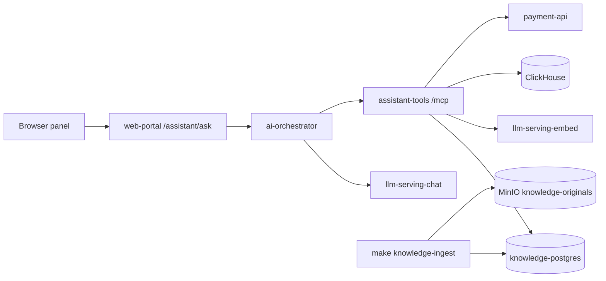

# Runbook: AI operations assistant

- **Severity:** Low
- **Owner:** varunpathania86
- **Last reviewed:** 2026-11-05

Covers the opt-in Stage 10 assistant:

- the [web-portal](../../modules/web-portal/README.md) BFF route
  `POST /assistant/ask` and its React panel
- [ai-orchestrator](../../modules/ai-orchestrator/README.md)
- [assistant-tools](../../modules/assistant-tools/README.md) (MCP)
- [llm-serving](../../modules/llm-serving/README.md)
- [operations-knowledge](../../modules/operations-knowledge/README.md)
  ingestion
- the knowledge PostgreSQL (`data/knowledge-postgres`)

Design: [ADR-029](../adr/ADR-029-ai-operations-assistant.md),
[ADR-030](../adr/ADR-030-assistant-identity-assertions.md).



## Start the lean AI profile

```bash
make dev-up DEV_CONFIG=templates/ai-topology.json   # analytics + ai, no Flink
export MINIKUBE_PROFILE=rpp-a
make knowledge-ingest   # bundle the corpus, embed and load it (first run waits for model download)
make ai-fixtures        # synthetic ClickHouse payment facts and advisory predictions
make ai-eval            # starter evaluation; report in .local/$MINIKUBE_PROFILE/ai-eval/
make dev-access         # then open http://127.0.0.1:8080/analytics
```

Synthetic user passwords are generated by Terraform. Read them with:

```bash
kubectl --context "$MINIKUBE_PROFILE" -n apps get secret web-portal-identity \
  -o jsonpath='{.data.dev-users}' | base64 -d | jq 'map_values(.password)'
```

| User | Assistant behaviour |
|---|---|
| `ops-viewer` | Knowledge (non-restricted) and analytics tools |
| `payments-clerk` | Payment lookup only; knowledge questions are `denied` |
| `ops-engineer` | Everything, including restricted incident documents |

## Symptoms

- The panel shows "The assistant is busy", "timed out" or
  "temporarily unavailable".
- Answers have the `fallback` badge, with no model-generated text.
- Answers cite nothing, or say no relevant documents were found.
- Tool results show `unavailable` or `denied`.
- `make ai-eval` exits nonzero.

## Impact

Only the assistant is affected. The LLM is never in the payment path, and
payments, analytics and dashboards keep running.

## Diagnosis

1. Check that the pods are ready. The first `llm-serving` start downloads about
    1.2 GiB:

    ```bash
    kubectl --context "$MINIKUBE_PROFILE" -n apps get pods -l 'app.kubernetes.io/name in (llm-serving,ai-orchestrator,assistant-tools)'
    kubectl --context "$MINIKUBE_PROFILE" -n apps logs deployment/llm-serving -c fetch-models
    ```

2. Read the audit lines. They contain request IDs, hashes, statuses and
    durations, but never question text or tool results:

    ```bash
    kubectl --context "$MINIKUBE_PROFILE" -n apps logs deployment/ai-orchestrator | tail -20
    kubectl --context "$MINIKUBE_PROFILE" -n apps logs deployment/assistant-tools | tail -20
    kubectl --context "$MINIKUBE_PROFILE" -n apps logs deployment/web-portal | grep assistant_request | tail
    ```

3. Empty retrieval usually means ingestion has not run. Count the indexed
    chunks:

    ```bash
    kubectl --context "$MINIKUBE_PROFILE" -n data exec statefulset/knowledge-postgres -- \
      psql -U rpp_knowledge_admin -d ai_knowledge -c 'SELECT count(*) FROM knowledge_chunks'
    ```

4. Analytics tools returning no rows usually means there are no recent facts.
    Without Flink, run `make ai-fixtures` again; fixtures are relative to the
    current time. `payment_history` reports `unavailable` unless the lakehouse
    is enabled.

5. If you see 401 or `unauthenticated`, compare the verifier key with the
    portal signer. Both come from Terraform:

    ```bash
    kubectl --context "$MINIKUBE_PROFILE" -n apps get secret ai-identity web-portal-assistant-signer
    ```

## Mitigation

- Ingestion failed: inspect `kubectl logs job/<knowledge-ingest-...>`, fix the
  cause, then run `make knowledge-ingest` again. Ingestion is idempotent per
  content hash and chunking version.
- The model is slow or out of memory: requests queue in the portal (two
  concurrent questions maximum, 210-second timeout). Reduce load, or raise the
  `llm-serving` limits in the chart values.
- Fallback demonstration, or keeping the panel alive without the model:

  ```bash
  kubectl --context "$MINIKUBE_PROFILE" -n apps scale deployment/llm-serving --replicas=0
  # ask a question: status "fallback" with extractive, cited text
  kubectl --context "$MINIKUBE_PROFILE" -n apps scale deployment/llm-serving --replicas=1
  ```

  With `llm-serving` scaled to zero, knowledge search uses full-text ranking
  only, and live tools keep working. Fallback answers return in well under a
  second.

## Verification

- `make ai-eval` exits 0. Read
  `.local/$MINIKUBE_PROFILE/ai-eval/report.md` for Recall@5, citation
  correctness, latency and authorization leaks.
- In the browser, `ops-viewer` sees cited answers, and `payments-clerk` is
  denied knowledge questions.
- Reference measurement on 2026-11-05 (4 CPUs, 10 GiB, CPU only): 21/21
  cases, Recall@5 0.9, citation correctness 1.0, latency p50 21 s and p95
  103 s; the node used about 5.4 GiB. First ingestion of 424 chunks took
  about 6 minutes.

## Prevention and follow-up

- HNSW, a reranker and Kafka-driven ingestion stay deferred until measurements
  justify them (ADR-029).
- Stage 11 replaces the portal-signed assertions with Keycloak (ADR-030).
