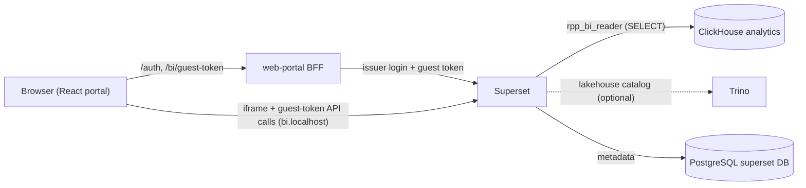

# Runbook: BI dashboards

- **Severity:** Low
- **Owner:** varunpathania86
- **Last reviewed:** 2026-11-05

Covers the opt-in Stage 9 embedded BI:

- [Superset](../../modules/bi-dashboards/README.md)
- the [web-portal](../../modules/web-portal/README.md) BFF, which signs in local
  development users and issues guest tokens
- the ClickHouse and Trino data sources

Design: [ADR-028](../adr/ADR-028-embedded-superset-bi.md).



## Symptoms

- `make bi-verify` fails.
- The portal's **Analytics** page shows an error alert, or the iframe is blank
  or blocked.
- `POST /bi/guest-token` returns 502.
- During `dev-update`, the `bi-dashboards-setup` hook Job or the
  `superset-database-init` Job fails.
- Charts show "No results" or an error.

## Impact

Only the dashboards are affected. Payments, streaming, analytics ingestion and
the lakehouse keep running. Superset holds no payment data of its own. Its
PostgreSQL metadata (charts, dashboard, roles) is rebuilt by the setup Job on
every install or upgrade.

## Diagnosis

1. Select the profile explicitly: `PROFILE=rpp-1` for the multi-cluster topology,
  or `PROFILE=rpp` for the default single cluster.
2. Check the workloads and Jobs:

    ```bash
    kubectl --context "$PROFILE" -n apps get deploy,pod -l 'app.kubernetes.io/name in (bi-dashboards,web-portal)'
    kubectl --context "$PROFILE" -n apps logs deploy/bi-dashboards
    kubectl --context "$PROFILE" -n apps logs job/bi-dashboards-setup  # present only while running or failed
    kubectl --context "$PROFILE" -n data logs job/superset-database-init
    kubectl --context "$PROFILE" -n apps logs deploy/web-portal
    ```

3. Interpret what you find:
    - **Guest-token 502.** The portal logs the Superset step that failed
      (login, CSRF or guest token). Login failures usually mean the issuer
      password in the `bi-dashboards` Secret changed without the setup Job
      running again.
    - **Blocked iframe.** The browser console reports a `frame-ancestors`
      violation when the page origin isn't in the embedded allow-list. Origins
      come from `LOCAL_PORT` at `dev-up`/`dev-update` time
      (`http://localhost:<port>` and `http://127.0.0.1:<port>`). Browse the
      portal on the same port that was deployed.
    - **Setup Job fails importing the Trino database.** `lakehouse-query`
      wasn't reachable. Check it with the [lakehouse runbook](lakehouse.md).
    - **Empty charts.** No data has reached ClickHouse yet. Run
      `make streaming-fixtures MINIKUBE_PROFILE=$PROFILE`, then see the
      [realtime analytics runbook](realtime-analytics.md). Risk charts need
      risk scoring enabled. The Iceberg history chart exists only with the
      lakehouse.

4. Read the generated local credentials. They are synthetic and per profile:

    ```bash
    # Superset admin (bi.localhost, for chart changes and diagnosis only)
    kubectl --context "$PROFILE" -n apps get secret bi-dashboards \
      -o jsonpath='{.data.admin-password}' | base64 -d; echo
    # Portal development users: ops-viewer (bi:view) and payments-clerk (none)
    kubectl --context "$PROFILE" -n apps get secret web-portal-identity \
      -o jsonpath='{.data.dev-users}' | base64 -d | jq
    ```

## Mitigation

- Re-run the setup and restart the pods with `make dev-update`. The bootstrap
  is idempotent: it reapplies roles, permissions, database connections and
  assets that have stable UUIDs.
- If a Secret changed, run `make dev-update` so the setup Job runs again, then
  restart the pods, which read Secrets only at start:
  `kubectl --context "$PROFILE" -n apps rollout restart deploy/bi-dashboards deploy/web-portal`.
- To disable BI, set `"bi": false` in your ignored topology copy and run
  `make dev-update`. The `superset` PostgreSQL database stays; drop it
  manually if you want a clean start.

### Changing or adding a chart

Charts live in
[rpp_bi_assets.py](../../modules/bi-dashboards/superset/rpp_bi_assets.py),
together with their stored query context. Guest requests must match that
stored context, so whenever you change a chart's metrics, columns or ordering:

1. Deploy the change with `make dev-update`. Then open
    `http://bi.localhost:<port>/superset/dashboard/payment-operations/` as the
    admin with the browser developer tools' **Network** tab open.
2. For every `POST /api/v1/chart/data` request, copy `form_data.viz_type` and,
    for each entry in `queries`, the non-null `metrics`, `columns`, `groupby`
    and `orderby` values.
3. In
    [frontend-chart-queries.json](../../modules/bi-dashboards/tests/fixtures/frontend-chart-queries.json),
    store them under the chart's key from `rpp_bi_assets.py`.
4. Run `make -C modules/bi-dashboards test` and
    `make -C modules/bi-dashboards integration`.

## Verification

```bash
make bi-verify MINIKUBE_PROFILE=$PROFILE
```

`make bi-verify` uses a temporary ingress port-forward to run 26 checks:

- Anonymous, wrong-password and foreign-origin requests are rejected.
- `payments-clerk` is denied a guest token.
- `ops-viewer` receives a five-minute token scoped to the single embedded
  dashboard, with no other claims.
- The embedded page refuses foreign referrers and allows only the portal
  origins in CSP `frame-ancestors`.
- Using the CSRF token and session that the embedded page gives every browser,
  the guest token can't list databases or datasets, run SQL Lab, create
  connections, read roles or run ad-hoc chart queries.
- The guest token's dashboard and chart listings stay scoped to the embedded
  dashboard.

To see the dashboard itself, run `make dev-access`, open
`http://localhost:8080/analytics` and sign in as `ops-viewer`. Superset loads
charts below the iframe fold only when you scroll to them. A console 404 for
`/static/service-worker.js` is expected: the pinned image doesn't ship that
optional file.

## Prevention and follow-up

- Stage 11 replaces the local development identity with Keycloak and adds
  Trino authentication.
- Add row-level security only when a concrete tenant boundary exists.
- Keep the Superset pin (`.tool-versions`) and the guest-path hardening in
  step. After an upgrade, re-run `make -C modules/bi-dashboards integration`
  and re-capture the fixture.
