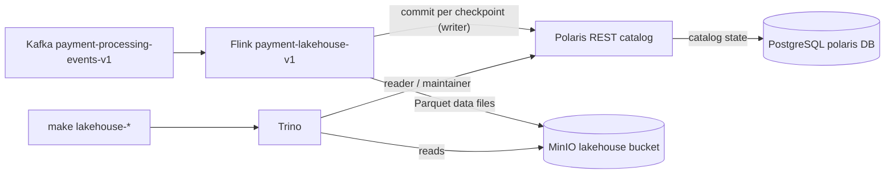

# Runbook: Lakehouse

- **Severity:** Medium
- **Owner:** varunpathania86
- **Last reviewed:** 2026-11-06

Covers the opt-in Stage 8 lakehouse: the
[Polaris catalog](../../modules/lakehouse-catalog/README.md),
[Trino](../../modules/lakehouse-query/README.md) and the Flink
`payment-lakehouse-v1` writer. Design: [ADR-026](../adr/ADR-026-polaris-iceberg-lakehouse.md).



## Symptoms

- `make lakehouse-verify` reports no curated rows, duplicates or a failed
  time-travel/evolution check.
- The Flink `payment-lakehouse-v1` job is missing or restarting, or its
  checkpoints stop completing.
- `lakehouse-catalog` or `lakehouse-query` pods are not ready, or the
  `lakehouse-catalog-setup` hook Job fails during `dev-update`.
- Queries slow down as many small files accumulate.

## Impact

Only the analytical history is affected. Payment processing, PostgreSQL and
the Stage 5–7 streaming jobs keep running; Kafka retains events for
replay. Lakehouse rows appear only after a Flink checkpoint commits, so a
lag of one checkpoint interval is normal, not an incident.

## Diagnosis

1. Select the profile explicitly: `PROFILE=rpp-a` (or your owned profile).
2. Check the workloads and setup hook:

    ```bash
    kubectl --context "$PROFILE" -n apps get deploy,pod -l 'app.kubernetes.io/name in (lakehouse-catalog,lakehouse-query)'
    kubectl --context "$PROFILE" -n apps get job lakehouse-catalog-setup  # present only while running or failed
    kubectl --context "$PROFILE" -n apps logs deploy/lakehouse-catalog -c bootstrap
    kubectl --context "$PROFILE" -n apps logs deploy/lakehouse-catalog
    kubectl --context "$PROFILE" -n data logs job/polaris-database-init
    ```

3. Check both Flink jobs are `RUNNING` and checkpoints complete:

    ```bash
    kubectl --context "$PROFILE" -n apps exec deploy/stream-processor-jobmanager -- \
      curl -fsS http://localhost:8081/jobs/overview
    ```

    `Forbidden` or `NotAuthorized` in TaskManager logs means the writer
    principal lacks a privilege; rerun the setup hook with `make dev-update`
    rather than granting broader rights by hand.
4. Inspect table state through the read-only catalog:

    ```bash
    make lakehouse-query MINIKUBE_PROFILE="$PROFILE" SQL='SELECT committed_at, operation, summary FROM "payment_events$snapshots" ORDER BY committed_at DESC LIMIT 5'
    make lakehouse-query MINIKUBE_PROFILE="$PROFILE" SQL='SELECT count(*) AS files, sum(file_size_in_bytes) AS bytes FROM "payment_events$files"'
    ```

## Mitigation

- **Trino table browsing fails with `Failed to list views`:** inspect Polaris
  logs for HTTP 403 on `/namespaces/payments/views`. Trino `SHOW TABLES`
  enumerates views too, requiring `VIEW_LIST` even when none exist. The
  catalog setup grants that read-only listing privilege; rerun the upgraded
  setup hook, not an administrator connection. For single-cluster development,
  use `make run-local MINIKUBE_PROFILE="$PROFILE"` with your memory override;
  for three-cluster development use `make dev-update`.
- **Setup or bootstrap failed:** fix the cause shown in the logs (usually
  PostgreSQL or MinIO not ready), then `make dev-update`. Both the bootstrap
  and the setup script are idempotent.
- **Too many small files:** run maintenance (below). One checkpoint commit
  per minute per table creates many small files.
- **Writer stuck after a Polaris outage:** Flink restarts from its last
  checkpoint; uncommitted files from failed checkpoints become orphans that
  `remove_orphan_files` deletes after the retention period.
- **Lost PostgreSQL `polaris` database but kept MinIO:** tables are
  unreachable. Do not hand-edit metadata. Recreate the profile, or register
  the latest `metadata.json` through an explicit, reviewed Polaris
  `register table` call.

### Table maintenance

```bash
make lakehouse-maintain MINIKUBE_PROFILE="$PROFILE"
```

It runs `optimize` (compact files under 32 MB), `expire_snapshots` and
`remove_orphan_files` with a 7-day retention through `lakehouse_admin`.
`LAKEHOUSE_RETENTION=1h` lowers the Trino minimum only for that session, and
only in disposable development profiles: it removes time-travel history.

### Schema and partition evolution

Use `lakehouse_admin` explicitly. The Flink writer inserts with an explicit
column list, so adding a nullable column or changing partitioning does not
stop the running job; new columns stay `NULL` until the job writes them.
Never drop or rename a column that the writer still inserts.
`make lakehouse-verify` exercises both on a disposable `evolution_check` table.

### Upgrades and lakehouse toggling

Enabling or disabling the lakehouse changes the Flink session cluster and
restarts it. Stop with savepoints first:

```bash
make streaming-stop MINIKUBE_PROFILE="$PROFILE"
```

The first output line is the payment-job savepoint URI. If the lakehouse job
was running, a second line `LAKEHOUSE_RESTORE_PATH=<uri>` follows. Export both
before `dev-update`:

```bash
STREAMING_RESTORE_PATH=<first line> LAKEHOUSE_RESTORE_PATH=<uri> make dev-update
```

## Verification

```bash
make streaming-fixtures MINIKUBE_PROFILE="$PROFILE"
make lakehouse-verify MINIKUBE_PROFILE="$PROFILE"
```

Expected: non-zero bronze and curated counts with bronze at least curated,
zero duplicate `event_id`, time travel to the first snapshot, `Access
Denied` for `CREATE` through the reader catalog, and the scratch evolution
check passing. Verification takes up to one checkpoint interval plus query
time.

## Prevention and follow-up

- Run maintenance regularly in long-running profiles.
- Keep PostgreSQL and MinIO volumes together; they are one recovery unit.
- Keep Trino ad-hoc queries on `lakehouse`; reserve `lakehouse_admin` for
  reviewed changes.
