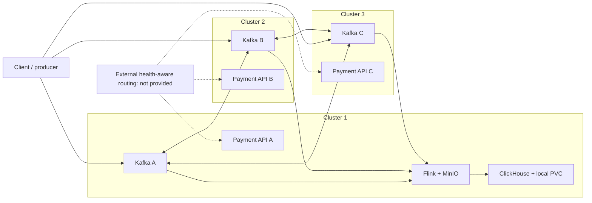

# Runbook: Realtime analytics (ClickHouse)

- **Severity:** Medium
- **Owner:** varunpathania86
- **Last reviewed:** 2026-11-04

## Symptoms

ClickHouse is not ready, the Flink job repeatedly restarts, inserts fail, or
analytical queries return duplicate fact/revision rows.

## Impact

The optional analytics path may lag or stop checkpoint progress. PostgreSQL
payment processing remains the transactional source of truth.

## Diagnosis

1. Select the profile explicitly: `PROFILE=rpp-1` for the multi-cluster topology,
    or `PROFILE=rpp` for the default single cluster, and use `kubectl --context "$PROFILE"`.
2. Check workload, service and PVC status:

    ```bash
    kubectl --context "$PROFILE" -n apps get statefulset,pod,service,pvc
    kubectl --context "$PROFILE" -n apps logs statefulset/realtime-analytics
    ```

3. Check Flink task logs for `ClickHouse insert failed` and inspect Flink's
    completed-checkpoint age at the JobManager REST API.
    `ModuleNotFoundError: No module named 'analytics'` means the submission
    package is incomplete: both `processing.py` and `analytics.py` must be
    included in the comma-separated `--pyFiles` argument. A healthy pod or an
    initial empty checkpoint alone does not verify the record-processing path.
4. If the PVC is `Pending`, inspect the profile's default StorageClass and
    available node disk. Do not remove the PVC to make the symptom disappear.

## Mitigation

Restore ClickHouse readiness, credentials or profile storage first. Sink
inserts are authenticated with a profile-generated Kubernetes Secret. Do not
copy its password into source control, logs or issue reports. If credentials
must be replaced, use a reviewed Terraform plan and keep the secret and server
configuration synchronized.

The StatefulSet owns one local PVC. It is not replicated or backed up. Do not
run `make dev-clean` or disable analytics if its local data must be retained.

## Verification

1. Confirm the pod and service are ready and `/ping` succeeds.
2. Confirm Flink completes a new checkpoint and the synthetic input resumes.
3. Query with replacement semantics while background merges may be pending:

    ```sql
    SELECT event_id, count()
    FROM analytics.payment_facts FINAL
    GROUP BY event_id
    HAVING count() > 1;
    ```

    The query should return no duplicate logical event IDs.
4. If investigating performance, follow the
    [benchmark procedures](../../tests/benchmarks/README.md). Historical query
    and pipeline results live there, not in this operational runbook.

## Prevention and follow-up

Monitor ClickHouse disk use, active parts, insert errors and Flink checkpoint
age. Detailed payment facts expire after 90 days. Window revisions have no TTL
in this local stage. Export data before deleting a profile or its PVC.

## Three-cluster resources and failure boundaries

The compact benchmark template allocates node caps, not per-container limits:

| Cluster | Node CPU / RAM | Workloads |
|---|---|---|
| A | 4 CPUs / 6144 MiB | Payment stack, Kafka broker/controller, CNPG writer initially, plus Flink JobManager/TaskManager, MinIO and ClickHouse |
| B | 2 CPUs / 3072 MiB | Payment stack, Kafka broker/controller and CNPG remote standby initially |
| C | 2 CPUs / 3072 MiB | Payment stack, Kafka broker/controller and CNPG remote standby initially |

This is a low-load test allocation, not measured capacity. There is one shared
Kafka cluster across the three Kubernetes clusters. There are not three
independently running analytics pipelines.

Application container requests/limits come from module chart values:
[Flink](../../modules/stream-processor/chart/values.yaml),
[ClickHouse](../../modules/realtime-analytics/chart/values.yaml),
[payment API/workers](../../modules/payment-api/chart/values.yaml) and
[portal](../../modules/web-portal/chart/values.yaml).
Infrastructure budgets are in the
[Kafka Terraform module](../../platform/terraform/modules/kafka-broker/main.tf),
[CNPG chart](../../platform/terraform/modules/cnpg/chart/templates/cluster.yaml),
and [local streaming resources](../../platform/terraform/environments/local/streaming.tf).
Requests guide scheduling; limits constrain containers. Node caps do not
automatically increase container allocations, and Kubernetes Services do not
have application CPU/RAM limits.



| Failure | Current behavior | Boundary |
|---|---|---|
| Application pod exits | Its controller recreates it in the same Kubernetes cluster; a Service uses other ready endpoints in that cluster if present | A single replica has a recovery gap; no automatic move to another cluster |
| Service has no ready endpoints or incorrect configuration | Calls fail until endpoints/configuration recover | A Service is a network abstraction, not a process Kubernetes can restart; it does not discover another cluster's Service |
| One Kafka broker/cluster fails | Kafka clients can discover surviving brokers and leaders; replication factor 3 and minimum ISR 2 can tolerate one unavailable replica when the remaining replicas are in sync and controller quorum remains | Cross-server networking, TLS identity, advertised addresses and quorum must remain valid; two failures can prevent writes |
| PostgreSQL standby cluster fails | The writer can continue with the other healthy synchronous standby | The configured required synchronous acknowledgement must still be satisfied |
| PostgreSQL writer cluster fails | Use the existing explicit fencing and reviewed database failover workflow | No automatic writer promotion; never allow two unfenced writers |
| Cluster 2 or C fails | A's analytics can continue if Kafka quorum/ISR and required database dependencies remain healthy | Payment traffic sent to the failed ingress does not automatically move elsewhere |
| Cluster 1 fails | Flink, MinIO and ClickHouse become unavailable; surviving Kafka can retain input within configured retention and disk capacity | No Flink JobManager HA or ClickHouse replication in this stage; local PVCs do not move to 2/3 |
| ClickHouse becomes unavailable | Synchronous inserts fail, Flink recovery/backpressure occurs and input backlog can grow | Kafka buffering is finite; this is not uninterrupted analytics availability |

On separate servers, these are independent failure domains only if the servers,
storage and networking are genuinely independent. The local adapter's shared
Docker network and node addresses are **not** a ready-to-use multi-server
deployment. Such deployment needs routable private addresses, authenticated/
encrypted inter-server connectivity, reachable Kafka advertised endpoints and
PostgreSQL replication endpoints. Client traffic also needs external,
health-aware ingress routing; the repository does not currently implement that
cross-server routing layer.

Adding automatic cross-cluster application failover, Flink HA, replicated
ClickHouse or independent checkpoint storage is a separate architecture change,
not something enabled by setting a node resource budget. The bounded benchmark
does not stop clusters or certify these failure scenarios.

## Performance investigation references

Use the [benchmark index](../../tests/benchmarks/README.md) for goals, targets,
measured results, raw JSON and ordered setup/cleanup commands. Preserve node
minimums and host safety reserves when investigating constrained environments.
Do not delete data-bearing PVCs or relax delivery semantics to make a benchmark
pass. A fast query over stored rows does not prove a healthy ingestion path.
