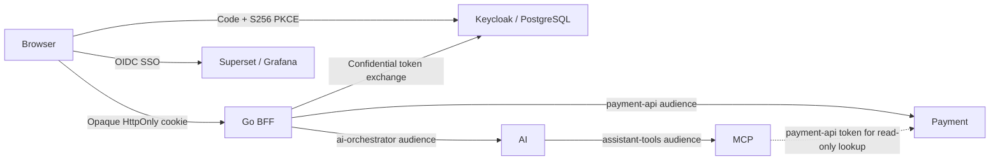

# Runbook: Unified Keycloak identity

- **Severity:** Medium
- **Owner:** Platform maintainer
- **Last reviewed:** 2026-11-07

## Symptoms

Login fails, an existing realm retains outdated clients or roles, a resource
rejects a token, or a rotated signing key is not accepted.

## Impact

Configured identity always fails closed. React holds only an opaque session
cookie; payment and AI APIs reject invalid or incorrectly addressed tokens.
The identity-disabled development login is not a fallback for a broken provider.



## Diagnosis

1. Check the explicitly selected profile, not the current kubectl context:

    ```bash
    kubectl --context rpp -n security get pods
    kubectl --context rpp -n apps get pods
    kubectl --context rpp -n telemetry get pods
    ```

2. Check `/auth/config`: `oidc: true` means the password-based portal login is
    disabled. `/auth/login` is a GET redirect, not a JSON password POST.
    Loopback aliases redirect to the registered portal origin before the
    transaction cookie is created; continue browsing on that canonical host.
3. Confirm public issuer/origins match the access port. Internal token/JWKS
    endpoints use cluster DNS, but token `iss` remains the public realm URL.
    Never disable issuer, signature, expiry, audience or resource-role checks.
4. Do not log OAuth codes, tokens, client secrets or synthetic passwords.

## Mitigation

Startup import intentionally does not overwrite existing realms. Reconcile
the managed settings, clients, resource roles, groups and users explicitly:

```bash
# Terminal 1: administrative paths are exposed only on loopback.
make identity-access
# Terminal 2: repeatable; existing human passwords are never reset.
make identity-sync
```

New users receive the profile-specific initial password from the identity
Secret. Existing passwords survive reconciliation; that Secret is not a
password-recovery mechanism. Only declared application roles are reconciled;
unrelated users/clients are not deleted. Argo CD stays disabled and is not
deployed. DBX retains its separate development password.

The BFF stores tokens in bounded process memory, using one replica. Restarting
it revokes its sessions. Failed refresh or verification also removes a session.
Logout removes the local cookie/session before attempting provider revocation;
a provider error is reported rather than silently claiming successful logout.

## Verification

```bash
make ci
make identity-verify
make security
```

The live check uses its own automatically assigned loopback forwards. It
reconciles twice, signs one viewer into React, Superset, Grafana and the
assistant, verifies independent API write/audience denials, rotates an RSA
signer while retaining the old key, checks genuine token expiry, and logs out.
Only the check's additional signing component is removed; its token-lifetime
override is restored. It does not stop or destroy the profile or replace
browser/DBX/MinIO forwarding.

## Prevention and follow-up

Treat realm JSON changes as upgrades requiring `identity-sync`, not restarts.
Keep access tokens at five minutes, PKCE S256 enabled and direct password grants
disabled for all application clients. Signing keys use RS256 and JWKS; unknown
Python keys trigger at most one refresh per five seconds with five-second
HTTP connect/read timeouts. The standard Go OIDC library refreshes unknown
keys with a five-second network deadline and coalesces concurrent refreshes.

Single-profile Stage 11 reuses the shared observability chart for Grafana only;
it does not install the later GitOps/Argo CD system or a second telemetry stack.
Grafana's provisioned data sources need the separately enabled observability
backends to supply data. Multi-replica durable BFF sessions remain future work.
