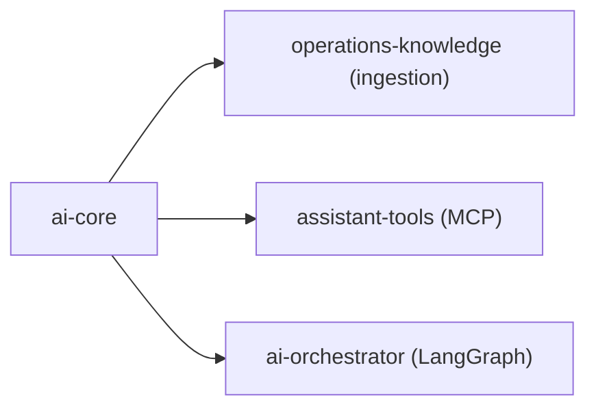

# ai-core

Shared Python library for the Stage 10 AI operations assistant. Part of
[realtime-payment-platform](../../README.md); catalogued in
[solution.yaml](../../solution.yaml) as a `library` module.

It is not deployed by itself. The
[operations-knowledge](../operations-knowledge/README.md),
[assistant-tools](../assistant-tools/README.md) and
[ai-orchestrator](../ai-orchestrator/README.md) images copy it through a named
Docker build context
([ADR-031](../../docs/adr/ADR-031-catalog-dependency-build-contexts.md)).

| File | Purpose |
|---|---|
| [identity.py](src/ai_core/identity.py) | Verifies Keycloak RS256 JWTs with issuer, resource audience, expiry, scope and per-resource roles; bounded JWKS refresh supports rotation. Portal Ed25519 assertions are only an identity-disabled development compatibility path ([ADR-032](../../docs/adr/ADR-032-keycloak-identity-and-bff.md)) |
| [retrieval.py](src/ai_core/retrieval.py) | Hybrid search: exact pgvector cosine plus PostgreSQL full-text, fused with Reciprocal Rank Fusion. Permission, classification, tenant, version and quarantine filters run in SQL. Without an embedding it ranks by text only |
| [embeddings.py](src/ai_core/embeddings.py) | LangChain `Embeddings` adapter for the llama.cpp embeddings endpoint (nomic-embed-text v1.5, 768 dimensions) |
| [safety.py](src/ai_core/safety.py) | Deterministic redaction (secrets, tokens, private keys, Luhn-valid card numbers), prompt-injection signals and citation verification |
| [sql/knowledge.sql](src/ai_core/sql/knowledge.sql) | Idempotent knowledge schema, created by the ingestion job; grants SELECT to `rpp_knowledge_reader` |
| [requirements.txt](requirements.txt) | The shared, fully pinned AI runtime lock for every Python AI module |
| [runtime.Dockerfile](runtime.Dockerfile) | Check container built by `scripts/ai-python.sh`, using the same `ai-python` pin as the module images |



Authorization is deterministic code. It never runs inside LangChain or
LangGraph, and the model never grants or infers permissions.

## Development

Checks run in the pinned AI runtime container
([developer setup](../../docs/developer-setup.md)):

```bash
make -C modules/ai-core lint test   # imports, unit tests and the pgvector integration check
```
