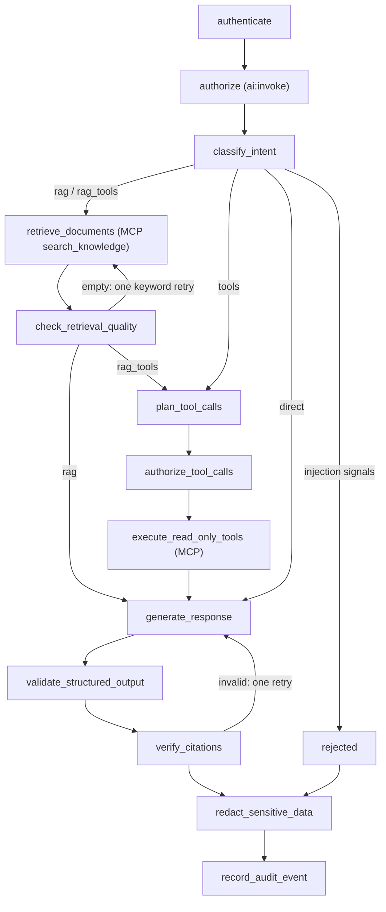

# ai-orchestrator

Stage 10 AI operations assistant API: FastAPI plus a
[LangGraph](https://langchain-ai.github.io/langgraph/) graph that answers
operator questions with cited platform knowledge and live read-only data. Part
of [realtime-payment-platform](../../README.md); catalogued in
[solution.yaml](../../solution.yaml).

The LLM is advisory. It never sits in the payment path, never grants
permissions and never makes authorization or numeric decisions. The graph never
touches a database; every document and data row comes through the
[assistant-tools](../assistant-tools/README.md) MCP server.



## API

`POST /v1/assistant/ask` with `{"question": "..."}` (1–1000 characters).

| Header | Purpose |
|---|---|
| `Authorization: Bearer <assertion>` | Ed25519 assertion for audience `ai-orchestrator`, minted by the web-portal BFF |
| `X-Assistant-Tools-Assertion` | Assertion for audience `assistant-tools`; same subject and tenant; relayed to MCP |
| `X-Request-ID` | Optional correlation ID, forwarded to MCP and written to audit logs |

The response has `status` (`answered`, `fallback`, `denied` or `rejected`),
`answer`, `intent`, `citations` (`id`, `document_id`, `heading`,
`source_uri`), `retrieved` document IDs, `tools` (`name`, `status`),
`request_id`, `latency_ms` and `model`. Invalid or mismatched assertions return
HTTP 401 with `status: unauthenticated`.

## Safety design

- Assertions are verified in FastAPI before the graph runs. Permission checks
  are set lookups in code, before retrieval and before every tool call; the
  MCP server checks them again.
- The relayed tools assertion is passed in the LangGraph run config, never in
  graph state, and no checkpointer stores state.
- Questions matching injection patterns are rejected before the model. Retrieved
  chunks that carry instructions (indirect injection) are dropped before
  generation.
- The model proposes intent and tools through a JSON schema; code restricts the
  proposal to the MCP allowlist and derives every tool argument from the
  question within fixed bounds.
- Answers use grammar-constrained JSON whose `sources` can only name labels of
  retrieved chunks; citations are verified, with one retry before an extractive
  fallback.
- When the model is unavailable, keyword routing and extractive answers keep
  the assistant useful (`status: fallback`).
- Answers are redacted. Audit lines contain a question hash and length, not the
  question text.

See the [Helm chart guide](chart/README.md) for Kubernetes resources and the
[AI assistant runbook](../../docs/runbooks/ai-assistant.md) for operations.

## Development

```bash
make -C modules/ai-orchestrator lint test   # import, chart contract, graph, routing, API and MCP client tests
```
