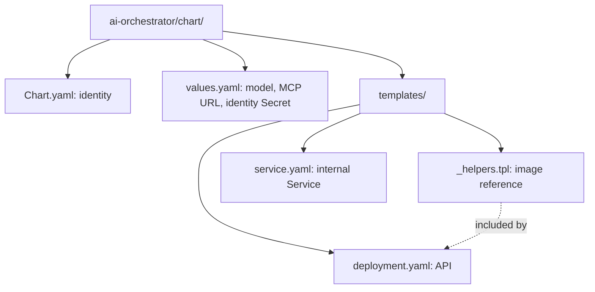
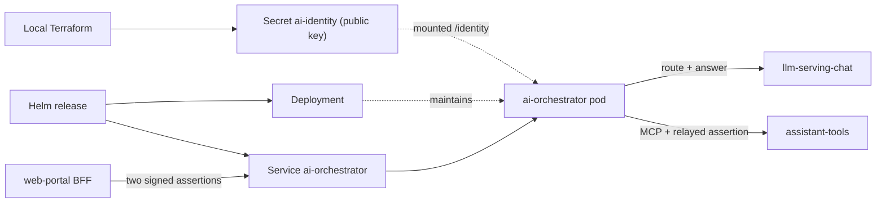

# ai-orchestrator Helm chart

Deploys the Stage 10 assistant API (FastAPI + LangGraph). Part of
[realtime-payment-platform](../../../README.md).

## Responsibilities

Local [Terraform](../../../platform/terraform/environments/local/main.tf)
installs this chart in `apps` only when the AI feature is enabled
(`local.feature: ai`). For Make, Terraform, Helm and Kubernetes context see the
[local platform guide](../../../docs/architecture/local-platform-guide.md).

## Layout

File layout (the next diagram shows how the installed resources connect):

| File | Creates | Used by / uses |
|---|---|---|
| [_helpers.tpl](templates/_helpers.tpl) | Nothing (shared snippet) | Digest-pinned or local image reference |
| [deployment.yaml](templates/deployment.yaml) | Deployment running the API on 8080 | Mounts the identity public key; `/healthz` probes; no database credentials |
| [service.yaml](templates/service.yaml) | `ai-orchestrator` ClusterIP Service on 8080 | web-portal BFF calls `POST /v1/assistant/ask` |
| [values.yaml](values.yaml) | Default Helm inputs | Model URL and alias, MCP URL, identity Secret, resources |
| [Chart.yaml](Chart.yaml) | Chart metadata | Helm rendering and packaging |

## Prerequisites

Use [developer setup](../../../docs/developer-setup.md) and the
[API chart glossary](../../payment-api/chart/README.md#configuration) for
Kubernetes terms and Helm syntax.

## Configuration

| Value | Purpose |
|---|---|
| `assertionVerifier.existingSecret`, `assertionVerifier.publicKeyKey` | Ed25519 public key that verifies both portal-signed assertions |
| `llm.chatUrl`, `llm.model` | llama.cpp OpenAI-compatible endpoint and served alias; empty URL forces the fallback path |
| `assistantTools.url` | Platform MCP endpoint; the only path to knowledge and live data |
| `resources` | CPU and memory |

The Service has no Ingress. The React panel reaches the API through the
portal's ingress and its `/assistant/ask` BFF route, which mints the assertions.
