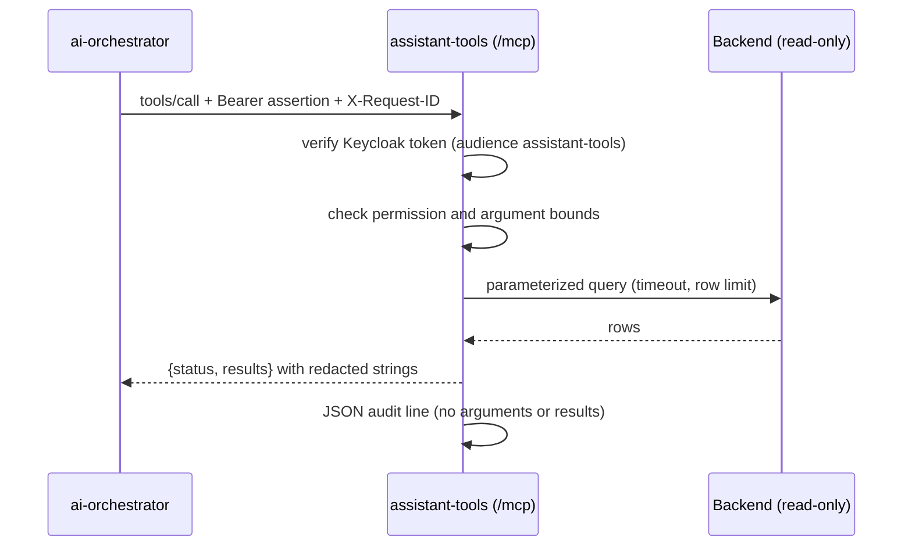

# assistant-tools

Read-only [Model Context Protocol](https://modelcontextprotocol.io) (MCP)
server for the Stage 10 AI operations assistant. Part of
[realtime-payment-platform](../../README.md); catalogued in
[solution.yaml](../../solution.yaml).

The orchestrator's graph never touches a database. All data access goes
through these tools, and each tool checks the caller's permissions again.

Stage 11 validates Keycloak RS256 signature, issuer, `assistant-tools`
audience, expiry, `openid` scope and this resource's own client roles.
`get_payment` additionally verifies the same-subject `payment-api` token
relayed by the BFF/orchestrator and forwards it to the independently protected
payment API. Tokens live only in request-local context, never model input,
tool results or audit logs. The development Ed25519 issuer remains available
only with OIDC unconfigured.

| Tool | Permission | Backend | Bounds |
|---|---|---|---|
| `search_knowledge` | `knowledge:read` (restricted documents need `knowledge:restricted`) | knowledge PostgreSQL + pgvector, query embeddings from llm-serving | query 3–500 characters, 1–8 results |
| `get_payment` | `payments:read` | payment-api `GET /payments/{id}` | UUID only; returns the last 4 characters of the account ID |
| `payment_metrics` | `analytics:read` | ClickHouse `payment_facts` | window 5–1440 minutes, allowlisted grouping |
| `risk_model_summary` | `analytics:read` | ClickHouse `payment_risk_predictions` | window 5–10080 minutes |
| `payment_history` | `analytics:read` | Trino `lakehouse.payments.payment_events` (optional) | 1–30 days, allowlisted grouping |



- Every result carries a `status`: `ok`, `denied`, `invalid`, `not_found`,
  `unavailable` or `unauthenticated`.
- SQL uses typed parameters or allowlisted identifiers; ClickHouse queries run
  as a `readonly = 2` user with execution-time and row limits.
- Audit lines log the tool, request ID, subject, tenant, an assertion hash,
  status and duration. Arguments and results are never logged.
- The image reuses the shared [ai-core](../ai-core/README.md) library through a
  dependency build context.

See the [Helm chart guide](chart/README.md) for Kubernetes resources and the
[AI assistant runbook](../../docs/runbooks/ai-assistant.md) for operations.

## Development

```bash
make -C modules/assistant-tools lint test   # import, chart contract, unit and MCP round-trip tests
```
