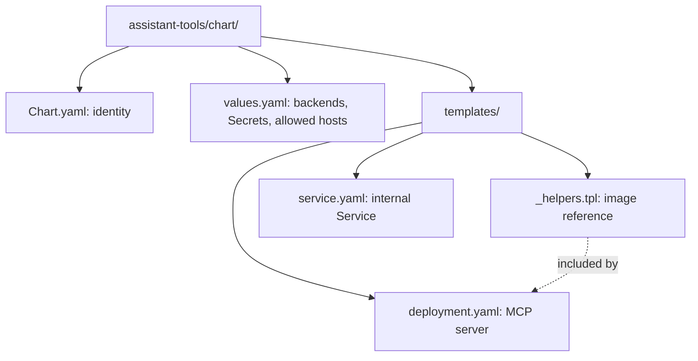
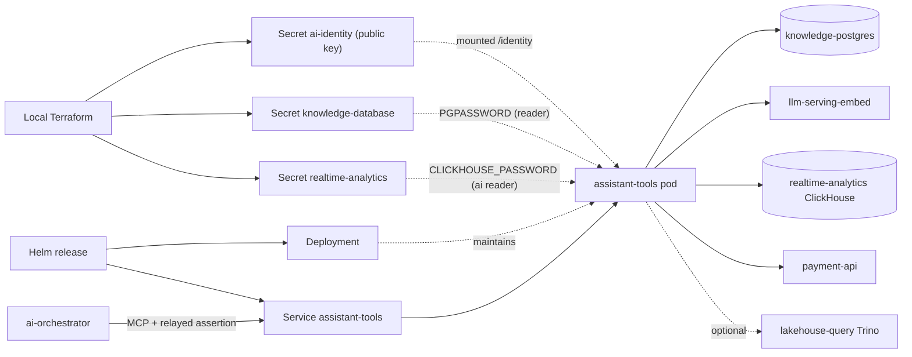

# assistant-tools Helm chart

Deploys the cluster-internal platform MCP server used by the Stage 10 AI
assistant. Part of [realtime-payment-platform](../../../README.md).

## Responsibilities

Local [Terraform](../../../platform/terraform/environments/local/main.tf)
installs this chart in `apps` only when the AI feature is enabled
(`local.feature: ai`). For Make, Terraform, Helm and Kubernetes context see the
[local platform guide](../../../docs/architecture/local-platform-guide.md).

## Layout

File layout (the next diagram shows how the installed resources connect):

| File | Creates | Used by / uses |
|---|---|---|
| [_helpers.tpl](templates/_helpers.tpl) | Nothing (shared snippet) | Digest-pinned or local image reference |
| [deployment.yaml](templates/deployment.yaml) | Deployment running the MCP server on 8080 | Mounts the identity public key; reads reader passwords from Secrets; `/healthz` probes |
| [service.yaml](templates/service.yaml) | `assistant-tools` ClusterIP Service on 8080 | ai-orchestrator calls `http://assistant-tools:8080/mcp` |
| [values.yaml](values.yaml) | Default Helm inputs | Backend URLs, reader users, Secret names and keys, allowed hosts, resources |
| [Chart.yaml](Chart.yaml) | Chart metadata | Helm rendering and packaging |

## Prerequisites

Use [developer setup](../../../docs/developer-setup.md) and the
[API chart glossary](../../payment-api/chart/README.md#configuration) for
Kubernetes terms and Helm syntax.

## Configuration

| Value | Purpose |
|---|---|
| `assertionVerifier.existingSecret`, `assertionVerifier.publicKeyKey` | Ed25519 public key that verifies portal-signed assertions |
| `allowedHosts` | `Host` headers accepted by the MCP transport (DNS-rebinding protection) |
| `knowledgeDatabase.*` | Knowledge PostgreSQL reader; the password stays in `PGPASSWORD`, never in the DSN |
| `clickhouse.*` | `readonly = 2` ClickHouse user created by the realtime-analytics `aiReader` |
| `paymentApi.url`, `embeddings.url` | Read-only payment lookups and query embeddings |
| `trino.url` | Optional lakehouse history; empty makes `payment_history` report `unavailable` |
| `resources` | CPU and memory |

`join "," .Values.allowedHosts` turns the list into the comma-separated
`ALLOWED_HOSTS` variable. The Service has no Ingress: only in-cluster callers
reach the MCP endpoint, and every tool re-verifies the caller's assertion.
