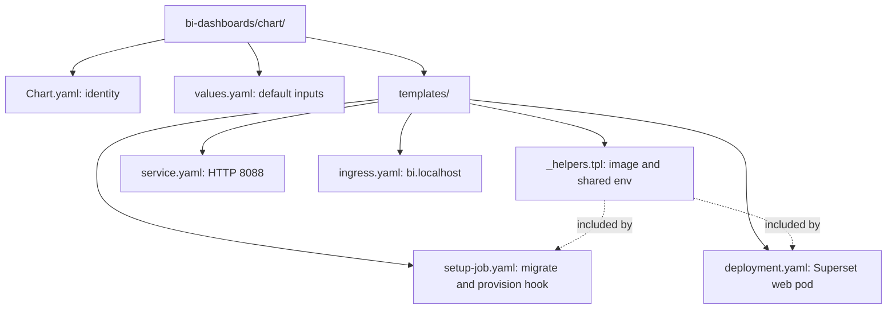
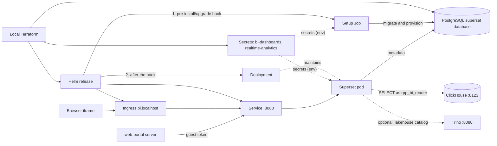

# BI dashboards Helm chart

Deploys one Superset web server and a setup hook that migrates and provisions
its metadata database. Part of [realtime-payment-platform](../../../README.md).

## Responsibilities

Local [Terraform](../../../platform/terraform/environments/local/bi.tf)
installs this chart in `apps` only when BI is enabled. It does so after the
realtime-analytics release (and lakehouse-query when the lakehouse is
enabled), the generated `bi-dashboards` Secret and the `superset` metadata
database. For Make, Terraform, Helm and Kubernetes context see the
[local platform guide](../../../docs/architecture/local-platform-guide.md).

## Layout

File layout (the next diagram shows how the installed resources connect):



| File | Creates | Used by / uses |
|---|---|---|
| [_helpers.tpl](templates/_helpers.tpl) | Nothing (shared snippets) | Image reference and the environment both containers need |
| [setup-job.yaml](templates/setup-job.yaml) | `pre-install,pre-upgrade` hook Job | Runs `superset db upgrade`, `superset init` and `rpp_bi_bootstrap.py`; reads both Secrets |
| [deployment.yaml](templates/deployment.yaml) | One-replica Deployment | Superset web server; fails rendering if `replicaCount` is not 1 |
| [service.yaml](templates/service.yaml) | Internal Service on 8088 | Web portal's guest-token endpoint; Ingress backend |
| [ingress.yaml](templates/ingress.yaml) | Traefik Ingress for `bi.localhost` | Browser iframe and admin UI |
| [values.yaml](values.yaml) | Default Helm inputs | Database, users, data sources, embed origins and resources |
| [Chart.yaml](Chart.yaml) | Chart metadata | Helm rendering and packaging |



## Prerequisites

Use [developer setup](../../../docs/developer-setup.md) and the
[API chart glossary](../../payment-api/chart/README.md#configuration) for
Kubernetes terms and Helm syntax. Requires the
[realtime-analytics chart](../../realtime-analytics/chart/README.md) with
`biReader.enabled=true`.

## Quick start

From the repository root:

```bash
make -C modules/bi-dashboards test lint
make dev-up MULTI_CLUSTER=3 DEV_CONFIG=templates/bi-topology.json
```

## Configuration

The setup Job is a Helm hook because `helm --wait` runs post-install hooks
only after the Deployment is ready, and Superset cannot become ready against
an unmigrated database. The hook's delete policy removes it after success and
before the next run. Its logs remain until then, which helps debug failed
upgrades.

`{{ fail ... }}` in `deployment.yaml` refuses extra replicas, because there is
no shared cache or rate-limit store. `{{ join " " .Values.embed.origins }}`
turns the origin list into the space-separated `SUPERSET_EMBED_ORIGINS`
value. Both pods run read-only as UID 1000, with `emptyDir` volumes for
`/app/superset_home` and `/tmp`.

## Documentation

- [Module guide](../README.md)
- [BI dashboards runbook](../../../docs/runbooks/bi-dashboards.md)
