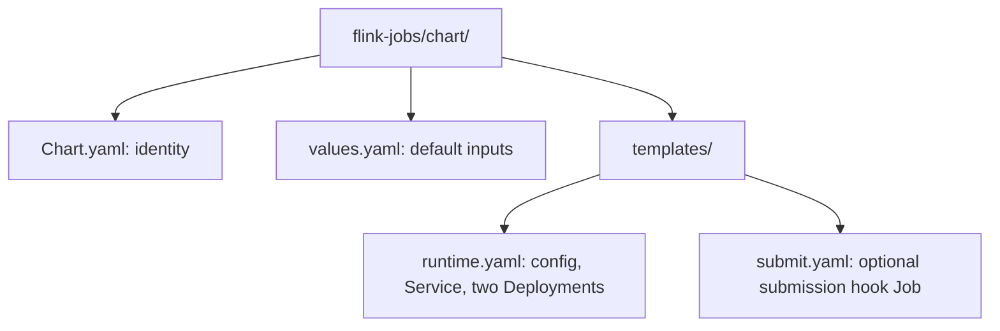
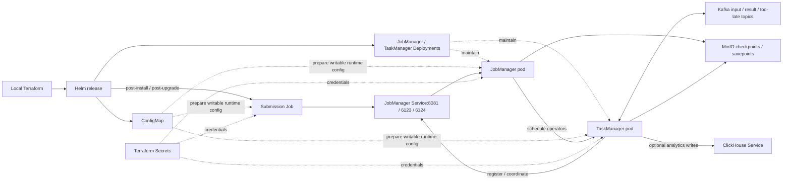

# Flink jobs Helm chart

Deploys the opt-in session cluster and submits the payment processing job.
Part of [realtime-payment-platform](../../../README.md).

## Responsibilities

Local [Terraform](../../../platform/terraform/environments/local/main.tf)
selects this chart only for streaming and installs it in `apps`.
The **JobManager** coordinates the job; the **TaskManager** runs its operators.
Terraform separately provides Kafka, MinIO and Secrets, plus optional ClickHouse.

## Layout

File layout (one template can render several Kubernetes resources):



| File | Creates | Used by / uses |
|---|---|---|
| [runtime.yaml](templates/runtime.yaml) | ConfigMap, JobManager Service, two Deployments | JobManager/TaskManager and submission Job share configuration; Service selects JobManager only |
| [submit.yaml](templates/submit.yaml) | One-off submission Job, only with `streaming.enabled` | Calls the JobManager via the Service; uses ConfigMap, Kafka/MinIO Secrets |
| [values.yaml](values.yaml) | Default Helm inputs | Defines checkpoint/savepoint locations, resource budgets and optional analytics |
| [Chart.yaml](Chart.yaml) | Chart metadata | Helm rendering and packaging |



## Prerequisites

### Opt-in low-memory runtime

`runtimeProfile: low-memory` selects coordinated Flink process and container
budgets from `lowMemory` in [values.yaml](values.yaml). The ordinary
`standard` profile remains unchanged:

| Role | Standard process / container limit | Low-memory process / container limit |
|---|---|---|
| JobManager | 1024m / 1280Mi | 768m / 1024Mi |
| TaskManager | 2048m / 2560Mi | 1280m / 2048Mi |

Process budgets are not container limits: Python workers and other native
allocations need headroom. The low-memory TaskManager request is 1280Mi;
the JobManager request stays 768Mi. CPU budgets, checkpoint intervals and
parallelism are unchanged. Invalid profile names fail Helm rendering.

The topology input `runtime_profile` flows through the multi-cluster script
into local Terraform and this chart's `runtimeProfile` value. Select
[analytics-low-memory-topology.json](../../../templates/analytics-low-memory-topology.json)
with `DEV_CONFIG` only after the benchmark memory preflight passes. This
profile does not lower node minimums, ClickHouse limits or host safety reserves.
It is a measured development option, not a certified throughput improvement;
see the [measured limits](../../../tests/benchmarks/pipeline/2026-11-04-low-memory.md).

Use the [streaming developer guide](../../../docs/developer-setup.md) and the
[API chart glossary](../../payment-api/chart/README.md#configuration) for
Kubernetes terms and Helm syntax.

## Quick start

From the repository root:

```bash
make dev-up DEV_CONFIG=templates/streaming-topology.json
make streaming-fixtures
make streaming-inspect
```

To include ClickHouse, use the analytics topology instead. Ordinary payment-only
development does not install this optional chart.

## Configuration

Default `streaming.enabled: false` renders the Deployments with zero replicas
and omits submission. Enabled local streaming runs one pod per role in cluster A.
The roles use `Recreate`, not rolling replacement. Configuration checksums
trigger pod replacement when the shared ConfigMap changes.

The `configuration` init container runs `runtime.py prepare` to copy configuration
into a writable `emptyDir`; the main containers retain read-only root filesystems.
`emptyDir` disappears with its pod. Durable recovery state is instead stored in
MinIO, outside this chart, at the configured S3 URIs.

A **Helm hook** is a Job Helm runs at a lifecycle event. The submission hook runs
after install/upgrade, uses `runtime.py submit`, and reports success only after
a completed durable checkpoint. Successful hook Jobs are deleted; failures
remain available for diagnosis until the next run. This is distinct from
Flink's own restart/checkpoint recovery.

The Service's HTTP port is for submission/status, RPC for coordination and blob
port for job artifacts. TaskManager health probes check its own RPC port 6122;
there is no TaskManager Service in this chart.

`analytics.enabled` wires optional ClickHouse writes; it does not install
ClickHouse itself. Flink checkpoints do not make ClickHouse and Kafka writes
one cross-system transaction.

## Documentation

- [Module guide](../README.md)
- [Recovery runbook](../../../docs/runbooks/flink-recovery.md)
- [ClickHouse chart](../../clickhouse-analytics/chart/README.md)
