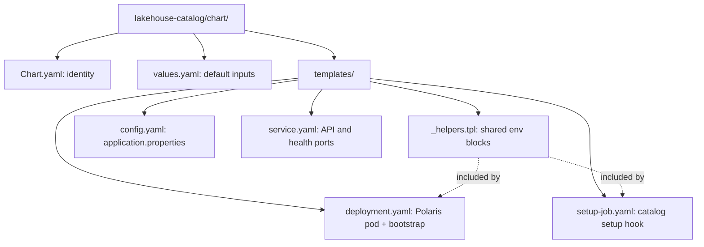
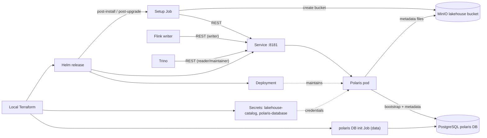

# Lakehouse catalog Helm chart

Deploys one Apache Polaris catalog server and converges its catalog, tables
and least-privilege principals. Part of
[realtime-payment-platform](../../../README.md).

## Responsibilities

Local [Terraform](../../../platform/terraform/environments/local/lakehouse.tf)
installs this chart in `apps` only when the lakehouse is enabled. It first
creates the `polaris` PostgreSQL role/database (a one-off Job in `data`) and
the generated credential Secrets. Flink and Trino releases wait for this one.
For Make, Terraform, Helm and Kubernetes context see the
[local platform guide](../../../docs/architecture/local-platform-guide.md).

## Layout

File layout (the next diagram shows how the installed resources connect):



| File | Creates | Used by / uses |
|---|---|---|
| [_helpers.tpl](templates/_helpers.tpl) | Database and object-storage env snippets | Deployment and setup Job include them |
| [config.yaml](templates/config.yaml) | ConfigMap with `application.properties` | Mounted at `/deployments/config`; checksum triggers rollout |
| [deployment.yaml](templates/deployment.yaml) | One-replica Deployment | Init container bootstraps the realm in PostgreSQL; server reads the token key, DB and storage Secrets |
| [service.yaml](templates/service.yaml) | Internal Service on 8181 (REST API) and 8182 (health) | Flink, Trino and the setup Job call 8181 |
| [setup-job.yaml](templates/setup-job.yaml) | Post-install/upgrade hook Job | Runs `setup_catalog.py` with root and principal credentials |
| [values.yaml](values.yaml) | Default Helm inputs | Realm, catalog, warehouse, Secret names, JVM heap and resources |
| [Chart.yaml](Chart.yaml) | Chart metadata | Helm rendering and packaging |



## Prerequisites

Use [developer setup](../../../docs/developer-setup.md) and the
[API chart glossary](../../payment-api/chart/README.md#configuration) for
Kubernetes terms and Helm syntax. The lakehouse requires streaming (MinIO and
Flink) and the profile-local PostgreSQL.

## Quick start

From the repository root:

```bash
make -C modules/lakehouse-catalog test lint
make dev-up DEV_CONFIG=templates/lakehouse-topology.json
```

There is no Ingress. Developers query through Trino (`make lakehouse-query`).

## Configuration

`javaMaxHeap` caps the Polaris JVM heap; the container limit leaves room for
metaspace and buffers. The root filesystem is read-only; `/tmp` is an
`emptyDir`. The **init container** runs the Polaris admin tool `bootstrap`,
which skips an already-bootstrapped realm, so restarts are safe.

The **setup hook** is idempotent: existing catalogs, namespaces and tables are
kept; principal credentials are reset to the Secret values each run so a
regenerated Secret takes effect. Failed hook Jobs remain for diagnosis.

Polaris stores catalog state in PostgreSQL. Deleting the PostgreSQL volume
while keeping MinIO data orphans the Iceberg files (and vice versa); treat the
two as one recovery unit, as described in the runbook.

## Documentation

- [Module guide](../README.md)
- [Lakehouse runbook](../../../docs/runbooks/lakehouse.md)
- [Trino chart](../../lakehouse-query/chart/README.md)
- [Flink chart](../../stream-processor/chart/README.md)
