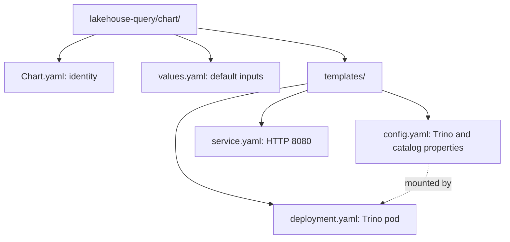
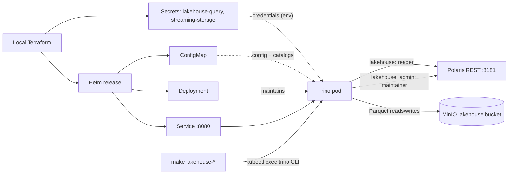

# Lakehouse query Helm chart

Deploys one Trino coordinator (also the worker) with read-only and maintainer
Iceberg catalogs. Part of [realtime-payment-platform](../../../README.md).

## Responsibilities

Local [Terraform](../../../platform/terraform/environments/local/main.tf)
installs this chart in `apps` only when the lakehouse is enabled, after the
Polaris release and the generated `lakehouse-query` Secret. For Make,
Terraform, Helm and Kubernetes context see the
[local platform guide](../../../docs/architecture/local-platform-guide.md).

## Layout

File layout (the next diagram shows how the installed resources connect):



| File | Creates | Used by / uses |
|---|---|---|
| [config.yaml](templates/config.yaml) | ConfigMap: `config.properties`, `node.properties`, `jvm.config`, `log.properties`, `lakehouse.properties`, `lakehouse_admin.properties` | Deployment mounts files individually; checksum triggers rollout |
| [deployment.yaml](templates/deployment.yaml) | One-replica Deployment (`Recreate`) | Reads catalog credentials and storage keys from Secrets; health-check probes |
| [service.yaml](templates/service.yaml) | Internal Service on 8080 | Make targets exec into the pod; Superset will use the Service in Stage 9 |
| [values.yaml](values.yaml) | Default Helm inputs | Catalog URI, warehouse, Secret names, memory limits and resources |
| [Chart.yaml](Chart.yaml) | Chart metadata | Helm rendering and packaging |



## Prerequisites

Use [developer setup](../../../docs/developer-setup.md) and the
[API chart glossary](../../payment-api/chart/README.md#configuration) for
Kubernetes terms and Helm syntax. Requires the
[Polaris chart](../../lakehouse-catalog/chart/README.md).

## Quick start

From the repository root:

```bash
make -C modules/lakehouse-query test lint
make dev-up DEV_CONFIG=templates/lakehouse-topology.json
make lakehouse-query SQL='SELECT count(*) FROM payment_events'
```

## Configuration

`lakehouse.properties` sets `iceberg.security=read_only`, so even a
misconfigured reader principal cannot write through Trino. Polaris also denies
writes for that principal. `lakehouse_admin.properties` allows writes and
evolution through the maintainer principal; use it only for the operations in
the runbook.

Catalog credentials are referenced as `${ENV:...}` in the properties files, so
the ConfigMap holds no secrets. The config files are mounted with `subPath`
and `items`, leaving the image's other files intact. Writable `emptyDir`
volumes back `/data/trino` and `/tmp`; the root filesystem is read-only.

## Documentation

- [Module guide](../README.md)
- [Lakehouse runbook](../../../docs/runbooks/lakehouse.md)
- [Polaris chart](../../lakehouse-catalog/chart/README.md)
