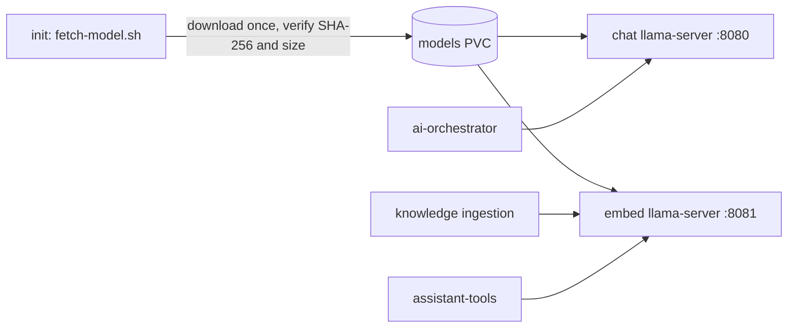

# llm-serving

CPU model serving for the Stage 10 AI assistant: one pod running two pinned
[llama.cpp](https://github.com/ggml-org/llama.cpp) servers. Part of
[realtime-payment-platform](../../README.md); catalogued in
[solution.yaml](../../solution.yaml).

| Server | Model | Port / Service | Callers |
|---|---|---|---|
| `chat` | Qwen2.5-1.5B-Instruct Q4_K_M GGUF (≈940 MiB) | `llm-serving-chat:8080`, OpenAI-compatible | ai-orchestrator routing and answers |
| `embed` | nomic-embed-text-v1.5 F16 GGUF, 768 dimensions | `llm-serving-embed:8080` | operations-knowledge ingestion, assistant-tools search |



- The image is the pinned upstream `ghcr.io/ggml-org/llama.cpp` server
  (`llama-cpp` and `llama-cpp-image-digest` in
  [.tool-versions](../../.tool-versions)) plus
  [fetch-model.sh](scripts/fetch-model.sh). Models are not baked into the image.
- Model URLs, checksums and sizes are chart values. The first start downloads
  about 1.2 GiB into a kept PersistentVolumeClaim; later starts only re-verify.
- The LLM is advisory only: it never sits in the payment path or makes
  authorization or numeric decisions.
- Generation runs at roughly 25 tokens/second on three CPU cores. The pod
  requests 1.4 GiB of memory and is limited to 2.25 GiB.

See the [Helm chart guide](chart/README.md) for Kubernetes resources and the
[AI assistant runbook](../../docs/runbooks/ai-assistant.md) for operations.

## Development

```bash
make -C modules/llm-serving lint test   # chart contract, ShellCheck, offline fetch tests
```
