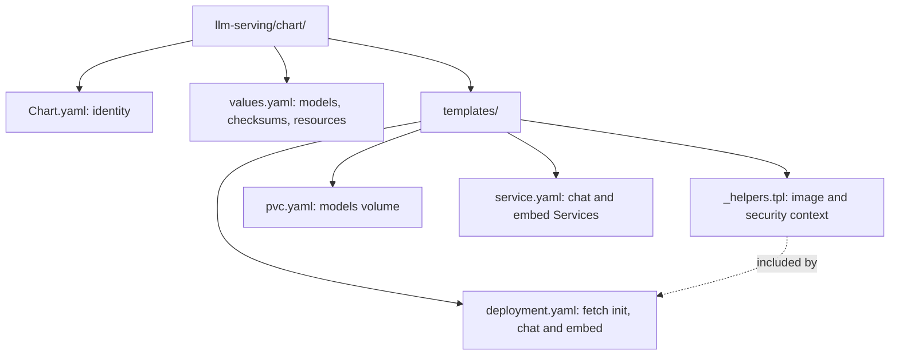
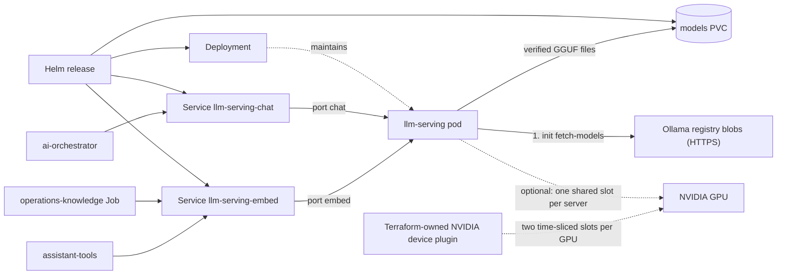

# LLM serving Helm chart

Deploys one pod with llama.cpp chat and embedding servers over a persistent
models volume. Part of [realtime-payment-platform](../../../README.md).

## Responsibilities

Local [Terraform](../../../platform/terraform/environments/local/main.tf)
installs this chart in `apps` only when the AI feature is enabled
(`local.feature: ai`). For Make, Terraform, Helm and Kubernetes context see the
[local platform guide](../../../docs/architecture/local-platform-guide.md).

## Layout

File layout (the next diagram shows how the installed resources connect):

| File | Creates | Used by / uses |
|---|---|---|
| [_helpers.tpl](templates/_helpers.tpl) | Nothing (shared snippets) | Image reference and restricted container security context |
| [pvc.yaml](templates/pvc.yaml) | `<release>-models` PersistentVolumeClaim, kept on uninstall | Mounted by the Deployment |
| [deployment.yaml](templates/deployment.yaml) | One-replica Deployment, `Recreate` strategy | Init container fetches models; `chat` on 8080, `embed` on 8081; fails rendering if `replicaCount` is not 1 |
| [service.yaml](templates/service.yaml) | `<release>-chat` and `<release>-embed` ClusterIP Services on 8080 | ai-orchestrator, operations-knowledge, assistant-tools |
| [values.yaml](values.yaml) | Default Helm inputs | Model URLs, SHA-256, sizes, context, threads and resources |
| [Chart.yaml](Chart.yaml) | Chart metadata | Helm rendering and packaging |

## Prerequisites

Use [developer setup](../../../docs/developer-setup.md) and the
[API chart glossary](../../payment-api/chart/README.md#configuration) for
Kubernetes terms and Helm syntax. The first start needs internet access to
download the models; later starts reuse the volume offline.

## Configuration

| Value | Purpose |
|---|---|
| `models.chat`, `models.embed` | File name, served alias, HTTPS URL, SHA-256 and size of each GGUF model |
| `modelStorage.size`, `modelStorage.storageClassName` | Models volume; empty class uses the cluster default |
| `chat.contextSize`, `chat.threads`, `chat.parallel` | Chat server capacity; `--jinja` enables JSON-schema output |
| `embed.contextSize`, `embed.threads` | Embedding batch size equals context so each input embeds in one pass |
| `*.resources`, `fetchResources` | CPU and memory per container |
| `replicaCount` | Must be 1 because the models volume is ReadWriteOnce |
| `gpu.enabled` | Require CUDA0 and full layer offload in both servers; each requests/limits one `nvidia.com/gpu.shared` slot |

GPU mode also requires the CUDA image selected by the local build and the
Terraform-owned NVIDIA device plugin; this chart does not install a second
plugin. The plugin advertises shared slots using time slicing, without GPU
memory isolation. The init container explicitly hides GPU devices and requests
no slot; CUDA caching is disabled so application filesystems stay read-only.
See [GPU setup](../../../docs/developer-setup.md#optional-nvidia-acceleration-for-ai)
before enabling the value. The default CPU render is unchanged.
