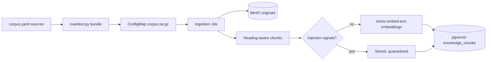

# operations-knowledge

Versioned, synthetic operations knowledge for the Stage 10 AI assistant and the
batch job that indexes it into PostgreSQL + pgvector. Part of
[realtime-payment-platform](../../README.md); catalogued in
[solution.yaml](../../solution.yaml).

## What it contains

| Path | Purpose |
|---|---|
| [corpus.yaml](corpus.yaml) | Source globs with classification, required permission and tenant |
| [documents/](documents/) | Synthetic support, vendor and restricted incident notes |
| [src/operations_knowledge/manifest.py](src/operations_knowledge/manifest.py) | Validates the manifest and writes a deterministic `corpus.tar.gz` |
| [src/operations_knowledge/chunking.py](src/operations_knowledge/chunking.py) | LangChain heading-aware Markdown chunking |
| [src/operations_knowledge/ingest.py](src/operations_knowledge/ingest.py) | Originals to MinIO, versioned chunks and embeddings to pgvector |
| [src/operations_knowledge/evaluation.py](src/operations_knowledge/evaluation.py) | Scores assistant responses for the starter evaluation |
| [evaluation/cases.yaml](evaluation/cases.yaml) | 21 starter cases: RAG, tools, authorization and injection |

The corpus covers runbooks, ADRs, module READMEs, the payment OpenAPI and the
Avro event contracts from this repository plus the module's own documents.
Markdown splits on headings; contracts split by size under their file name.
Incident notes are `restricted` and need `knowledge:restricted`; they and the vendor notice contain canary strings the
evaluation treats as leaks.

## Ingestion



- Each document version is a hash of content, chunking version and embedding
  version. Reruns skip unchanged documents; a changed document closes the old
  version (`valid_to`); a removed document is retired.
- Chunks containing prompt-injection patterns are stored for audit but never
  retrieved.
- Retrieval filters (tenant, classification, permission, active version) live
  in [ai-core](../ai-core/README.md) and run inside SQL.

Run it locally with `make knowledge-ingest` after `AI=1 make dev-up`; see the
[AI assistant runbook](../../docs/runbooks/ai-assistant.md). The
[Helm chart guide](chart/README.md) explains the Kubernetes resources.

## Development

```bash
AI=1 make setup                                     # build the shared AI test runtime
make -C modules/operations-knowledge lint test      # unit tests in the runtime
make -C modules/operations-knowledge test INTEGRATION=1  # adds a throwaway pgvector check
```

Tests are offline: embeddings and object storage are faked, and the
integration check starts a private pgvector container.
