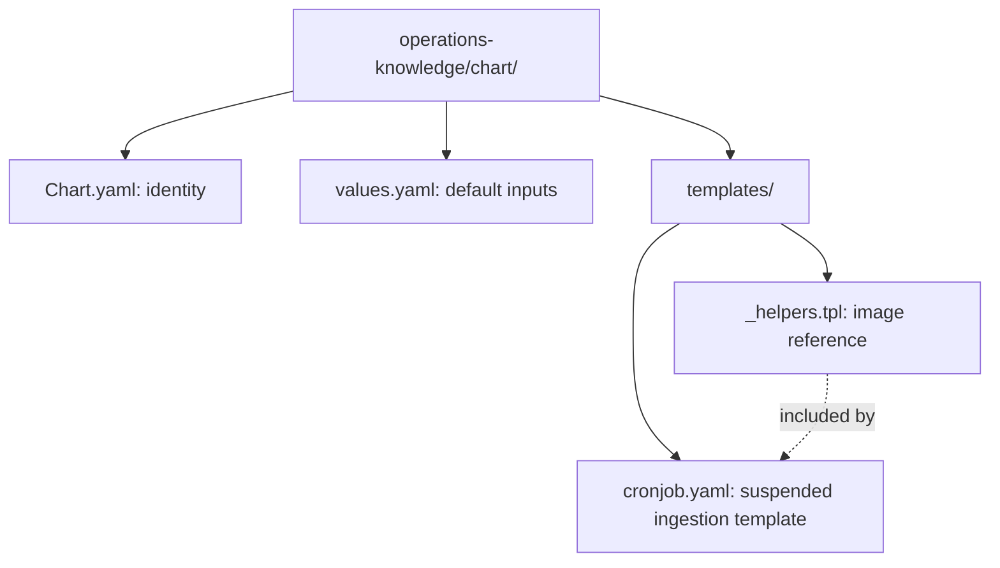
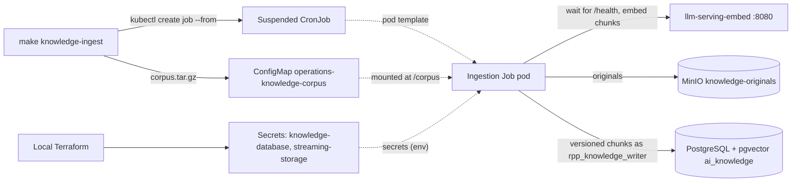

# Operations knowledge Helm chart

Stores the batch-ingestion pod template for the Stage 10 assistant's
knowledge base. Part of [realtime-payment-platform](../../../README.md).

## Responsibilities

Local [Terraform](../../../platform/terraform/environments/local/ai.tf)
installs this chart in `apps` only when the AI feature is enabled. Installing
it runs nothing: the CronJob is suspended and only holds the pod template.
`make knowledge-ingest` packages the corpus, refreshes the ConfigMap and
creates a Job from the CronJob. For Make, Terraform, Helm and Kubernetes
context see the
[local platform guide](../../../docs/architecture/local-platform-guide.md).

## Layout

File layout (the next diagram shows how the installed resources connect):

| File | Creates | Used by / uses |
|---|---|---|
| [_helpers.tpl](templates/_helpers.tpl) | Nothing (shared snippet) | Digest or tag image reference |
| [cronjob.yaml](templates/cronjob.yaml) | Suspended CronJob `<release>-ingest` | `make knowledge-ingest` creates Jobs from it; reads the corpus ConfigMap and two Secrets |
| [values.yaml](values.yaml) | Default Helm inputs | Corpus ConfigMap, embedding URL, database, object store and resources |
| [Chart.yaml](Chart.yaml) | Chart metadata | Helm rendering and packaging |

## Prerequisites

Use [developer setup](../../../docs/developer-setup.md) and the
[API chart glossary](../../payment-api/chart/README.md#configuration) for
Kubernetes terms and Helm syntax. Requires the llm-serving release, the
knowledge PostgreSQL and MinIO created by local Terraform.

## Configuration

| Value | Purpose |
|---|---|
| `corpus.configMap`, `corpus.key` | ConfigMap and key holding the deterministic corpus archive |
| `embeddings.url` | llama.cpp embedding server; the pod waits up to `readyTimeoutSeconds` for `/health` |
| `knowledgeDatabase.*` | Writer connection; the password comes from `existingSecret`/`passwordKey` as `PGPASSWORD` |
| `objectStore.*` | MinIO endpoint, originals bucket and credentials Secret |
| `local.feature` | `ai`: Terraform installs the chart only for AI-enabled members |
