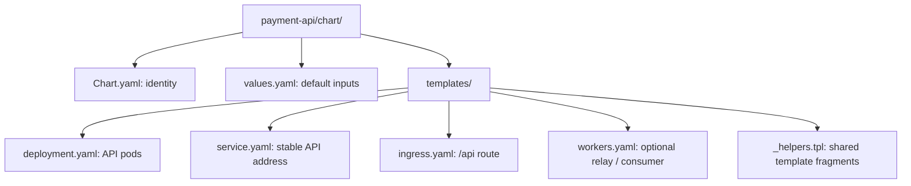
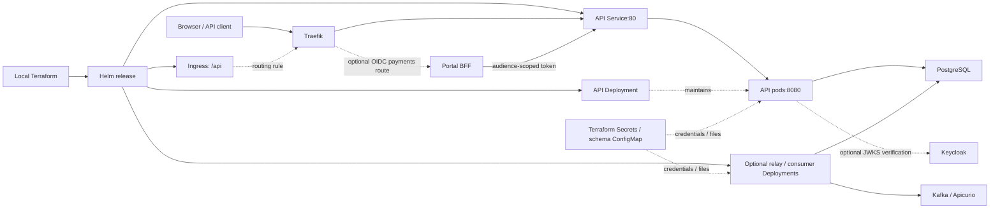

# Payment API Helm chart

Deploys the HTTP API and optional event workers. Part of
[realtime-payment-platform](../../../README.md).

## Responsibilities

Helm turns the files in this chart into Kubernetes resource definitions.
Kubernetes then runs the requested workloads; YAML files do not call each other
like application functions. Resources connect through names, labels, ports,
and mounted configuration.

For local development, `make dev-up` and `make dev-update` use
[Terraform](../../../platform/terraform/environments/local/main.tf) to install
or upgrade this chart as a **Helm release** in the `apps` namespace. Terraform
also supplies the database/event Secrets, schema ConfigMap, PostgreSQL, Kafka,
Apicurio and Traefik. This chart does not create those dependencies.

## Layout

This diagram maps files on disk; the next diagram maps deployed resources.
Read [the platform walkthrough](../../../docs/architecture/local-platform-guide.md)
first if you are unsure how Terraform reaches this chart.



| File | Creates | Used by / uses |
|---|---|---|
| [deployment.yaml](templates/deployment.yaml) | API Deployment (maintains API pods) | Selected by the Service; uses database Secret, optional TLS/telemetry and HTTP-container OIDC configuration |
| [service.yaml](templates/service.yaml) | Internal Service (stable address) | Ingress and internal callers; selects API pods, port 80 to pod port 8080 |
| [ingress.yaml](templates/ingress.yaml) | `/api` Ingress rule | Traefik reads the rule and routes to the API Service without removing `/api` |
| [workers.yaml](templates/workers.yaml) | Relay and consumer Deployments, only when `events.enabled` | Use database/event Secrets and schema ConfigMap; communicate with PostgreSQL/Kafka/Apicurio |
| [_helpers.tpl](templates/_helpers.tpl) | Reusable Helm fragments, not standalone resources | API and workers share image selection, database settings and optional telemetry |
| [values.yaml](values.yaml) | Default inputs, not a Kubernetes resource | Helm merges these with Terraform-supplied values |
| [Chart.yaml](Chart.yaml) | Chart identity/version metadata | Helm reads this when rendering or packaging the chart |



Solid arrows show installation or traffic; dotted arrows show configuration
or workload ownership, as labelled. The Service selects only the API labels:
the workers' health ports are not exposed by the API Service.

## Prerequisites

Use the existing [developer setup](../../../docs/developer-setup.md) and local
Make workflow. A chart alone is not the full platform.

## Quick start

From the repository root:

```bash
make ci
make dev-up
make dev-access
```

`dev-access` forwards Traefik to loopback; it is not created by an Ingress rule.
Use `make dev-update` for normal iteration, not teardown.

## Configuration

Useful vocabulary shared by the other charts:

- **Pod / container:** a pod is Kubernetes' running unit; it contains one or more
  containers. An **init container** must finish before the main container starts.
  Here, `migrate` applies database migrations first.
- **Deployment:** maintains the requested number of replaceable pods.
- **Service:** a stable internal address that forwards traffic to ready pods
  matching its `selector` labels. `targetPort: http` refers to the pod port
  named `http`, not necessarily port 80.
- **Ingress / controller:** an Ingress declares HTTP routing; Traefik is the
  separate running controller that implements it.
- **Secret / ConfigMap:** referenced credentials / non-secret configuration.
  A reference does not create the resource.
- **Readiness / liveness:** readiness decides whether a pod receives Service
  traffic; liveness decides whether to restart its container.
- **Resources / securityContext:** CPU/memory requests reserve scheduling
  capacity; limits bound usage. Security settings restrict user, filesystem
  writes and Linux privileges.

When `oidc.enabled`, only the HTTP container receives `oidc.issuer` and
`oidc.internalUrl`. It independently requires a `payment-api` audience,
`openid` scope and `payments:read` or `payments:write`, even for direct Service
callers. Probes, metrics and version endpoints remain public. Migrations and
event workers retain their scoped database/Kafka credentials, not human OIDC
sessions. The identity-enabled portal installs the more-specific payments
Ingress and exchanges a token before forwarding to the API Service.

Use `make dev-update` after changing module charts: it refreshes their local
snapshots before Terraform applies them, preserving the streaming savepoint
guard. Applying an already prepared snapshot alone does not copy new chart
source into the deployment.

Helm syntax is evaluated before Kubernetes sees the YAML:

- `.Release.Name` is the installation's name; `.Values` contains merged inputs.
- `if` includes optional YAML; `range` repeats a section. Inside the workers
  loop, `$` retains the root chart context.
- `include` reuses a named helper; `nindent` adds a newline and indentation;
  `quote` emits a quoted string; `required` fails rendering for a missing input.
- `{{/* ... */}}` comments explain the template without becoming Kubernetes
  configuration. Ordinary `#` comments may appear in rendered YAML.

## Documentation

- [Module guide](../README.md)
- [Portal chart](../../web-portal/chart/README.md)
- [Flink chart](../../stream-processor/chart/README.md)
- [ClickHouse chart](../../realtime-analytics/chart/README.md)
