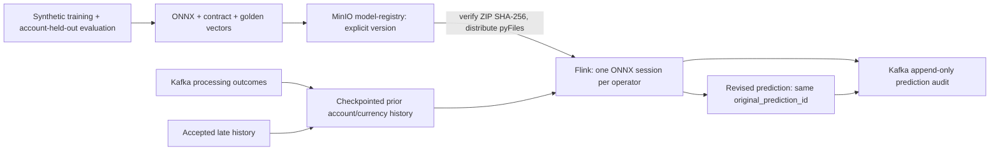

# Payment risk model

Reproducible synthetic feature engineering and model export for Stage 7.
Part of [realtime-payment-platform](../../README.md).

## Responsibilities

- Validate an explicit, versioned feature contract.
- Train a scikit-learn imputation/scaling/encoding/logistic-regression baseline.
- Compare LightGBM on account-held-out synthetic data.
- Export and check ONNX artifacts; verify original Python versus ONNX scores
  for held-out and golden rows within absolute tolerance `1e-5`.
- Package the selected model, feature code and golden cases for checksum-pinned
  distribution to Flink workers, with one verified ONNX session per operator.
- Keep scores advisory; never authorize, reject or block a payment.

MinIO publication, opt-in Flink inference, model-version telemetry and
append-only late-history revisions are implemented. The bounded integration
test exercises the actual Flink Python worker, not just graph construction.
Live acceptance and the resource boundary are recorded below.

## Layout

```text
payment-risk-model/
├── module.yaml
├── feature_contract.json
├── features.py
├── scorer.py
├── train.py
├── requirements.txt
├── Dockerfile
├── Makefile
└── tests/
```

## Prerequisites

Follow [developer setup](../../docs/developer-setup.md).
`RISK_MODEL=1 make setup` installs the optional pinned Python/ML toolchain
inside a Docker image; `RISK_MODEL=1 make doctor` verifies it.
Do not install these libraries into the catalog environment manually.
First-use image/package downloads need internet; training runs with Docker
network access disabled after setup. No new host Python or Java installation
is needed.

The finite training container is not a service and has no Docker healthcheck.
Its path-scoped, expiring Trivy `DS-0026` exception records that boundary;
process exit status, artifact validation and parity tests determine success.
Other scanner findings and execution errors still fail the scan.

## Quick start

From the repository root:

```bash
RISK_MODEL=1 make setup
RISK_MODEL=1 make doctor
make -C modules/payment-risk-model build test lint
make -C modules/payment-risk-model integration
```

`integration` prepares both pinned containers through `make setup`, reproduces
training, checks Python/ONNX golden and held-out parity, and runs the same golden
cases plus late-history revisions inside an actual bounded Flink worker.
Affected-module CI (`INTEGRATION=1`) runs this gate for both the model and
Flink modules; ordinary unit tests remain offline and dependency-light.

Generated files go to ignored `.local/models/payment-risk/1.0.0/`:

```text
model.onnx
logistic-regression.onnx
lightgbm.onnx
metadata.json
metrics.json
golden.json
model-card.md
manifest.json
payment_risk.zip
```

These are local training outputs until explicitly published. The registry path is
`s3://model-registry/payment-risk/1.0.0/`. Version `1.0.0` identifies the
experimental model artifact; it does not change the module's stable catalog
version. Do not commit generated models or promote this experimental version
as production-certified.

## Make targets

| Target | Purpose |
|---|---|
| `build` | Compile sources and parse the feature contract |
| `test` | Offline deterministic feature/dataset tests without ML dependencies |
| `lint` | Syntax and metadata checks |
| `fmt` | Repository formatting checks |
| `train` | Train/export in the setup-built isolated toolchain |
| `integration` | Train, compare, check ONNX graphs and parity |
| `clean` | Remove module bytecode only; retain generated experiment evidence |

`OUTPUT=/absolute/path` overrides the generated-output directory. Training
replaces files in that experiment directory; use a different directory to
preserve an earlier run.

### Publish and enable advisory scoring

Use an explicitly owned, running streaming profile. Model publication uses its
JobManager pod's existing MinIO credentials; it does not need GitHub, GHCR,
an active PI or access to a remote artifact service.

```bash
make risk-publish MINIKUBE_PROFILE=rpp-a
```

The command verifies every local manifest checksum, uploads artifacts to
`s3://model-registry/payment-risk/1.0.0/`, and prints the package key and SHA-256.
Writes are conditional: retries accept identical bytes, but refuse to overwrite
a different artifact under the same experimental version. A partial failure
stays failed and can be retried with the **same generated directory**.
Do not retrain over a published directory and expect to overwrite it: measured
latencies vary even when training inputs are reproducible. A changed experiment
needs a new explicitly versioned contract and registry prefix.

For the public three-cluster workflow, first start with
`make dev-up DEV_CONFIG=templates/streaming-topology.json`. Keep an ignored copy
of that topology for changes, rather than editing the template. After publication:

1. Run `make streaming-stop MINIKUBE_PROFILE=rpp-a` and retain its exact
    persistent savepoint URI.
2. Add this object to the ignored topology, replacing the checksum with the
    **actual** `risk_package_sha256` printed by publication:

    ```json
    {
      "risk": {
        "package_key": "payment-risk/1.0.0/payment_risk.zip",
        "package_sha256": "REPLACE_WITH_ACTUAL_64_CHARACTER_LOWERCASE_SHA256"
      }
    }
    ```

    This is an addition to the topology, not a standalone configuration;
    `streaming` must remain `true`. `risk` is enabled only on A.

3. Export `STREAMING_RESTORE_PATH` to the retained URI and run
    `make dev-update DEV_CONFIG=.local/risk-topology.json`.
    Use the same `DEV_PROFILE` as the original deployment if not `rpp`.
4. Run `make risk-verify MINIKUBE_PROFILE=rpp-a`, followed by
    `make smoke MINIKUBE_PROFILE=rpp-a`.

The verification uses unique synthetic accounts and current UTC timestamps.
It checks original and revised predictions, shared original audit identity,
feature/ONNX score parity, duplicate suppression, too-late output, completed
checkpoints and version-labelled metrics. It is a bounded correctness check,
not a 50/100-events/s benchmark. Do not start three clusters on a host without
the required memory. The maintainer-approved one-cluster procedure is described
in [developer setup](../../docs/developer-setup.md#single-cluster-risk-validation).

Flink refuses a missing/unversioned key, checksum mismatch, unexpected ZIP
contents, oversized package, incompatible contract or failed golden check.
There is no `latest` alias or silent unscored fallback after scoring is enabled.
Changing an image **or risk configuration** requires a stopped job and explicit
savepoint restore. Removing a stateful branch is a state migration; disabling
the flag alone is not a supported automatic savepoint-state discard.

### Runtime and audit contract



Scores use strictly preceding event-time history, not the current outcome or
future payments. Late events within two minutes may revise later payments in
the one-hour feature horizon. Every revised record has a new deterministic
`prediction_id`, increasing `window_revision`, and the same
`original_prediction_id`; original Kafka audit records are not overwritten.
Identity includes event, feature version/hash and model name/version/digest.
The noncompacted audit topic uses at-least-once delivery: consumers must dedup
`prediction_id`, not treat transport replay as a new decision.

Histories and latest revision references are checkpointed and event-time cleaned
after the one-hour horizon plus allowed lateness. Event-ID dedup has a 24-hour
processing-time TTL. Expired arrivals go to `payment-risk-too-late-v1`.
Metrics under `risk_model.<version>` include prediction/revision counts,
cumulative inference microseconds and too-late counts. Duration/count provides
a mean inference time, not an end-to-end percentile.

Risk processing is a branch of the analytics Flink job, not of payment
authorization. A scoring failure fails/restarts that job explicitly; payment
API/outbox operation does not depend on a model or registry call. Existing
streaming windows share the job and can stall while that job recovers.
No automatic cross-cluster Flink or MinIO failover is claimed.

### Acceptance status

Offline and real-worker golden parity, prior-history revisions, deduplication
and timer cleanup pass. On 2026-11-04, live acceptance passed on the dedicated
`rpp-stage7-verify` profile (4 CPUs, 6144 MiB, low-memory Flink, no ClickHouse
or observability backends):

- `make risk-publish MINIKUBE_PROFILE=rpp-stage7-verify` passed twice with the
  same generated artifacts, confirming identical-content retry.
- The pre-risk savepoint restored after adding the SQL sink hash bridge,
  without skipping unmatched state.
- `make streaming-stop MINIKUBE_PROFILE=rpp-stage7-verify` followed by the
  documented dirty-source update restored a second savepoint containing actual
  risk history and revision state.
- Replaying a pre-savepoint input after restoration produced neither another
  prediction nor a too-late output, confirming restored risk deduplication.
- `make risk-verify MINIKUBE_PROFILE=rpp-stage7-verify` passed: five advisory
  audit records, one revision (revision 2, original identity preserved), one
  too-late record, Python/runtime feature and score agreement, duplicate
  suppression and all four version-labelled counters.
- During that verification, completed checkpoints increased from 1 to 5,
  with no additional failures. One startup checkpoint had already aborted
  because required tasks were still initializing; it is retained in the
  reported initial/final failure counts, not hidden as a zero-failure run.
- Ingress smoke passed after both updates.
- A final persistent savepoint was created, then only the dedicated verification
  profile was stopped to reclaim RAM. Its MinIO artifacts and state remain on
  disk; other profiles were left untouched.

The initial live attempt also caught generated SQL sink identity changes;
the failed upgrade rolled back and the migration regression now covers that
case. An early verifier used implicit Kafka positions and future-dated marker
events; it was corrected to explicit bounded offsets, wall-clock-safe fixtures,
asynchronous metric-registration waits and a remote deadline. These were
verification fixes, not a relaxation of scoring parity or lateness policy.

This is correctness/recovery evidence, not a capacity or predictive-quality
benchmark. Three-cluster acceptance remains resource-deferred; the existing
Stage 6 throughput/latency reports do not certify the added scoring branch.

## Configuration

[feature_contract.json](feature_contract.json) fixes names, order, types,
history boundaries, preprocessing and output meaning. Numeric missing values
become NaN before median imputation. Explicit account/device missing-context
flags prevent treating absent information as a confirmed safe signal.
Categorical encoding ignores unseen values using the fitted encoder.

Feature history is scoped to account and currency; amount features are in
integer minor units before float32 model conversion. Equal timestamps use
event ID ordering. The current outcome is never included; rejection counts
refer only to earlier payments. Any live checkpointed operator must preserve
these semantics and revise affected predictions on accepted late history.

The generator is deterministic (seed 731), with 80 accounts and 40 events
per account. Twenty-five percent of accounts are held out. Constructed labels
are intentionally imbalanced. The baseline stays selected even if comparison
metrics differ. Threshold 0.5 is reported for evaluation only; no automatic
fraud or payment decision is made.

Inference latency is a warmed single-row ONNX CPU-session measurement,
excluding feature extraction and all network IO. It is not end-to-end payment
or pipeline latency. The first successful run exposed zero baseline recall at
threshold 0.5; successful parity is not proof of useful predictive quality.

## Documentation

- [Stage 7 scope](../../docs/master-plan.md#stage-7-first-predictive-ml-model-inside-flink)
- [Feature decision](../../docs/adr/ADR-024-advisory-event-time-risk-features.md)
- [Processing contract](../event-contracts/schemas/payment-processing-v1.avsc)
- [Existing Flink processing](../stream-processor/README.md)
