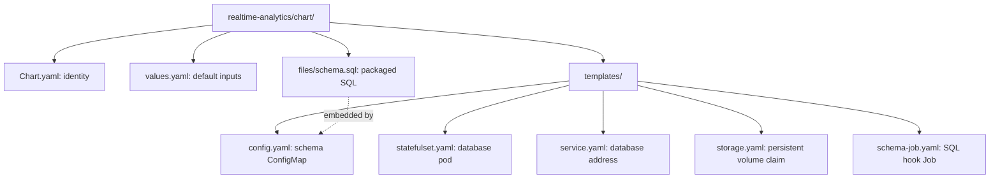
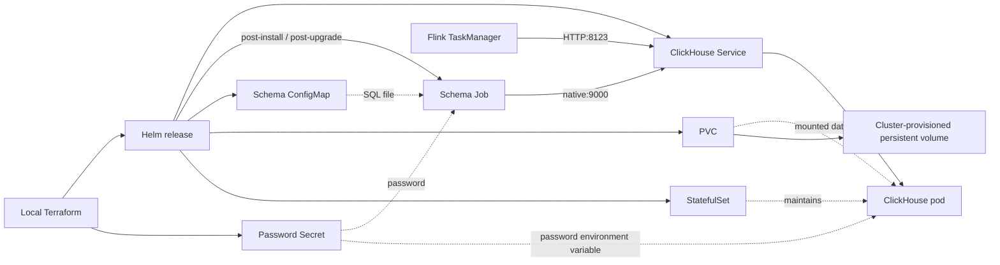

# Realtime analytics Helm chart

Deploys one persistent analytics database and applies its table schema.
Part of [realtime-payment-platform](../../../README.md).

## Responsibilities

Local [Terraform](../../../platform/terraform/environments/local/main.tf)
installs this chart in `apps` only when analytics is enabled, and creates the
password Secret first. It waits for this release before installing Flink.
Kubernetes runs ClickHouse; a Helm hook Job applies SQL through its Service.

## Layout

File layout (the next diagram shows how the installed resources connect):



| File | Creates | Used by / uses |
|---|---|---|
| [statefulset.yaml](templates/statefulset.yaml) | One-replica StatefulSet (stable pod identity) | Service selects its pod; uses the data PVC and external password Secret |
| [service.yaml](templates/service.yaml) | Internal HTTP/native Service | Flink uses HTTP 8123; schema Job uses native protocol 9000 |
| [storage.yaml](templates/storage.yaml) | PersistentVolumeClaim (PVC) | StatefulSet mounts it as `/var/lib/clickhouse` |
| [config.yaml](templates/config.yaml) | Schema ConfigMap | Schema Job mounts the SQL; StatefulSet tracks its checksum for rollout |
| [schema-job.yaml](templates/schema-job.yaml) | Post-install/upgrade hook Job | Reads ConfigMap and Secret; runs SQL through the Service |
| [schema.sql](files/schema.sql) | Packaged SQL, not a Kubernetes resource | Helm embeds it in the ConfigMap; the schema Job executes it |
| [values.yaml](values.yaml) | Default Helm inputs | Image, database/user, Secret name, storage size and resource budget |
| [Chart.yaml](Chart.yaml) | Chart metadata | Helm rendering and packaging |



## Prerequisites

Use [developer setup](../../../docs/developer-setup.md) and the
[API chart glossary](../../payment-api/chart/README.md#configuration) for
Kubernetes terms and Helm syntax. Analytics requires streaming.

## Quick start

From the repository root:

```bash
make dev-up DEV_CONFIG=templates/analytics-topology.json
make -C modules/realtime-analytics test lint
```

There is no public Ingress in this chart. Developer database access uses the
explicit loopback port-forward described in the runbook.

## Configuration

A **StatefulSet** keeps a stable pod name; this chart uses a separately declared
PVC rather than per-replica claim templates. It is one database instance, not
replication or high availability.

A **PVC** requests storage from the cluster's default StorageClass. `storage`
defaults to 8 GiB. `ReadWriteOnce` permits read/write on one node; it is not a
backup guarantee. Pod replacement keeps the data volume, but deleting the PVC
or cluster may delete the data. Local teardown is destructive.

The pod's `emptyDir` mounts for logs, temporary files and `users.d` last only
for that pod. The official image entrypoint generates the secret-backed user
configuration in writable `users.d`; the rest of the root filesystem stays
read-only. No password is placed in the chart's ConfigMap.

The **hook Job** runs after install/upgrade and executes idempotent table-creation
SQL. A ConfigMap alone never creates tables. Successful hooks are deleted;
failed Jobs remain for diagnosis until the next run. The schema checksum in
the pod template causes a rollout when SQL changes. That is not a general
database migration system; changes to existing tables need explicit planning.

## Documentation

- [Module guide](../README.md)
- [Analytics runbook](../../../docs/runbooks/realtime-analytics.md)
- [Flink chart](../../stream-processor/chart/README.md)
