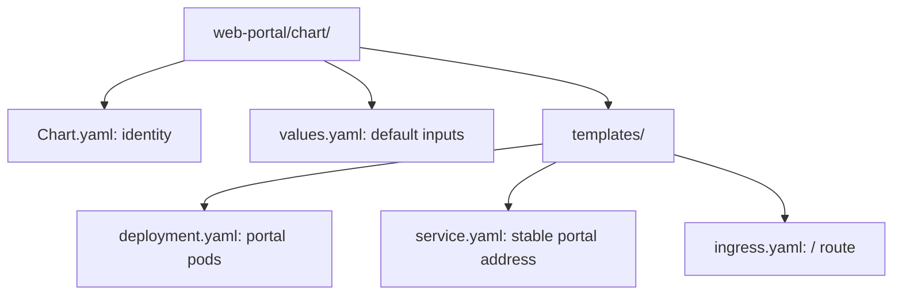
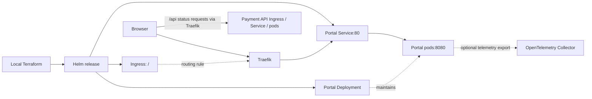

# Web portal Helm chart

Deploys the React portal's Go static server. Part of
[realtime-payment-platform](../../../README.md).

## Responsibilities

Local [Terraform](../../../platform/terraform/environments/local/main.tf)
installs or upgrades this chart as a Helm release in `apps`, using image and
replica values supplied by the Make workflow. Kubernetes maintains the pods;
the separately installed Traefik controller implements the Ingress rule.

## Layout

File layout (the next diagram shows deployed relationships):



| File | Creates | Used by / uses |
|---|---|---|
| [deployment.yaml](templates/deployment.yaml) | Deployment and its portal pods | Service selects pods; uses image/resources and optional telemetry values |
| [service.yaml](templates/service.yaml) | Internal Service on port 80 | Ingress routes here; forwards to ready portal pods on named `http` port 8080 |
| [ingress.yaml](templates/ingress.yaml) | `/` Ingress rule | Traefik reads it and forwards to the portal Service |
| [values.yaml](values.yaml) | Default Helm inputs | Terraform overrides local image, replicas and telemetry |
| [Chart.yaml](Chart.yaml) | Chart metadata | Helm rendering and packaging |



The browser downloads the UI from the portal, then requests `/api/healthz`,
`/api/readyz` and `/api/version` through the more-specific payment API route.
The static server does not proxy API requests. The two charts share Traefik
but deploy separate Services and pods.

## Prerequisites

Use [developer setup](../../../docs/developer-setup.md). For Kubernetes/Helm
terms and template syntax, start with the [API chart glossary](../../payment-api/chart/README.md#configuration).

## Quick start

From the repository root:

```bash
make dev-up
make dev-access
```

Open the loopback URL printed by `dev-access`; use `make dev-update` after edits.
Do not install this chart separately over the Terraform-owned release.

## Configuration

`replicaCount` controls server pods; `image.digest` takes precedence over
`image.tag`. Local images use `pullPolicy: Never` because the Make workflow
loads them into the selected Minikube cluster. Optional `telemetry` values
enable Collector export. Readiness controls routing and liveness restarts an
unhealthy process; both use the pod's HTTP port directly.

## Documentation

- [Module guide](../README.md)
- [API chart and shared terminology](../../payment-api/chart/README.md)
