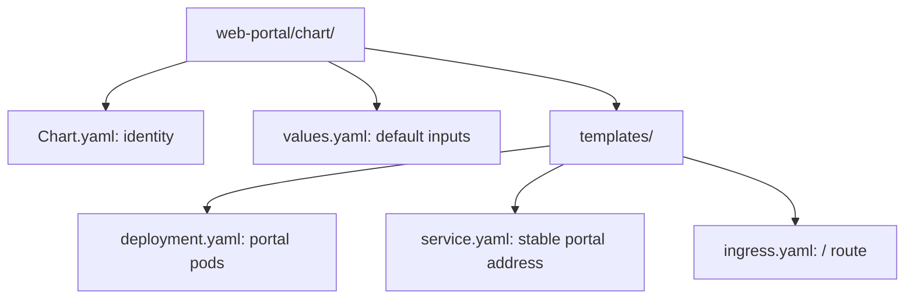
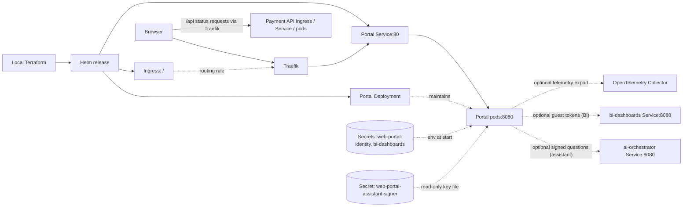

# Web portal Helm chart

Deploys the React portal's Go server: static UI, plus the optional local
development sign-in and Superset guest-token endpoints (Stage 9) and the
operations assistant BFF route (Stage 10). Part of
[realtime-payment-platform](../../../README.md).

## Responsibilities

Local [Terraform](../../../platform/terraform/environments/local/main.tf)
installs or upgrades this chart as a Helm release in `apps`, using image and
replica values supplied by the Make workflow. Kubernetes maintains the pods;
the separately installed Traefik controller implements the Ingress rule.

## Layout

File layout (the next diagram shows deployed relationships):



| File | Creates | Used by / uses |
|---|---|---|
| [deployment.yaml](templates/deployment.yaml) | Deployment and its portal pods | Service selects pods; uses image/resources, optional telemetry, and optional identity/BI/assistant values whose credentials come from Secrets |
| [service.yaml](templates/service.yaml) | Internal Service on port 80 | Ingress routes here; forwards to ready portal pods on named `http` port 8080 |
| [ingress.yaml](templates/ingress.yaml) | `/` Ingress rule | Traefik reads it and forwards to the portal Service |
| [values.yaml](values.yaml) | Default Helm inputs | Terraform overrides local image, replicas, telemetry, identity, BI and assistant |
| [values.schema.json](values.schema.json) | Input validation | Helm rejects identity without origins, BI without URLs or a dashboard UUID, and an assistant without an orchestrator URL |
| [Chart.yaml](Chart.yaml) | Chart metadata | Helm rendering and packaging |



The browser downloads the UI from the portal, then requests `/api/healthz`,
`/api/readyz` and `/api/version` through the more-specific payment API route.
The static server does not proxy API requests. The two charts share Traefik
but deploy separate Services and pods. With BI enabled, `/auth/*` and
`/bi/guest-token` are served by the portal itself; the browser loads the
dashboard iframe directly from Superset's own Ingress (`bi.localhost`).
With the assistant enabled, `/assistant/ask` is also served by the portal,
which calls the internal `ai-orchestrator` Service; the orchestrator has no
Ingress.

## Prerequisites

Use [developer setup](../../../docs/developer-setup.md). For Kubernetes/Helm
terms and template syntax, start with the [API chart glossary](../../payment-api/chart/README.md#configuration).

## Quick start

From the repository root:

```bash
make dev-up
make dev-access
```

Open the loopback URL printed by `dev-access`; use `make dev-update` after edits.
Do not install this chart separately over the Terraform-owned release.

## Configuration

`replicaCount` controls server pods; `image.digest` takes precedence over
`image.tag`. Local images use `pullPolicy: Never` because the Make workflow
loads them into the selected Minikube cluster. Optional `telemetry` values
enable Collector export. Readiness controls routing and liveness restarts an
unhealthy process; both use the pod's HTTP port directly.

`identity.enabled` turns on the non-production local development sign-in
([ADR-025](../../../docs/adr/ADR-025-interview-roadmap-and-read-only-mcp.md)).
Its Secret (`identity.existingSecret`) holds `session-key` and `dev-users`;
`identity.allowedOrigins` lists the browser origins accepted on POST requests.
`bi.enabled` additionally lets users with `bi:view` obtain Superset guest
tokens for `bi.dashboardId`; the issuer password comes from
`bi.existingSecret`/`bi.issuerPasswordKey`. Changed Secrets are read at pod
start, so restart the Deployment after rotating them. See the
[BI runbook](../../../docs/runbooks/bi-dashboards.md).

`assistant.enabled` (with identity) sets `AI_ORCHESTRATOR_URL` from
`assistant.orchestratorUrl` and mounts the Ed25519 private key from
`assistant.signingSecret`/`assistant.privateKeyKey` read-only at
`/assistant-identity`. The file has mode `0440`, and the pod's `fsGroup`
lets the non-root user read it. Only this chart mounts the private key;
the orchestrator and tools charts mount the public key from `ai-identity`
([ADR-030](../../../docs/adr/ADR-030-assistant-identity-assertions.md),
[assistant runbook](../../../docs/runbooks/ai-assistant.md)).

## Documentation

- [Module guide](../README.md)
- [API chart and shared terminology](../../payment-api/chart/README.md)
- [Local platform walkthrough](../../../docs/architecture/local-platform-guide.md)
