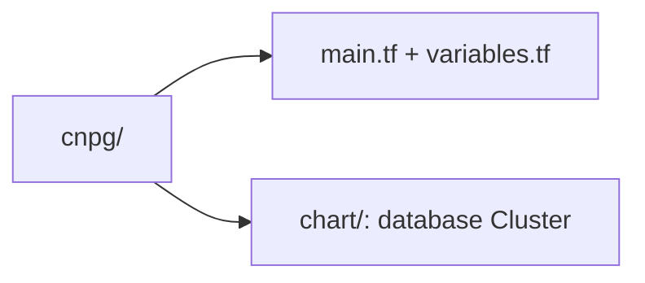

# Distributed PostgreSQL Terraform module

Provisions a CloudNativePG operator and one distributed database member for
an explicitly selected Kubernetes cluster.

## Responsibilities

Terraform owns the operator release, namespace, TLS and application Secrets,
external NodePort Service, and [database chart](chart/README.md). CloudNativePG
owns the database pods and volumes. The three-cluster root supplies members
`pg-1`, `pg-2`, and `pg-3`, a current writer and cross-cluster addresses.

## Layout



## Prerequisites

Use the project setup and the optional three-cluster prerequisites in the
[developer guide](../../../../docs/developer-setup.md#stage-3-full-stack-three-cluster-lab).
The chart archive and tool versions are managed by `make setup`.

## Quick start

From the repository root, validate the shared Terraform and chart contracts:

```bash
make -C platform/terraform test build
```

For deployment and recovery, use the public `dev-*` and `db-*` workflows in
the [developer guide](../../../../docs/developer-setup.md#stage-3-full-stack-three-cluster-lab).

## Make targets

| Target from repository root | Purpose |
|---|---|
| `make -C platform/terraform build` | Validate the Terraform roots |
| `make -C platform/terraform test` | Render charts and run mocked Terraform tests |
| `make -C platform/terraform lint` | Check Terraform formatting and lint |
| `make -C platform/terraform fmt` | Format Terraform files |
| `make -C platform/terraform clean` | Preserve local state; remove nothing |

## Configuration

The calling Terraform root supplies the member name, instance count, writer,
bootstrap source, promotion token, peer addresses, image versions and Secrets.
Never apply renamed identities to old state without the
[legacy-state procedure](../../../../docs/developer-setup.md#protecting-a-legacy-topology).

## Documentation

- [Chart resource map](chart/README.md)
- [Local platform walkthrough](../../../../docs/architecture/local-platform-guide.md)
- [Database recovery runbook](../../../../docs/runbooks/event-publication.md#cross-cluster-postgresql-recovery)
