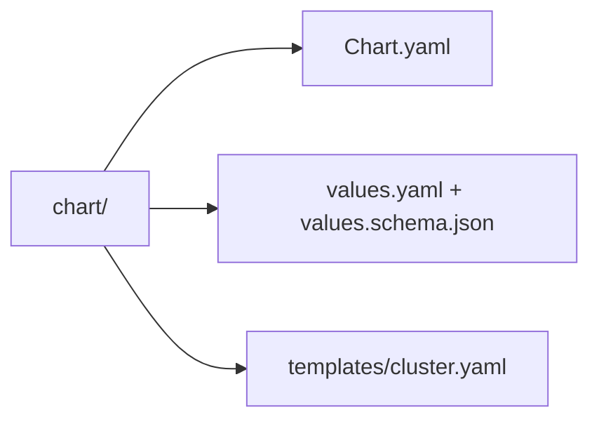
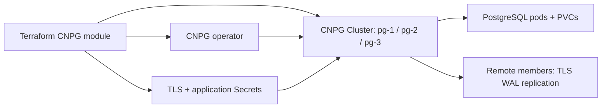

# Distributed PostgreSQL chart

The [CNPG Terraform module](../README.md) installs this chart after the
CloudNativePG operator and required TLS/application Secrets. It declares one
database member; the operator reconciles its pods, services and PVCs.

## File layout

| Template | Resource | Purpose and dependencies |
|---|---|---|
| `templates/cluster.yaml` | CNPG `Cluster` | Declares the numbered member, TLS, synchronous standby peers, bootstrap and promotion settings. Requires the operator and Terraform-owned Secrets. |

## Resource relationships

`primary` identifies the current writer. When this member is the writer, the
template selects another external member as `source` rather than pointing to
itself. `bootstrapSource` controls initial cloning separately from later
promotion; `promotionToken` is used during a planned switchover.

Run `make test-catalog` and `make -C platform/terraform test` from the repository
root to check chart rendering and Terraform plans. See the
[local platform walkthrough](../../../../../docs/architecture/local-platform-guide.md)
for the Make, Terraform, Helm and Kubernetes relationships.
