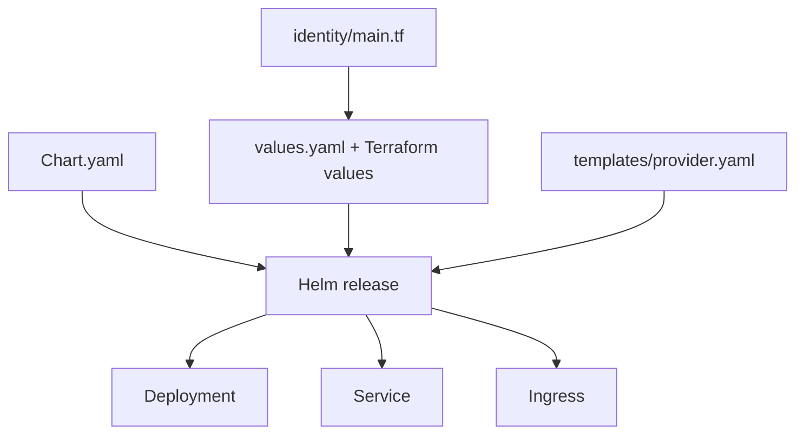
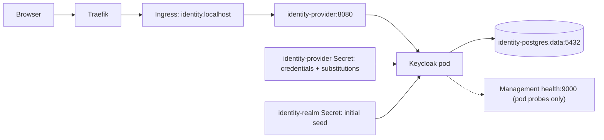

# Identity-provider chart

Shared solution infrastructure for Stage 11. Terraform installs this chart in
`security`; it is not an independently versioned catalog module.

See the [local-platform walkthrough](../../../../../docs/architecture/local-platform-guide.md)
for Make, Terraform, Helm and Kubernetes terminology, and
[ADR-032](../../../../../docs/adr/ADR-032-keycloak-identity-and-bff.md) for the identity
and BFF decisions.

## Files and resources

| File | Resource | Callers and dependencies |
|---|---|---|
| [Chart.yaml](Chart.yaml) | Chart metadata | Local Terraform identity module |
| [values.yaml](values.yaml) | Runtime image, external hostname, Secret names and limits | Values supplied by Terraform |
| [templates/provider.yaml](templates/provider.yaml) | Deployment, Service and Ingress | Browser OIDC requests; requires the optimized runtime image, two Secrets and identity PostgreSQL |





## Configuration and lifecycle

- Terraform supplies an optimized image built from the upstream digest pinned
  in the root `.tool-versions`. It is loaded into the selected Minikube profile,
  with pull policy `Never`. Health support is built into the image; startup
  does not need to modify its read-only filesystem.
- `hostname` is the browser-visible URL, including the selected `LOCAL_PORT`.
  The local realm permits HTTP for development only. Production requires TLS,
  Secure cookies and a reviewed hostname/proxy configuration.
- `urlParse` extracts the hostname for the Ingress rule; the browser's port is
  part of the external URL, not the Kubernetes Service port.
- PostgreSQL has its own persistent volume. Keycloak's writable `data` and
  `tmp` directories are ephemeral; realm data and user credentials live in
  PostgreSQL, not those directories.
- The realm seed uses Keycloak environment substitutions. Its client secrets
  and synthetic passwords come from the separate credential Secret; no real
  credentials are committed.
- The seed imports only when the realm does not exist. Its checksum annotation
  triggers a pod restart but **does not reconcile an existing realm**. Do not
  assume changing the seed updates users or clients. Run `make identity-access`
  and `make identity-sync` to reconcile managed realm settings, clients, roles,
  groups and users explicitly; existing human passwords are preserved.
- The Service exposes only port 8080. Management probes on port 9000 are
  pod-local. The Ingress exposes `/realms/rpp` and `/resources`, not `/admin` or
  `/realms/master`. Bootstrap administration requires an explicit loopback-only
  Service port forward.
- Grafana and Superset clients use OIDC and map per-tool resource roles.
  The Argo CD client remains disabled; Argo CD
  deployment is deferred to its own stage.
- Keep the `basic` default client scope: Keycloak 26.8 uses it to put `sub`
  into access tokens. Reconciliation updates `/default-client-scopes` bindings
  explicitly because a client PUT does not update them on existing databases.

## Verification

```bash
make -C platform/terraform build lint
make identity-integration
make identity-verify MINIKUBE_PROFILE=rpp-dev-single
```

The integration target starts isolated, disposable Keycloak and PostgreSQL
containers. It tests a real code exchange, PKCE enforcement, code replay and
the viewer/clerk permission boundary. `identity-verify` uses an existing full
AI/BI/identity profile for BFF, resource-validator, browser SSO, genuine expiry
and signing-key rotation checks. It preserves the profile and existing forwards.
