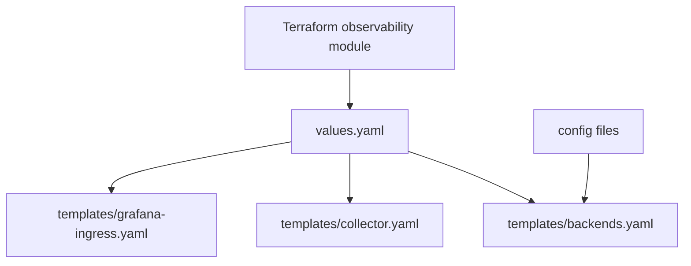
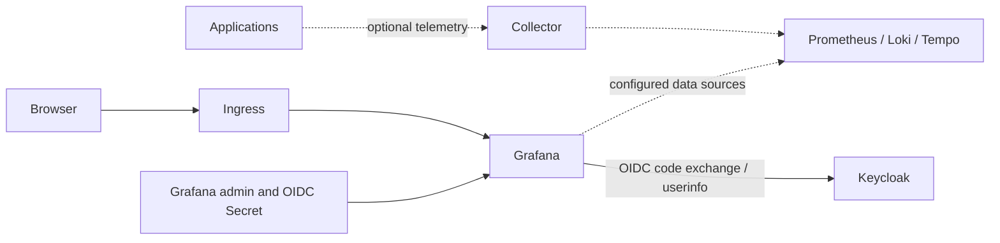

# Observability chart

Terraform owns this shared chart. The multi-cluster deployment installs all
backends in cluster 1 and collectors in each cluster. Stage 11's single-profile
identity deployment reuses **only Grafana**, with `collectorEnabled: false` and
`backendNames: [grafana]`; enabling full multi-cluster observability instead
configures that deployment's existing Grafana client, not a duplicate stack.

See the [local-platform walkthrough](../../../../../docs/architecture/local-platform-guide.md)
and [identity runbook](../../../../../docs/runbooks/unified-identity.md).

## Template-to-resource map

| Template | Resources | Callers and dependencies |
|---|---|---|
| `backends.yaml` | Grafana admin/OIDC Secret, provisioning ConfigMap, per-selected-backend Deployment/PVC/Service | Collectors and operators; pinned images, local persistent storage; Grafana OIDC requires Keycloak |
| `collector.yaml` | ServiceAccount, discovery RBAC, configuration, DaemonSet and OTLP Service | Application/browser telemetry and Kafka metrics; optional collectors require Kafka Secret and configured backends |
| `grafana-ingress.yaml` | Conditional Grafana Ingress | Browser SSO; requires backend-hosting cluster, OIDC, Grafana Service and separately installed Traefik |

`backendNames` selects capabilities from the existing backend list, never a
second product-specific chart. `collectorEnabled` defaults true, preserving
the earlier full observability deployment. The collector configuration helper
is defined at template top level even when no collector resources are rendered.
Grafana's role expression checks explicit client roles, with strict failure if
no Viewer/Editor/Admin role matches; it never promotes an unknown group name.
Its login name comes from Keycloak's `preferred_username`, not an implicit
email fallback.
